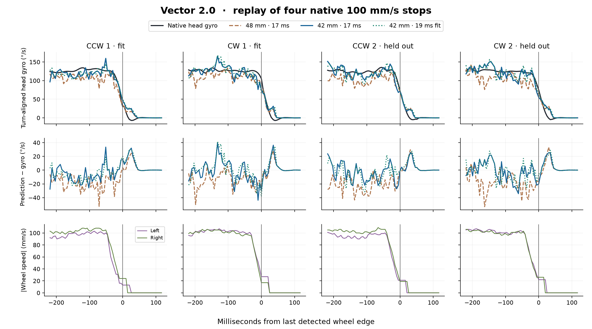
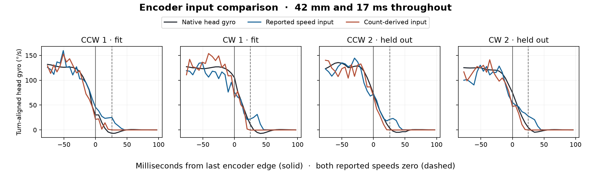

# Does the 42 mm contact span hold at native encoder cadence?

Yes, for the steady turn and braking interval of the two held-out Vector 2.0 runs on this table. In the held-out steady windows, measured mean turn-aligned head gyro was 122.2°/s CCW and 122.5°/s CW. The 42 mm model predicted 119.8 and 118.7°/s, respectively. The 48 mm control predicted 107.6 and 104.0°/s. Both simulations tracked their requested shaft speeds to within 0.010 mm/s at every solver step. The span describes the fore-aft spacing of the load-bearing tread patches. The axles and left/right track spacing were fixed.

| Evaluation window | 48 mm, 17 ms | 42 mm, 17 ms | 42 mm, fitted 19 ms | 42 mm, raw counts, 17 ms |
|---|---:|---:|---:|---:|
| Training pair, braking | 16.58 | 14.14 | 13.28 | 11.03 |
| Held-out CCW 2, braking | 16.83 | 11.88 | 11.03 | 9.92 |
| Held-out CW 2, braking | 18.89 | 13.91 | 12.92 | 11.47 |
| Held-out pair, braking | 17.89 | 12.94 | 12.01 | 10.72 |
| Held-out pair, steady turn | 20.89 | 12.94 | 11.76 | 14.98 |
| Held-out pair, final edge through +100 ms | 10.95 | 10.83 | 10.89 | 7.29 |

Entries are sample-pooled gyro RMS error in °/s. All four scores for each individual stop can be reproduced with the script below. The plots orient positive yaw toward the commanded turn. Predictions and measurements in the CSV retain the measured signs.

## What accounts for the last samples?

At the tick when both reported wheel speeds first reached zero, the measured head gyro was still 3.0°/s CCW and 4.9°/s CW in the held-out runs. The 42 mm/17 ms model driven by firmware wheel speeds predicted 21.5 and 27.8°/s. Driving it from cumulative count differences predicted approximately zero in both. The reported speed holds the last encoder estimate until five motionless control updates; using it as instantaneous shaft motion feeds that hold into the physics. Differencing the counts avoids the hold but quantizes the input: one count over 5 ms is about 25 mm/s. It also cannot resolve motion within one encoder count. This explains the tradeoff seen between the steady-turn and post-edge errors. [Native capture and firmware references](native-stops.md)

**Timing test.** We fitted one global 0–40 ms delay at 1 ms resolution to the first CCW and CW braking windows, then froze it for the second pair. The fitted 19 ms improves braking in each held-out direction and steady RMS overall. Its pooled post-edge error is virtually identical to the 17 ms baseline. As a control, removing the offset entirely from the reported-speed replay raises pooled held-out braking error to 22.57°/s. The delay is an alignment parameter for this replay. These results support retaining the 42 mm span; neither the 2 ms timing adjustment nor the raw-count reconstruction was applied to production physics.

## Reproduce

Run `python replay_native_stops.py` from the simulator root with MuJoCo, NumPy and Matplotlib. The script initializes at rest 2.2 s before each last edge, sets the measured head posture and 30.645 mm lift, and drives the front shafts of a free chassis throughout each turn. The reported-speed pass interpolates the native samples onto the 1 ms simulation clock. The second pass converts signed per-frame count increments to mm/s using the firmware pitch and actual interval width, timestamps each interval average at its midpoint, and interpolates those values. The same two input reconstructions and timing rules apply to both directions. The comparison uses simulated and measured **head-frame** gyro Z. The earlier capture report used head-angle-corrected chassis yaw, so its numbers differ by the frame projection.

All windows use the robot clock relative to the last count change. Steady is −850 to −250 ms, braking is −100 to +100 ms, and the tail is 0 to +100 ms. These are four stops in a single session on one surface; the second pair was held out from timing calibration. No fresh hardware run or data from the refurbished Gen 1 comparison robot entered this test.

[Native inputs including the approach to each stop](unit2-native-replay-input.csv) · [Signed measured and predicted gyro](native-replay-predictions.csv)
