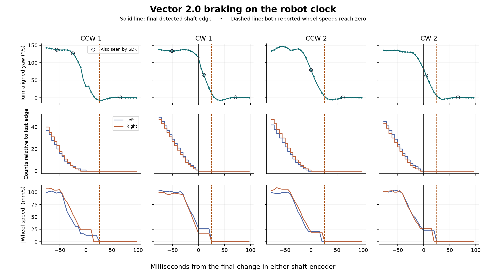

# Vector 2.0 stops on the robot clock

The head IMU still registered yaw in the commanded direction at the final detected wheel edge in all four 100 mm/s stops. Both wheel speeds reported zero 25–26 ms later. By then yaw was already small or reversing. The net gyro-inferred angle from reported zero to 100 ms after the last edge was less than 0.1° in every trial.

| Stop | Last edge → both speeds zero | Yaw at last edge | Yaw at speed zero | Yaw integrated over 100 ms after edge |
|---|---:|---:|---:|---:|
| CCW 1 | 26 ms | 32.7°/s | −7.5°/s | 0.215° |
| CW 1 | 25 ms | 114.0°/s | 12.3°/s | 1.345° |
| CCW 2 | 26 ms | 78.7°/s | 3.3°/s | 0.864° |
| CW 2 | 25 ms | 81.4°/s | 5.3°/s | 0.932° |

Signs in the table and overlay are relative to the commanded turn. A negative value indicates slight reversal. The CSV preserves the original signs.

## Capture and checks

- Two alternating pairs, each at opposing wheel commands of 100 mm/s for 1.5 s, on the same Vector 2.0 and its usual table. Its installed software reported 3.0.1.0, revision 1228e51b. The comparison robot used in earlier work is a refurbished first-generation Vector on a different surface. All four trials here come from the Vector 2.0.
- A read-only observer sampled the running supervisor's state and latest body-controller frame. It read the robot's millisecond state timestamp, raw cumulative shaft counts, count deltas, encoder intervals, reported speeds, head angle, and gyro. It accepted stable double-reads. The two buffers have their own update points. This pairs the streams to control-frame resolution, with residual uncertainty of roughly one tick; it does not provide a common hardware interrupt timestamp. We identified the turns by matching distinct wheel-speed and head-gyro samples to the simultaneous SDK recording (26, 27, 25 and 27 matches). SDK arrival time plays no role in the edge alignment. [Body frame layout](https://github.com/kercre123/victor/blob/669ec7499a7084640b57706a7937884a6568be50/robot/syscon/schema/messages.h#L206-L241) · [Supervisor fields](https://github.com/kercre123/victor/blob/669ec7499a7084640b57706a7937884a6568be50/robot/supervisor/src/messages.cpp#L77-L115)
- Time zero is the last change of either cumulative shaft count. Both counts then remained fixed through at least +550 ms in the captured segments. The frame counter advanced by exactly one at every observation from −100 to +150 ms in all four trials. The 25–26 ms interval before the speed fields zero agrees with the firmware's five-update stationary timeout. Counts resolve about 0.127 mm of tread travel in the reference scale. Smaller shaft motion or track slip can occur without another count. [Wheel scale and zero timeout](https://github.com/kercre123/victor/blob/669ec7499a7084640b57706a7937884a6568be50/robot/hal/src/hal_motors.cpp#L52-L66)
- The head angle held at 22.48° across all four braking windows. Following the reference firmware, we projected head Z rate onto chassis yaw by dividing by the cosine of head angle. At the last edge and at speed zero this agreed with the independently *logged field* for firmware body-frame yaw to within 0.01°/s; both fields use the same IMU. A zero IMU-frame timestamp denotes a missing queued sample. The head field remains available at those ticks. Per-stop stationary median bias was removed. The 95th percentile of absolute stationary residual was below 0.09°/s. [Head/body transformation](https://github.com/kercre123/victor/blob/669ec7499a7084640b57706a7937884a6568be50/robot/supervisor/src/imuFilter.cpp#L991-L1008)

## How much is physical yaw?

The synchronized samples show the yaw transient is already present below the SDK. They support substantial yaw **during** wheel deceleration and a short measured tail after the final encoder edge. A mechanical stop can occur between edges, and the gyro has its own filter. As a sensitivity check, attributing 17 ms of the signal to delay changes the four post-edge 100 ms integrals to −0.124°, +0.111°, +0.031° and +0.062°. That 17 ms was an empirical replay offset; it is not a measured latency for this gyro. These observations do not establish a sustained mechanical coast after both reported speeds reach zero. A docked camera-feed check yielded two frames 238 ms apart. It provided no optical measurement of the 25–26 ms interval. No braking or surface parameter was changed.

Run `python plot_native_stops.py` from the simulator root with NumPy and Matplotlib. [Synchronized stop windows](unit2-native-stops.csv) · [Earlier sensor timing replay](sensor-timing.md)
