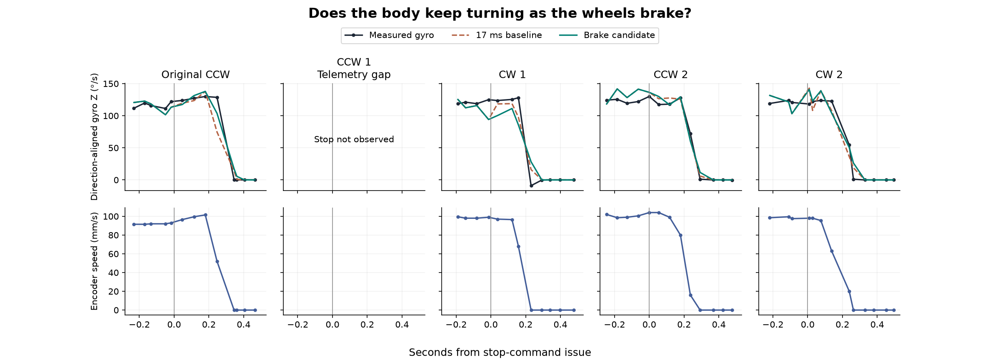

# Braking at 100 mm/s in both directions

The gyro stayed near 123–128°/s while the encoders were already slowing on all three observable repeat stops. At the first sample with both encoders at zero after braking, yaw speed was within 9°/s of zero. These recordings resolve a short braking transient. Their sampling intervals leave its physical duration and the relative contributions of tread slip, inertia and sensor timing uncertain.

| Stop | Samples in braking window | Baseline RMS error (°/s) | Candidate RMS error (°/s) |
|---|---:|---:|---:|
| Original CCW, used to fit | 7 | 21.39 | 12.32 |
| Repeat CCW 1 | Telemetry gap of 2.95 s | — | — |
| Repeat CW 1 | 7 | 15.20 | 23.69 |
| Repeat CCW 2 | 8 | 6.57 | 7.49 |
| Repeat CW 2 | 8 | 15.43 | 14.76 |
| Held-out repeats pooled | 23 | 12.97 | 16.31 |

The same robot ran four alternating, opposing-wheel turns on its usual table. Each 100 mm/s command held for approximately 1.5 seconds. Time zero is the host's stop-command issue time. The plot aligns gyro sign to the commanded direction. The lower row shows half the absolute difference between the two measured wheel speeds. Signed left and right speeds are in the CSV. On repeat CCW 2, 236 ms after issuing stop, the wheels read −17 and +15 mm/s while yaw was still +72°/s. At 292 ms both wheels read zero and yaw was about +1°/s.

Each replay drives the simulator with that turn's measured wheel speeds, retaining the 42 mm effective contact span, the original surface parameters and the 17 ms timing offset fitted on a different robot. We swept an additional 0–100 ms braking delay in 1 ms steps on the original CCW stop only. The delay ramps in over 120 ms from stop issue. The fit minimizes gyro RMS error at the observed samples from issue through +450 ms. A telemetry gap over 180 ms overlapping −100 to +400 ms excludes the stop. Telemetry uses host receipt times and contains no independent timestamps for when the encoder and gyro were sampled.

The fitted 8 ms extra delay reduced error on the original stop but increased pooled held-out error by 26%. The candidate gives the same predictions before stop issue by construction. Steady-turn RMS errors on the three scored repeats were 11.23, 13.71 and 11.08°/s, respectively. We retained the baseline.

Reproduce with `python diagnose_braking.py` from the simulator root with its simulation dependencies and Matplotlib installed. [Original recording](unit2-ccw100.jsonl) · [Repeat recording](unit2-repeat-stops.jsonl) · [Signed measurements and predictions](braking-predictions.csv)
