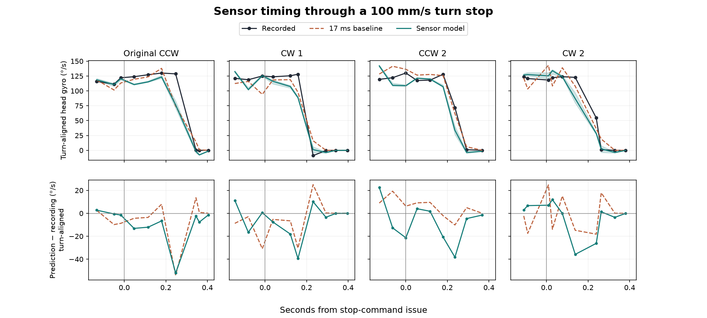

# What reaches the SDK during a turn stop

The firmware gives the encoder and head gyro different sample histories. A replay using those histories reproduced some delay, but increased pooled braking error on the three held-out stops. We kept the 42 mm contact span and the existing 17 ms comparison offset.

## Trace from acquisition to the recorder

1. Wheel transitions latch a syscon timer. Each motor update collects a count and the elapsed timer interval between the last edges of successive nonempty frames. The sign comes from the drive-direction hysteresis. HAL converts this interval rate to mm/s. When position stays unchanged for five HAL speed queries, it returns zero (nominally 25 ms at one query per control tick). The controller truncates to integer mm/s and calls the result “filtered”; its previous-value weight is zero. During monotonic braking an interval average generally makes wheels appear faster than their endpoint speed. The final zero also has an uncertain onset. [Edge capture](https://github.com/kercre123/victor/blob/669ec7499a7084640b57706a7937884a6568be50/robot/syscon/src/encoders.cpp#L265-L277) · [Syscon frame](https://github.com/kercre123/victor/blob/669ec7499a7084640b57706a7937884a6568be50/robot/syscon/src/motors.cpp#L115-L140) · [HAL thresholds and scale](https://github.com/kercre123/victor/blob/669ec7499a7084640b57706a7937884a6568be50/robot/hal/src/hal_motors.cpp#L52-L66) · [HAL rate](https://github.com/kercre123/victor/blob/669ec7499a7084640b57706a7937884a6568be50/robot/hal/src/hal_motors.cpp#L126-L154) · [Controller coefficient](https://github.com/kercre123/victor/blob/669ec7499a7084640b57706a7937884a6568be50/robot/supervisor/src/wheelController.cpp#L30-L50) · [Controller update](https://github.com/kercre123/victor/blob/669ec7499a7084640b57706a7937884a6568be50/robot/supervisor/src/wheelController.cpp#L214-L239)
2. The reference driver configures a BMI160 gyro at ±500°/s, 200 Hz, OSR4, with filtered FIFO data. HAL processes batches, converts to rad/s and queues samples. The supervisor drains the queue, subtracts a bias, and applies a 0.989 hardware Z-axis sensitivity correction. RobotState reads this head-frame value directly. A separately filtered, rotated signal feeds motion detection and internal yaw estimation. At the observed rates near 128°/s, the reference chip's configured measurement range still has headroom. [Driver configuration](https://github.com/kercre123/victor/blob/669ec7499a7084640b57706a7937884a6568be50/robot/hal/spine/imu.c#L238-L251) · [FIFO unpack](https://github.com/kercre123/victor/blob/669ec7499a7084640b57706a7937884a6568be50/robot/hal/spine/imu.c#L290-L315) · [HAL queue and polling](https://github.com/kercre123/victor/blob/669ec7499a7084640b57706a7937884a6568be50/robot/hal/src/hal_imu.cpp#L87-L174) · [Supervisor correction](https://github.com/kercre123/victor/blob/669ec7499a7084640b57706a7937884a6568be50/robot/supervisor/src/imuFilter.cpp#L919-L963) · [Yaw estimator](https://github.com/kercre123/victor/blob/669ec7499a7084640b57706a7937884a6568be50/robot/supervisor/src/imuFilter.cpp#L995-L1054) · [Published fields](https://github.com/kercre123/victor/blob/669ec7499a7084640b57706a7937884a6568be50/robot/supervisor/src/messages.cpp#L77-L101)
3. Each 5 ms supervisor tick updates the IMU and wheels before assembling the state. The internal message gets a snapshot timestamp; the nominal normal/calm send periods are 30/250 ms. The engine caches the values and broadcasts a protobuf from its latest state. The Python event stream unwraps that message. I checked the installed recording host's wirepod-vector-sdk 0.8.1 descriptor and event handler: RobotState carries neither sensor acquisition time nor the internal state timestamp. Its last_image_time_stamp belongs to vision. The recorder timestamps the callback with host monotonic time. Wheel and gyro share that callback time; common transport delay cannot separate the two fields within a message. Variable delivery can distort interpolation between messages. [Tick and periods](https://github.com/kercre123/victor/blob/669ec7499a7084640b57706a7937884a6568be50/robot/include/anki/cozmo/shared/cozmoConfig.h#L324-L386) · [Tick order](https://github.com/kercre123/victor/blob/669ec7499a7084640b57706a7937884a6568be50/robot/supervisor/src/cozmoBot.cpp#L559-L605) · [State transmission](https://github.com/kercre123/victor/blob/669ec7499a7084640b57706a7937884a6568be50/robot/supervisor/src/messages.cpp#L165-L172) · [DDL engine protobuf](https://github.com/digital-dream-labs/vector/blob/360cccbf7ab2db049b4b15c25cc3169e269ca741/engine/robot.cpp#L2311-L2347) · [Gateway broadcast](https://github.com/kercre123/victor/blob/669ec7499a7084640b57706a7937884a6568be50/engine/robotManager.cpp#L183-L196) · [Anki SDK schema](https://github.com/anki/vector-python-sdk/blob/d61fdb07c6278deba750f987b20441fff2df865f/anki_vector/messaging/messages.proto#L233-L253) · [SDK dispatch](https://github.com/anki/vector-python-sdk/blob/d61fdb07c6278deba750f987b20441fff2df865f/anki_vector/events.py#L239-L251) · [Recorder](../../hardware/record_barriered.py#L121-L135)

The low-level source is a pinned public Vector firmware mirror. The engine path was also checked against DDL's published source. Build identity between that reference and the robot's installed image has not been established.

## Held-out test

Wheel inputs, time zero, 42 mm contact span, table and chassis settings follow the previous replay. The source-based variants **replace** the empirical offset. No parameters were fitted to these stops. The gyro-only column filters the simulated head gyro at an approximate 18.65 Hz cutoff and averages predictions across 16 combinations of sensor/poll phase within a 5 ms tick. The combined model also estimates the encoder interval effect: integrate the linearly interpolated measured speeds, generate pulses at the HAL count pitch, compute the firmware-style readback, and apply its estimated error once in reverse before replaying the chassis. We average two initial encoder phases and two frame phases. This approximates the missing wheel history. The final column substitutes two cascaded poles at the same total cutoff. Bosch specifies approximate bandwidth; the filter phase and coefficients of this unit are unknown. We treat simulated gyro as calibrated and apply no additional gain. [Bosch BMI160 datasheet §2.4.2](https://www.bosch-sensortec.com/media/boschsensortec/downloads/datasheets/bst-bmi160-ds000.pdf#page=21)

| Window | Samples | 17 ms baseline | Gyro only | Encoder + gyro | Encoder + two-pole gyro |
|---|---:|---:|---:|---:|---:|
| Original CCW braking, reference | 7 | 21.39 | 19.12 | 21.19 | 20.10 |
| Held-out CW 1 braking | 7 | 15.20 | 16.63 | 17.13 | 16.99 |
| Held-out CCW 2 braking | 8 | 6.57 | 13.46 | 17.28 | 15.96 |
| Held-out CW 2 braking | 8 | 15.43 | 13.96 | 16.48 | 15.05 |
| Held-out braking, pooled | 23 | **12.97** | 14.66 | 16.96 | 15.98 |
| Held-out steady turn, pooled | 35 | 12.02 | 10.91 | **9.82** | 9.88 |

Values are sample-weighted gyro RMS errors in °/s. Scoring uses the original 0–450 ms braking window and the previous steady-turn definition. Repeat CCW 1 had a 2.947 s gap and is excluded. Error plots align positive yaw with turn direction. Shading spans the 16 gyro phase combinations for the one-pole combined model; it covers only the chosen phase grid.

On CCW 2 at +236 ms, measured yaw was +72.0°/s. The baseline predicted +61.8, gyro-only +42.0, and combined +33.7°/s (phase range +26.5 to +41.0). The same encoder correction that improves steady replay makes this braking sample worse. The readings bracketing the three stops arrived 19–101 ms apart in the −100 to +450 ms window. Sensor filtering can contribute lag in either direction, but these tests do not establish that it causes the remaining transient. Distinguishing genuine chassis rotation from unobserved between-message wheel motion or extra sensor latency requires an independent yaw reference or synchronized lower-level acquisition.

Reproduce from the repository root with `python diagnose_sensor_timing.py evidence/hw-rec-20261119/unit2-ccw100.jsonl evidence/hw-rec-20261119/unit2-repeat-stops.jsonl`. [Per-sample predictions and signed wheel speeds](sensor-timing-braking.csv) · [Prior held-out braking test](repeated-braking.md)
