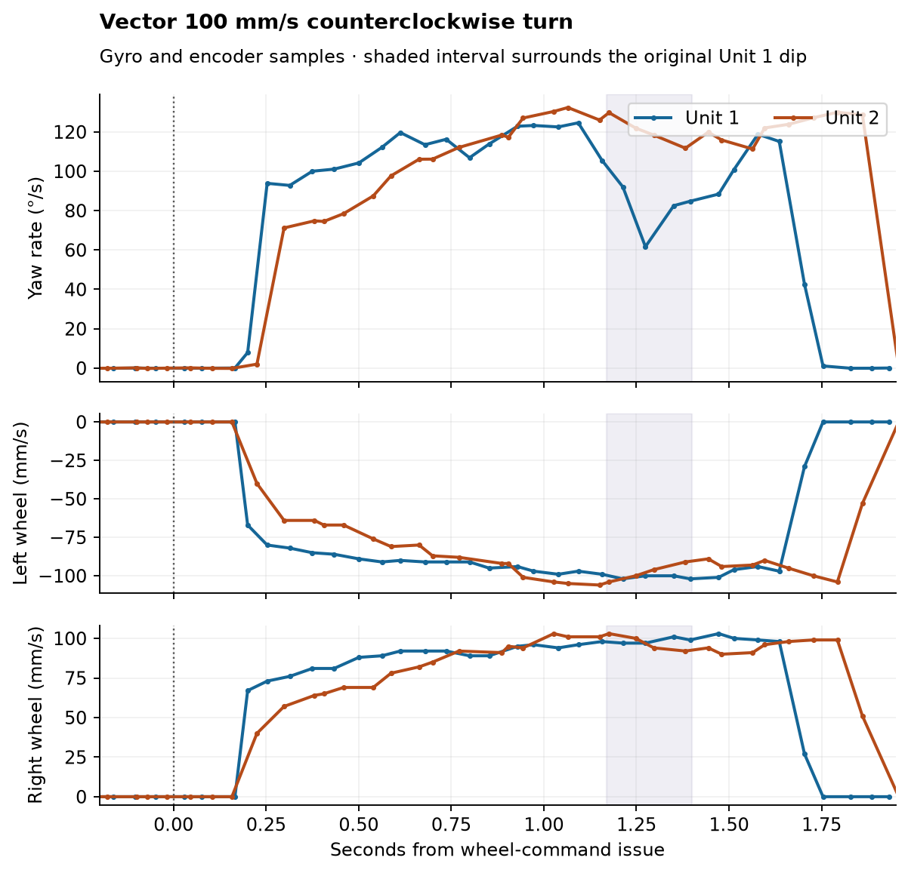
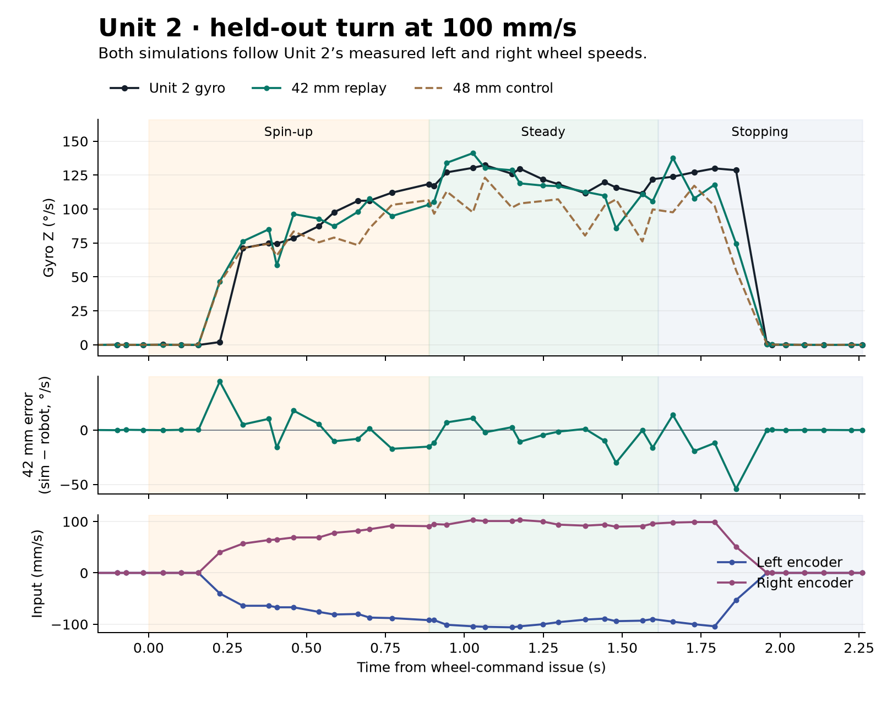
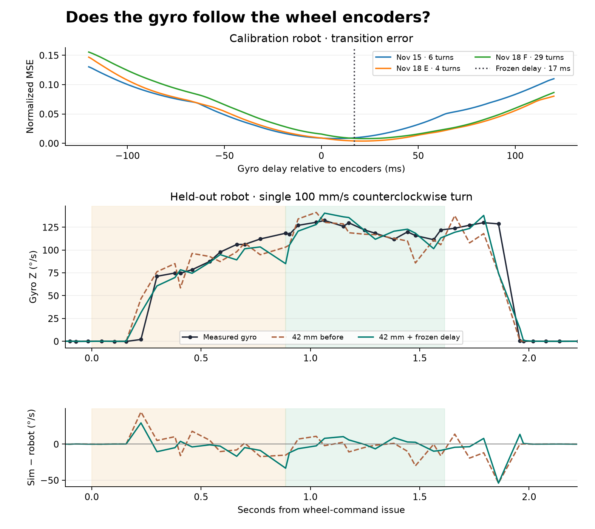

# Unit 2 and Unit 1 counterclockwise turn comparison

On November 19, 2026, the paired SDK on the mother pod recorded Unit 2 through the daughter relay. A read-only preflight returned 35 gyro/wheel state samples in two seconds. Earlier Unit 2 reported charging at 3.75 V. Both the preflight and the motion recorder found him off the charger. The recorder therefore skipped undocking, set the head to 22.4°, lowered the lift, commanded left −100 and right +100 mm/s for 1.5 s, stopped, and released default-priority control. The final state was off the charger with both wheels stopped. The [Unit 2 recording](unit2-ccw100.jsonl) and [Unit 1 recording](../hw-rec-20261115/table-run1.jsonl) use host receipt times.

Aligned at wheel-command issue, Unit 1's measured gyro sample at +1.274 s was 61.7°/s with −100/+97 mm/s encoders. Unit 2 bracketed that time at +1.248 and +1.297 s (approximately), with 121.9 and 118.4°/s respectively. Linear interpolation gives approximately 120°/s and −98/+97 mm/s. Unit 2 showed some slowing as his encoders slowed, but none of his four samples in the 1.17–1.40 s window approached Unit 1's trough. Head angles at the trough were 22.24° and 22.36° respectively. Unit 2's wheel RPC took 101 ms to acknowledge versus 29 ms for Unit 1, so command alignment alone has timing uncertainty. The plot includes all measured samples around the turn without smoothing. One unmarked pose, different tables/robots, Unit 2 on purplOS, and a nominal 15–17 Hz state stream limit the comparison. It establishes non-recurrence in this take; a heading or surface dependence remains untested.

## SDK refusal

The pod's activated-robot list retained Unit 2's pairing and address while live battery and stats calls returned TCP connection refused. The spore later reached the correct robot at the reserved address on wlan0, verified by ping and robot hostname. On the robot, vic-cloud owns TCP 443. Its journal shows a cloud-only restart at boot +1641 s; the replacement process retried the local switchboard gateway Unix socket about every five seconds from +1644.6 through +2519.9, receiving “operation not permitted.” It never logged a port-443 listener in that interval. Switchboard was still the earlier process. Both services restarted around +2524–2529 s, and vic-cloud logged its listener at +2537.9 s. The journal establishes the failing dependency and recovery; it does not identify which permission check or launch condition caused that socket error. Monotonic times avoid the robot's incorrect wall clock.

During this investigation a lane switched the daughter from an independent wire-pod to forwarding for the mother. The paired SDK worked through the daughter's port 443; control and telemetry used that path. The prior robot-local failure and the change in pod topology are distinct events. No further daemon or firmware change was necessary for this recording.

## Held-out replay with measured wheel speeds

The opt-in 42 mm model transferred better than a 48 mm control on Unit 2's table. The steady gyro-z mean was 121.6°/s on Unit 2, 115.8°/s at 42 mm, and 101.5°/s at 48 mm. Neither span captured the timing of the first acceleration or the last moving sample during braking.

| Phase | Samples | 42 mm mean error / RMS (°/s) | 48 mm mean error / RMS (°/s) |
| --- | ---: | ---: | ---: |
| Spin-up, command to 0.887 s | 13 | +2.6 / 15.7 | −4.1 / 17.7 |
| Steady, 0.887 s to stop issue at 1.613 s | 14 | −5.8 / 11.8 | −20.1 / 21.8 |
| Stopping, stop issue through 2.260 s | 11 | −6.5 / 18.2 | −12.5 / 25.2 |

Errors are simulated minus measured, weighted equally by telemetry sample. The steady interval begins at the first observation with both wheels at or above 90 mm/s in magnitude. The stopping interval includes the delay before wheel deceleration and the samples at rest. At 0.225 s the encoders first showed −40/+40 mm/s while the gyro read 2.0°/s; the 42 mm replay already read 46.6°/s. At 1.480 s the model alone dipped to 85.8°/s against 115.9°/s measured. At 1.860 s, as the wheels fell to −53/+51 mm/s, Unit 2 still measured 128.7°/s against the model's 74.6°/s. Both were below 1°/s at the next sample, 98 ms later. Integrating gyro Z over the entire plotted data file gives 184.6° measured, 177.2° at 42 mm and 155.7° at 48 mm. This integral is about the head IMU's Z axis.

The input was the pair of measured encoders linearly interpolated on the original host receipt clock. At each physics step a two-motor torque solve imposes that speed at the two real front shafts; the chassis and all contact forces evolve in MuJoCo. The remaining error in wheel speed at the original timestamps was at most 0.18 mm/s. The output is the noise-free gyro-Z sensor at the simulated head IMU, sampled at those same timestamps. No measured gyro, fitted time offset, or motor-command delay enters the trajectory. The run uses the Vector 2 variant, recorded starting head/lift posture, level open table, and fixed default heading. The 48 mm control puts the contact patches back at the original axle centers while preserving the trial's solver and belt coupling. Tightening the wheel solve from 0.01 to 0.001 mm/s reproduced the reported phase scores to two decimals.

Both replays use the simulator's original surface parameters. The physical tables and robots differ, and this run supplies no independent friction, tread deformation, or load-distribution measurements. The sample spacing also leaves unresolved the relative timing of encoders and gyro during rapid speed changes. The 42 mm effective fore–aft span improves prediction for this held-out maneuver; one run cannot determine the contact span of either physical table.

Reproduce from the simulator directory with `python replay_measured_turn.py evidence/hw-rec-20261119/unit2-ccw100.jsonl /tmp/unit2-replay.csv`. [Per-sample results](unit2-measured-replay.csv)

## Encoder-to-gyro timing test

Unit 1 supplied the calibration. We used all 39 completed opposite-wheel turns in Nov 15 table-run1 (6), Nov 18 run E (4) and Nov 18 run F (29); the final interrupted endurance turn was excluded. For each turn, normalize the signed right-minus-left encoder speed and gyro Z using each signal's rest median and its median over 55–85% of the commanded interval. Compare both shapes over the first second (capped at 55% duration) and from 120 ms before to 480 ms after the logged stop. Scan delays from −120 to +120 ms in 1 ms steps, giving equal weight to each recording, each turn within it, and each transition. A positive delay means the measured gyro follows the encoder signal. The stop timestamp only selects the comparison window.

The shared minimum is **+17 ms**. Spin-up alone gives +22 ms, braking alone +13 ms. Leaving out each recording in turn gives +22, +15 and +14 ms. Individual recording pairs (spin-up, braking) are (25, 0), (22, 21) and (21, 23) ms. This is an effective wheel-to-body delay and can include mechanical response, filtering and sampling. The 1 ms search grid does not give either sensor a 1 ms timestamp.

On Unit 2, shift the existing 42 mm model's physics-step gyro output 17 ms later and sample at the original telemetry times. Wheel inputs, phase boundaries, pose, table and solver are identical before and after. No gain or offset was fitted to this robot. The raw gyro is unchanged.

| Held-out phase | RMS before → after (°/s) | Mean model gyro before → after (°/s) | Measured mean (°/s) |
| --- | ---: | ---: | ---: |
| Spin-up | 15.69 → 10.46 | 64.90 → 60.80 | 62.34 |
| Steady | 11.82 → 11.40 | 115.82 → 118.67 | 121.60 |
| Stopping | 18.16 → 17.06 | 39.89 → 42.79 | 46.38 |

At +0.225 s the model moves from 46.6 to 31.4°/s against a measured 2.0°/s. At +1.860 s both predictions are about 74.6°/s against a measured 128.7°/s. At the next frame (+1.958 s), shifting the prediction raises it from 0.5 to 14.1°/s against a measured 0.5°/s. Timing accounts for part of spin-up and little of the sharp braking discrepancy. A universal gyro correction would require independently timestamped samples or an external motion reference, especially across two surfaces. This remains an evaluation-only shift.

Reproduce with `python diagnose_turn_lag.py --plot` from the simulator directory (NumPy, MuJoCo, Matplotlib). [Unit 1 delay sweep](turn-lag-training.csv) · [Unit 2 before and after samples](turn-lag-test.csv).
