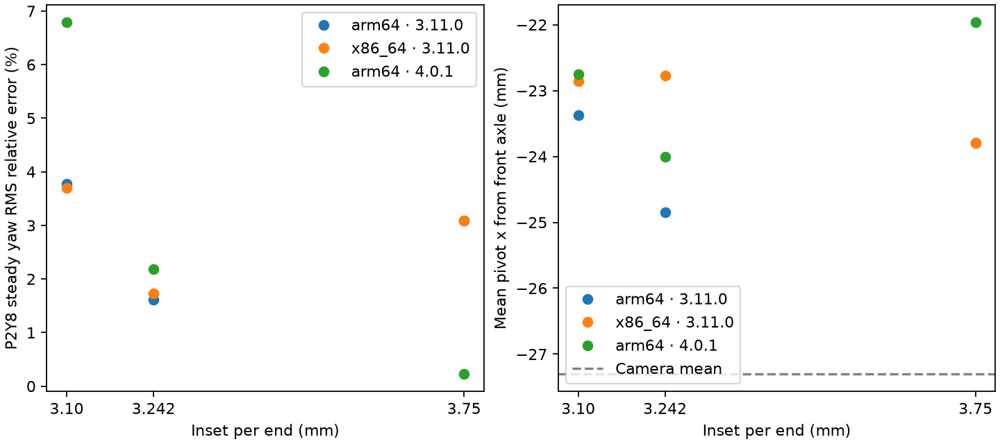
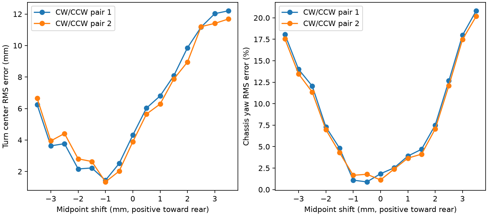
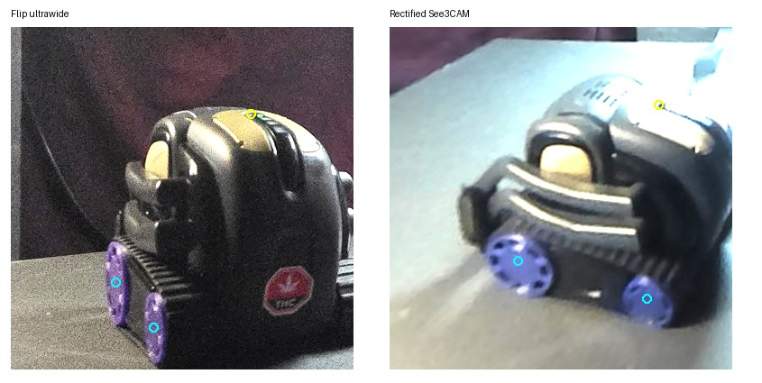
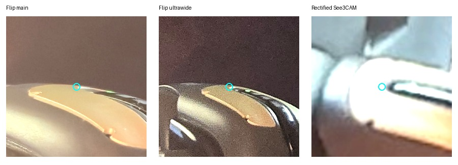
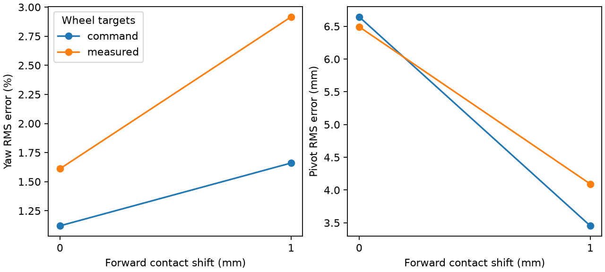
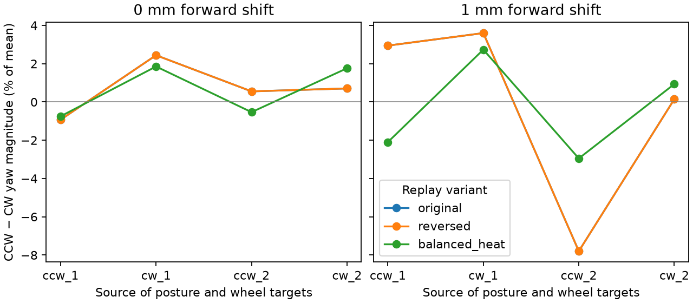
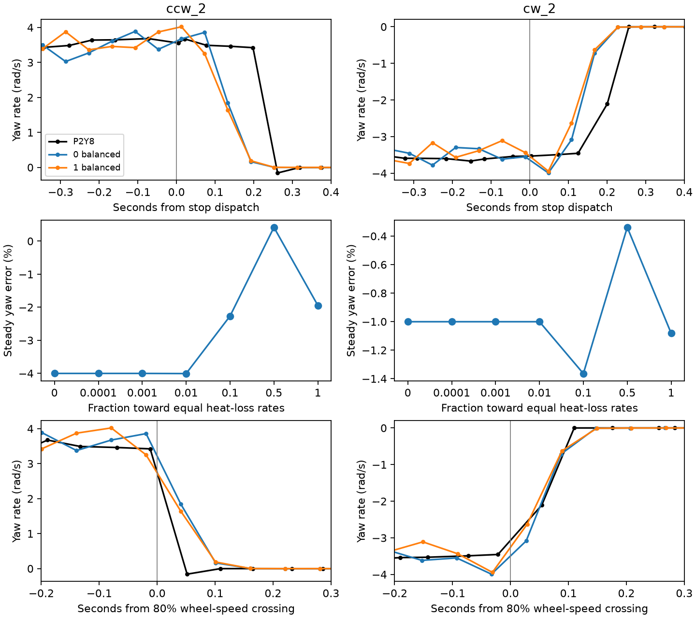
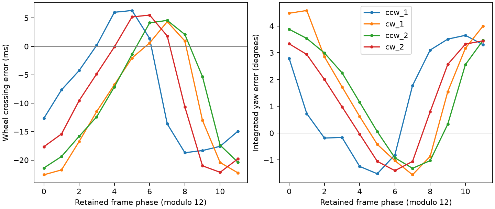
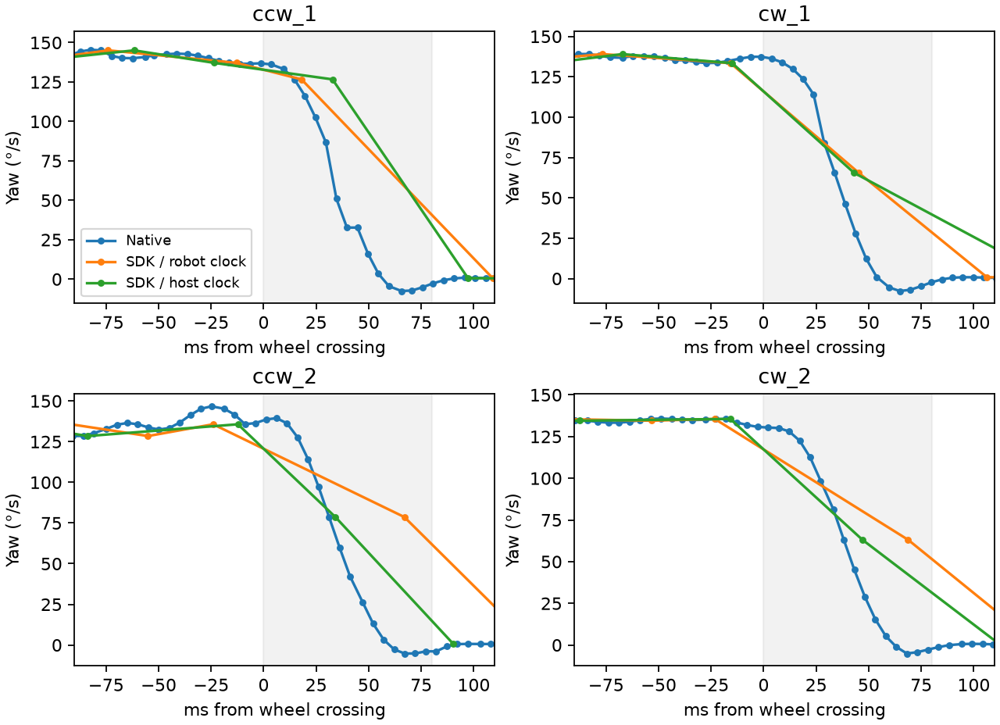
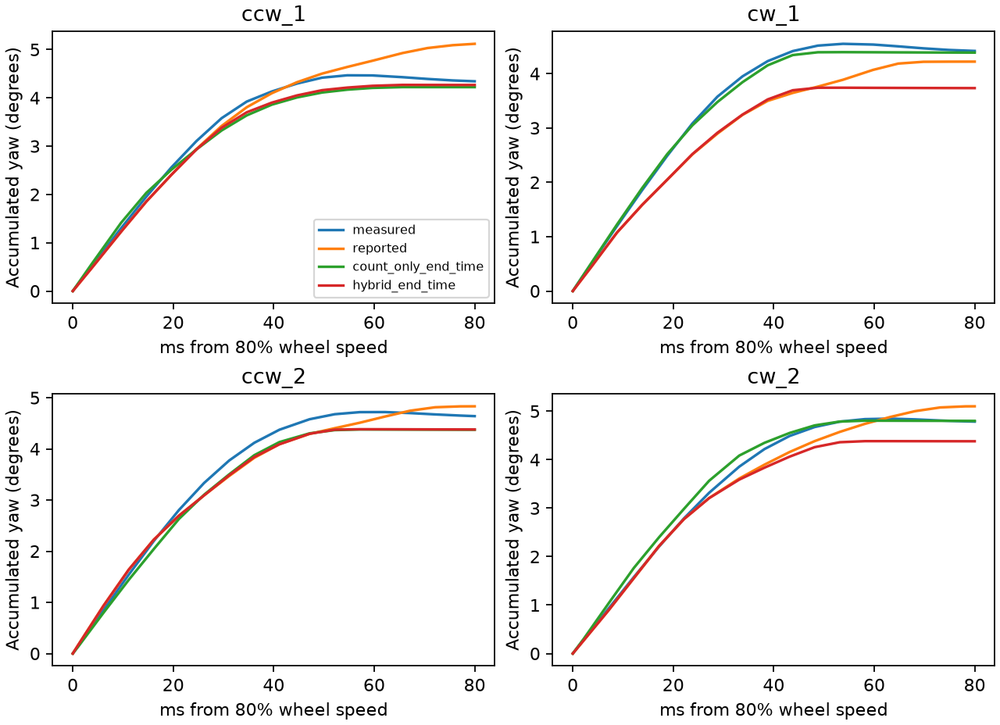

# Reproducing the 3.10 mm tread inset

On Linux x86_64 with MuJoCo 3.11.0, replaying unit 1's four run E spins with the current model gives **3.104737083567137 mm** per end. That exactly reproduces the [archived fit](../imu-filter-20261120/fit_spins-output.json). On the same host with MuJoCo 4.0.1 the fit gives **3.242032 mm**. The measurements and 48 mm physical axle spacing were the same in both runs. The crossing interpolates between integer-millimetre grid points and does not establish submillimetre physical accuracy.

| Build | Unit 1 fit (mm) |
|---|---:|
| Linux x86_64, 3.11.0 | 3.105 |
| macOS arm64, 3.11.0 | 2.940 |
| Linux x86_64, 4.0.1 | 3.242 |
| macOS arm64, 4.0.1 | 3.242 |

Repeating the two macOS runs with the original model package from commit 9b8f606 gave the same crossings as the current package to the precision shown. The original recording differs only in a free-text note. These comparisons isolate a solver-version effect within each platform. The between-platform comparison also changes the operating system and native build, so it cannot isolate CPU architecture.

On MuJoCo 4.0.1, transferring 3.10 and 3.242 mm to unit 3's four camera spins yields respectively **6.79% and 2.19%** RMS relative errors in steady head-gyro Z. The mean modeled pivot moves from −22.76 to −24.00 mm, versus −27.30 mm from the camera. At 3.75 mm the yaw error is 0.23% but the pivot moves farther forward to −21.96 mm. Unit 3 is held out for the unit 1 fit; it was used to select the separate 3.75 mm candidate. The historical fit uses head-gyro Z. The [recorded-pose experiment](../recorded-pose-inset/README.md) uses chassis-axis yaw and its own contact implementation.

The default calibration remains 3.10 mm. The regression checks the stored calibration against its archived fit, reproduces the crossing on the reference build, and checks the live fit against the documented range on each build. The independent rate and pivot regressions remain in place.

From the current repository root, run `PYTHONPATH=. python evidence/inset-portability/compare.py --model-label current` with the desired MuJoCo version. To replay the older model, point PYTHONPATH at an export of commit 9b8f606 containing simulacrum and the two parameter tables. The CSVs contain the four per-spin results at each inset. Run `python evidence/inset-portability/plot.py` to redraw the figure.

## Moving the contact midpoint at fixed span

With axle spacing fixed at 48 mm and the auxiliary roller centers 40.5 mm apart, moving both contacts rearward by 1 mm worsened first-pair pivot RMS error from 4.31 to 6.80 mm. On the second pair it rose from 3.89 to 6.29 mm. The geometrical center of the support points and the dynamic center of rotation can move in different directions.

The opposite shift gave a partial correction. Across a ±3.5 mm grid in 0.5 mm steps, we selected the lowest first-pair pivot RMS among candidates whose first-pair yaw RMS was no worse than the centered control. That selected **1 mm forward**. First-pair pivot/yaw errors changed from 4.31 mm / 1.85% to 1.44 mm / 1.10%. On the second CW/CCW pair, excluded from the selection, pivot error fell from **3.89 to 1.34 mm**, while yaw error rose from **1.12% to 1.66%**. The repeat pair shares the robot and shelf, and the camera calibration itself can move the inferred pivot by several millimetres. On unit 1's four runs on its other surface the frozen change slightly worsened yaw RMS from **2.20% to 2.31%**; there is no independent physical pivot measurement for unit 1. The production model retains its original calibration.

This is an offline auxiliary-roller experiment on the current model with its built-in inset set to zero, a 1 ms physics step and MuJoCo 4.0.1. Each spin starts at its recorded head and lift pose. The roller experiment uses its historical multi-contact setting and its camera-sampled center estimator, which differ from the preceding native-model comparison. A separate contact-force check at nominal 22.5° head and 32.7 mm lift found the four patches carried all sampled normal load. The front share varied by turn direction, so these forces alone do not identify a universal cause for the pivot motion.

[All unit 3 spins](shift.csv) · [Frozen unit 1 transfer](shift-c7.csv) · [Contact loads](shift-load.csv). Positive shifts in the CSVs are toward the front. Run `python shift.py` and `python shift_load.py` from this directory.

### Camera sensitivity of the forward shift

On the held-out unit 3 pair, the frozen 1 mm forward contact shift reduced longitudinal pivot RMS by **2.10–2.85 mm** across nine reconstructions. All reuse the same image picks, dock and shelf constraints. We varied the focal prior from 450 to 720 pixels and the backpack lens height by ±3 mm around 65.5 mm. These are sensitivity scenarios for the same four spins.

The longitudinal registration of the backpack landmark matters more. At nominal calibration, moving the *measured* pivots **2.00 mm forward relative to the front axle** would equalize held-out RMS for the two models. The crossover ranges from 1.52 to 2.48 mm across the grid. This is a calculated break-even offset. Its physical size and sign need an independent side-view measurement of the backpack landmark relative to the front axle. The gyro comparison is independent of this camera calculation.

[Per-pair RMS and crossover](camera-sensitivity.csv) · [Reproduce the calculation](camera_sensitivity.py)

### Backpack landmark relative to the front axle

We recovered the six See3CAM landmark triples used for the crown survey. Five B headings fit a common backpack location, allowing its height, longitudinal location and lateral distance from the visible rim to vary. Each pose uses the observed hubs and released hub heights. The nominal wheel-calibrated rig placed the tip **35.51 mm behind the front axle** and **64.66 mm above the shelf**. B reprojection RMS was 3.00 working pixels. The frozen prediction missed the tip by **18.27 px** at A.

A separate triangulation at A used three points picked in the full-resolution Flip ultrawide photo and their See3CAM counterparts. The tip measured **43.42 mm behind the front axle** and **66.12 mm high**. Free horizontal axle spacing measured 50.16 mm against the released 48 mm. The difference between B and A exceeds the 2 mm pivot crossover. The A measurement depends on locating nearly edge-on printed rims in the phone view and on camera calibration at the robot. Both checks use the same See3CAM at A. The physical landmark registration remains unresolved. Keep the pivot comparison conditional on its assumed landmark position.

[Original calibration and held-out fit](landmark-registration.csv) · [Held-out stereo check across three rig calibrations](landmark-stereo.csv) · [Image coordinates and reproduction script](landmark_registration.py)

### Independent three-camera repeat at A

The side-on cap-scale orbit sees the gold backpack surface nearly edge-on, obscuring the indicator tip in the clearest opposing rim views. A separate stationary A repeat (S-Am-15) shows the black tip from both phone lenses and the See3CAM. Using the archived rim-center observations and the frozen B rig, all three cameras placed the tip **38.95 mm behind the front axle** at **66.55 mm height**. Free axle spacing was **48.93 mm**. The two combinations of one phone lens with the See3CAM gave 38.85 and 39.15 mm. Using the two phone lenses alone gave an implausible 83.63 mm axle spacing. The three-lens estimate shares calibration errors across cameras, and the phone shutters were sequential.

Using each survey's measured longitudinal coordinate and height together, the held-out spin pair favors the 1 mm forward contact shift in all three reconstructions. Pivot RMS for centered versus shifted contacts was **3.02 versus 1.39 mm** using B, **11.02 versus 7.74 mm** using the first A capture, and **6.65 versus 3.47 mm** using the independent A repeat. Variation between captures exceeds the residual in the nominal fit. The shifted model's absolute pivot accuracy therefore depends on the landmark survey, while the yaw tradeoff persists.

[Camera subsets and wheelbase checks](repeat-landmark.csv) · [Held-out pivot scores](landmark-pivot-scores.csv) · [Reproduce](repeat_landmark.py)

### Contact midpoint with measured wheel speeds

We targeted each tread's recorded mean speed magnitude from 0.7–1.4 s with its commanded sign. On the held-out CW/CCW pair, the simulated steady wheel-speed errors were within **0.42 mm/s**. The 1 mm forward shift still improved longitudinal pivot RMS, from **6.49 to 4.09 mm**, while yaw RMS worsened from **1.61% to 2.92%**. The adverse yaw result comes from the CCW repeat (+0.64% centered, −4.00% shifted). CW improved from −2.19% to −1.00%. The shifted proxy also underestimated steady roll and pitch magnitudes in both directions. Neither geometry was refitted.

Both simulated and observed lens paths now use the same A-repeat landmark position. With the original commands the pivot RMS values are 6.65 and 3.45 mm. The preceding survey comparison adjusted only the observed landmark and reported 3.47 mm for the shifted case. These steady-speed inputs do not reproduce the encoder history through braking. [Per-spin wheel, gyro and pivot errors](shift-speed.csv) · [Replay script](shift_speed_check.py)

### Does the simulated turn mirror at fixed posture?

For each of the four recordings we kept its head/lift start, stop time and two steady-speed targets, then exchanged the signed targets between treads. Only the original direction has a matching physical observation. With the 1 mm forward shift, the second CCW recording's inputs gave 3.398 rad/s CCW and 3.673 rad/s CW. The **7.80%** difference relative to their mean also appeared in the simulated heading trajectory (**7.32%**). The mirrored wheel speed magnitudes agreed within **0.17 mm/s**. The other three inputs gave gyro differences of +2.95%, +3.60% and +0.14%, so a constant directional correction would miss the sign change.

Reversing only the four auxiliary roller bodies' XML order reproduced the gyro asymmetries to within 0.000001 percentage points. Giving both treads the mean of the two configured heat-loss rates reduced the −7.80% case to −2.95%. Across the two recorded hold-out directions, equalizing those rates improved the shifted model's physical yaw RMS from 2.92% to 1.57%, but worsened the centered model from 1.61% to 2.54%. These are sensitivity results on a previously examined pair. They show an interaction between drive and contact assumptions. A physical temperature difference was never measured in these recordings.

[All mirrored runs and heading slopes](mirror-spins.csv) · [Reproduce](mirror_spins.py)

### Braking at the robot's wheel-speed crossing

For the shifted model at measured steady targets, the original heat parameters reduced simulated motor torque by at most 0.185% during the steady scoring window. Mean absolute PWM duty was about 0.69. Moving the two heat-loss rates toward their common mean produced a nonmonotonic response in steady CCW yaw. Earlier mirrored-run yaw percentages score steady turns. The braking measurements below use the next 300 ms of gyro samples.

| Held-out repeat | Time to 80% wheel speed, robot / sim | Angle after stop dispatch, robot / sim | Angle after 80% crossing, robot / sim |
|---|---:|---:|---:|
| CCW | 210 / 92 ms | 45.6° / 29.2° | 3.6° / 9.7° |
| CW | 146 / 81 ms | 40.4° / 30.4° | 11.4° / 12.9° |

Wheel alignment reverses the sign of the integrated error for both repeats. A blanket increase in braking travel would worsen the CCW wheel-aligned result. Equalizing motor heat-loss rates moves the wheel-aligned sim values to 8.6° CCW and 11.6° CW. These timings combine command delivery, encoder filtering and SDK receipt timing. The threshold interpolates the first descending crossing of 80% of the recorded steady mean absolute wheel speed, using the same threshold in hardware and sim. The roughly 60 ms SDK sampling period limits timing precision. [All ablations and both clocks](heat-transient.csv) · [Reproduce](heat_transient.py)

### Sampling the native 100 mm/s stops at SDK cadence

Across four archived 100 mm/s stops, the 5 ms encoder and head gyro traces gave **4.35–4.78°** of rotation in the 300 ms after the wheels crossed 80% of steady speed. We repeated the measurement on every twelfth controller frame, trying all twelve phases independently. This changes only the sampling. Measured angle moved by **−1.56 to +4.58°** and the inferred crossing by **−22.6 to +6.3 ms**. The archive has some missing frames, so the CSV includes the largest gap in each retained series.

We separated interpolated wheel-crossing error from sparse gyro integration by integrating the native gyro from each sparse crossing. Moving the crossing alone gave **1.81° RMS** across the 48 stop/phase combinations. Sampling the gyro sparsely added **0.73° RMS** relative to that shifted dense integral. The combined error was **2.38° RMS**. These are deterministic phase comparisons on four physical moves. The window used to estimate steady speed was 250–500 ms before the last wheel edge, and stationary gyro bias was subtracted per stop. The 150 mm/s spins above have different braking profiles and SDK host timestamps, so the 100 mm/s phase errors cannot be subtracted from them. [Per-phase results](braking-cadence.csv) · [Reproduce](braking_cadence.py) · [Original native captures](../hw-rec-20261119/native-stops.md)

### The SDK samples actually delivered during braking

We recovered the simultaneous SDK receipt log for the four 100 mm/s native stops. Matching both reported wheel speeds and all three gyro components uniquely to native frames gave 9–11 consecutive SDK samples per stop with no omitted receipts between the first and last matches. This permits an 80 ms integral after the 80% wheel-speed crossing in every stop without extrapolation. Each series uses the same native steady-speed threshold and gyro bias. The shaded area shows the integration window.

| Stop | All native frames | SDK frames, robot time | Same SDK frames, host time |
|---|---:|---:|---:|
| CCW 1 | 4.34° | 7.53° | 8.05° |
| CW 1 | 4.42° | 5.74° | 5.85° |
| CCW 2 | 4.64° | 7.59° | 5.55° |
| CW 2 | 4.79° | 6.84° | 5.80° |

The actual frame selection and interpolation overestimated braking travel in all four cases by 1.32–3.18°. Using host receipt intervals for those same values changed the estimate by −2.04 to +0.53°. For the second CCW stop, receipt timing masked about two degrees of sampling error. The native angle over 80 ms is within 0.02° of the earlier 300 ms integral for every stop. No host-to-robot clock offset was fitted. Each clock is aligned to its own interpolated wheel crossing. [Matched-clock results](sdk-stop-clock.csv) · [SDK receipt excerpt](sdk-stop-receipts.csv) · [Reproduce](sdk_stop_clock.py)

### Frozen replay against native braking angle

Scoring the archived 42 mm replays against native gyro on the common 80 ms interval after the measured 80% wheel crossing gives a different ranking from the earlier head-rate tail score. The count-only reconstruction (count increments timestamped at interval end) had the smallest first-pair angular RMS error: **0.088°**, versus **0.566°** for reported speed and **0.487°** for the hybrid. Its second-pair RMS was **0.188°**, versus **0.261°** and **0.341°** respectively. On the second pair it predicted **4.375° versus 4.641° measured CCW** and **4.800° versus 4.785° measured CW**. Thus one held-out direction missed the 5% angle tolerance. These four recordings share one robot, surface and session.

The same ranking held for a 60% wheel crossing. At 90%, reported speed gave lower second-pair RMS than counts (0.236° versus 0.271°). All methods use the original frozen 17 ms gyro offset, observed head angle, and identical measured crossing times. Each rate series has its own post-stop median removed. The count-only replay also had a higher steady head-rate RMS than the hybrid in the original test. These tradeoffs support keeping both rate and angle in the score. [Per-spin and crossing sensitivity](native-brake-angle.csv) · [Reproduce](native_brake_angle.py) · [Original frozen replay inputs and rate scores](../hw-rec-20261119/hybrid-replay.md)
