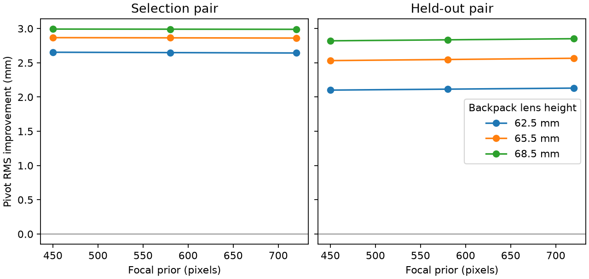

# Reproducing the 3.10 mm tread inset

On Linux x86_64 with MuJoCo 3.11.0, replaying C7K8's four run E spins with the current model gives **3.104737083567137 mm** per end. That exactly reproduces the [archived fit](../imu-filter-20261120/fit_spins-output.json). On the same host with MuJoCo 4.0.1 the fit gives **3.242032 mm**. The measurements and 48 mm physical axle spacing were the same in both runs. The crossing interpolates between integer-millimetre grid points and does not establish submillimetre physical accuracy.

| Build | C7K8 fit (mm) |
|---|---:|
| Linux x86_64, 3.11.0 | 3.105 |
| macOS arm64, 3.11.0 | 2.940 |
| Linux x86_64, 4.0.1 | 3.242 |
| macOS arm64, 4.0.1 | 3.242 |

Repeating the two macOS runs with the original model package from commit 9b8f606 gave the same crossings as the current package to the precision shown. The original recording differs only in a free-text note. These comparisons isolate a solver-version effect within each platform. The between-platform comparison also changes the operating system and native build, so it cannot isolate CPU architecture.

On MuJoCo 4.0.1, transferring 3.10 and 3.242 mm to P2Y8's four camera spins yields respectively **6.79% and 2.19%** RMS relative errors in steady head-gyro Z. The mean modeled pivot moves from −22.76 to −24.00 mm, versus −27.30 mm from the camera. At 3.75 mm the yaw error is 0.23% but the pivot moves farther forward to −21.96 mm. P2Y8 is held out for the C7K8 fit; it was used to select the separate 3.75 mm candidate. The historical fit uses head-gyro Z. The [recorded-pose experiment](../recorded-pose-inset/README.md) uses chassis-axis yaw and its own contact implementation.

The default calibration remains 3.10 mm. The regression checks the stored calibration against its archived fit, reproduces the crossing on the reference build, and checks the live fit against the documented range on each build. The independent rate and pivot regressions remain in place.

From the current repository root, run `PYTHONPATH=. python evidence/inset-portability/compare.py --model-label current` with the desired MuJoCo version. To replay the older model, point PYTHONPATH at an export of commit 9b8f606 containing simulacrum and the two parameter tables. The CSVs contain the four per-spin results at each inset. Run `python evidence/inset-portability/plot.py` to redraw the figure.

## Moving the contact midpoint at fixed span

With axle spacing fixed at 48 mm and the auxiliary roller centers 40.5 mm apart, moving both contacts rearward by 1 mm worsened first-pair pivot RMS error from 4.31 to 6.80 mm. On the second pair it rose from 3.89 to 6.29 mm. The geometrical center of the support points and the dynamic center of rotation can move in different directions.

The opposite shift gave a partial correction. Across a ±3.5 mm grid in 0.5 mm steps, we selected the lowest first-pair pivot RMS among candidates whose first-pair yaw RMS was no worse than the centered control. That selected **1 mm forward**. First-pair pivot/yaw errors changed from 4.31 mm / 1.85% to 1.44 mm / 1.10%. On the second CW/CCW pair, excluded from the selection, pivot error fell from **3.89 to 1.34 mm**, while yaw error rose from **1.12% to 1.66%**. The repeat pair shares the robot and shelf, and the camera calibration itself can move the inferred pivot by several millimetres. On C7K8's four runs on its other surface the frozen change slightly worsened yaw RMS from **2.20% to 2.31%**; there is no independent physical pivot measurement for C7K8. The production model retains its original calibration.

This is an offline auxiliary-roller experiment on the current model with its built-in inset set to zero, a 1 ms physics step and MuJoCo 4.0.1. Each spin starts at its recorded head and lift pose. The roller experiment uses its historical multi-contact setting and its camera-sampled center estimator, which differ from the preceding native-model comparison. A separate contact-force check at nominal 22.5° head and 32.7 mm lift found the four patches carried all sampled normal load. The front share varied by turn direction, so these forces alone do not identify a universal cause for the pivot motion.

[All P2Y8 spins](shift.csv) · [Frozen C7K8 transfer](shift-c7.csv) · [Contact loads](shift-load.csv). Positive shifts in the CSVs are toward the front. Run `python shift.py` and `python shift_load.py` from this directory.

### Camera sensitivity of the forward shift

On the held-out P2Y8 pair, the frozen 1 mm forward contact shift reduced longitudinal pivot RMS by **2.10–2.85 mm** across nine reconstructions. All reuse the same image picks, dock and shelf constraints. We varied the focal prior from 450 to 720 pixels and the backpack lens height by ±3 mm around 65.5 mm. These are sensitivity scenarios for the same four spins.

The longitudinal registration of the backpack landmark matters more. At nominal calibration, moving the *measured* pivots **2.00 mm forward relative to the front axle** would equalize held-out RMS for the two models. The crossover ranges from 1.52 to 2.48 mm across the grid. This is a calculated break-even offset. Its physical size and sign need an independent side-view measurement of the backpack landmark relative to the front axle. The gyro comparison is independent of this camera calculation.

[Per-pair RMS and crossover](camera-sensitivity.csv) · [Reproduce the calculation](camera_sensitivity.py)
