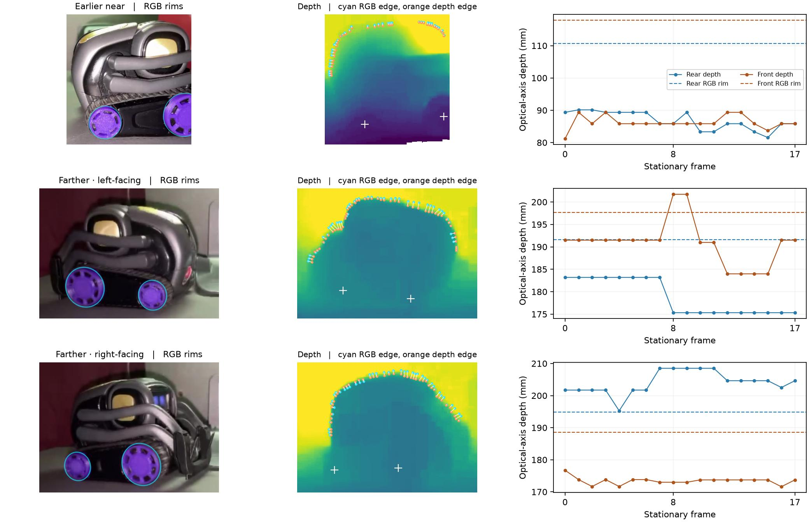

# Why unit 3’s close LiDAR hub span came up short

unit 3 was stationary for 18 paired Record3D frames per heading. The two farther poses were 179.6° apart by SDK yaw. Both complete printed rims cleared the image borders by at least 52 working pixels. Their estimated optical depths were 189–198 mm, versus 111–118 mm in the earlier close view.

| View | 3D span from printed rims in RGB | Raw depth span | Span after edge registration | Registered depth span, frame P10–P90 |
|---|---:|---:|---:|---:|
| Earlier near, right-facing | 49.3 mm | 34.7 mm | 34.7 mm | 34.3–36.3 mm |
| Farther, left-facing | 46.0 mm | 45.5 mm | 45.5 mm | 44.0–52.0 mm |
| Farther, right-facing | 42.9 mm | 60.0 mm | 60.2 mm | 56.8–64.5 mm |

The close view reads about 86 mm at both caps. Their printed diameters predict 111 and 118 mm. Correcting the body-edge offset leaves the median hub span at 34.7 mm. Moving farther eliminates that short span, but reversing the heading yields a 60.2 mm span. In that view depth puts the rear cap 31 mm behind the front. The rim fit predicts 6 mm. The depth difference between the caps accounts for most of the overestimate. Across these views the stream shows a near-range underestimate and heading-dependent local depth error. A single image translation or a single range offset cannot reconcile the measurements. The captures cannot isolate the sensor, foreground/background mixing, material response, depth upsampling or Record3D's hue encoding as the cause.

**How registration was checked.** The RGB robot boundary supplied independently selected edge segments above the wheels. At subpixel intervals along their normals we located the local RGB gradient and the midpoint of each usable foreground/background depth transition. A robust translation fit maps RGB samples to depth samples. The fitted (x,y) displacements in 640 × 480 pixels were (+3.8,+4.4) near, (0.0,+5.4) farther left, and (−1.8,+5.6) farther right. Median absolute residuals were 2.1–3.1 px. The crosses mark the shifted hub samples. A 9 × 9 patch supplies each frame’s median valid depth. Local nonrigid misregistration remains possible.

**Optical reference.** The two camera-space circles use parallel face planes and STL outer diameters of 18.5 and 26 mm. Each center is free, with no 48 mm wheelbase constraint or depth input. As a sensitivity check, the earlier focal-length/major-diameter approximation yields 49.2, 46.3 and 46.5 mm respectively. The 3.6 mm model spread in the farther right view limits the precision of its optical reference. The near front rim was clipped. Printed size, bevel selection and artwork segmentation remain sources of systematic uncertainty. All spans here are 3D distances between cap faces. The stock 48 mm value is fore–aft axle spacing.

[Numeric results](results.json) · [Earlier dock glyph and close-up check](../iphone-lidar-check/README.md) · [STL dimensions and orbit evidence](../orbit-cap-scale/README.md). To regenerate from the archived captures, run `python report.py NEAR_SIDE FAR_LEFT FAR_RIGHT` with NumPy, SciPy, OpenCV and Matplotlib.
