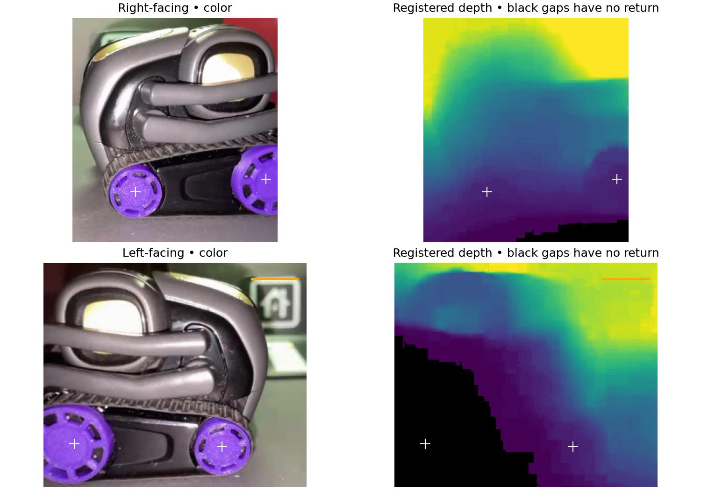

# P2Y8 wheelbase check with iPhone 12 Pro LiDAR

Two stationary, opposite-facing poses supplied 18 paired Record3D RGB and hue-coded depth frames each. P2Y8 has printed hubcaps. The existing camera reconstruction predicts 48.83 and 48.93 mm in the two held-out A photo sets. No iPhone measurement went into that fit.

| Measurement | Right-facing | Left-facing |
|---|---:|---:|
| LiDAR, 3D distance between visible hub-face centers | 34.7 mm | front center missing in 18/18 frames |
| Color, scaled from the printed rim diameters | 49.2 mm | 45.1 mm |
| LiDAR, dock glyph top edge (46 mm reference) | obscured | 45.0 mm |

We fitted ellipses to the visible purple rim outlines, excluding the image boundary where the front cap was clipped. The crosses locate their centers. For each frame we back-projected the median positive depth in a 9 × 9 working-pixel patch using the phone intrinsics. The right-facing 10th–90th percentile separation was 34.3–36.5 mm. These percentiles describe repeatability at a fixed pose. Registration, rim-pick errors, and depth bias remain. In the left-facing view the orange line marks the visible top edge of the dock glyph. Depth samples just inside its ends reduce contamination by the background. The extent of the slightly rounded corners is approximate.

As an independent photographic check, the long ellipse diameters gave a depth estimate per cap using its published STL diameter (front 26.0 mm, rear 18.5 mm) and the phone focal length. This approximates each rim as a projected circle. Clipping and obliquity affect the estimated centers and diameters. These results measure the distance between outboard face centers in 3D. The 48 mm specification measures longitudinal axle spacing. The 3.75 mm height offset alone would increase a 48 mm span by 0.15 mm.

The dock-scale agreement does not transfer to these near hub surfaces. The right-facing depth result undershoots even the shorter historical 42 mm camera estimate, while the opposite view loses the near front cap entirely. The two color estimates bracket the nominal axle spacing. We retained the existing reconstruction. This run does not establish a correction for LiDAR range bias or resolve the backpack and crown details. A repeat farther from the phone with both full rims and a same-plane scale would discriminate depth bias from RGB/depth registration errors.

[Measurement output](measurements.json) · [Analysis](check.py) · [Prior reconstruction and held-out checks](../hub-calibration-b/README.md)
