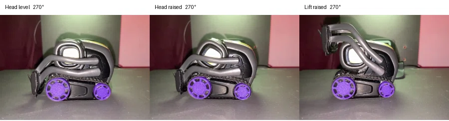
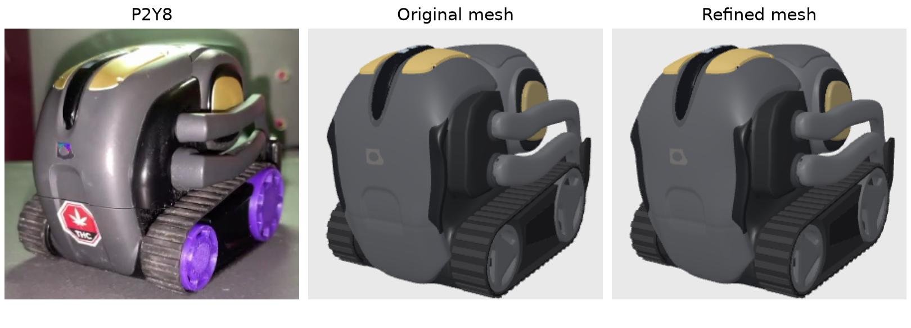
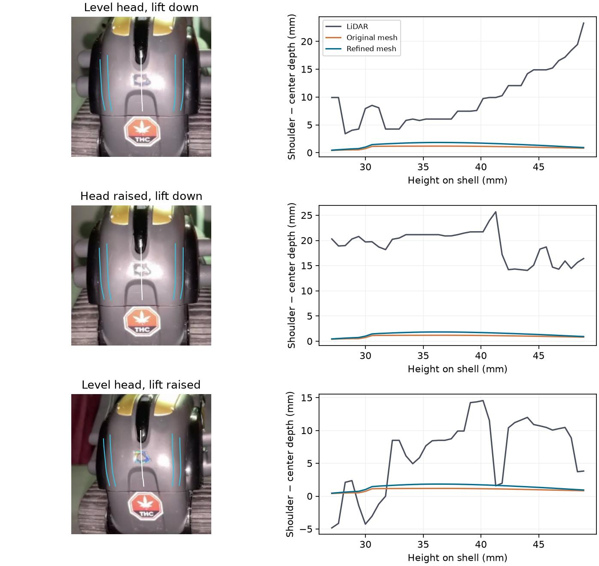

# Three 360° RGB-D scans of unit 3

unit 3 is a Vector 2.0 with printed hubcaps and lift, stock tracks, and the faceplate removed. The stationary iPhone 12 Pro recorded five paired color and depth frames at each of twelve headings spaced 30° apart, plus one closing view per pose. The encoder-reported head angles were about −1° and 35°. The lift reported about 31 mm down and 82 mm up. SDK yaw traversed +360.5°, −359.3° and +359.0° respectively. Both reported wheel speeds were zero in every capture index sample. The robot finished charging, with quiet mode confirmed on.

[Download all 39 median RGB-D views and intrinsics](scan.zip) · [Camera poses](poses.json) · [Level point cloud](level-scan.ply) · [Raised-head point cloud](headup-scan.ply) · [Raised-lift point cloud](liftup-scan.ply)

The archive contains the same crop in every view. The 16-bit PNG stores optical depth in 0.1 mm increments, with zero for missing returns. Record3D's compressed hue encoding sets the actual range resolution. The manifest contains each crop's focal lengths and principal point, device frame timestamps, and per-stop SDK telemetry. The closing views are included in the archive and excluded from point-cloud fusion.

Each PLY is a coarse colored point cloud in robot millimetres. Photography of the 18.5 and 26 mm printed rims, their 48 mm axle spacing, and SDK yaw register the exposures. For views without two usable rims we transferred the adjacent fitted poses using SDK displacement. Leaving out individual fitted views gave median translation differences of 2.0, 1.3 and 3.2 mm by orbit, with a maximum of 9.1 mm in the raised-lift orbit. For each occupied 3 mm voxel we kept the median measured position and color only if at least three distinct headings contributed a point within 4 mm of its center. We excluded the shelf plane and samples outside a robot-sized bounding box. The clouds have holes, mixed returns, and residual pose error. The underside touching the shelf is occluded.

## Rear shell refinement

The shoulder depth relative to the badge panel supported starting the transverse curve closer to the center. The Vector 2.0 mesh now blends from the earlier quartic section into a quadratic through the middle-height rear panel. The maximum vertex displacement is 0.62 mm. The centerline and outer lip coincide with their original positions. The change fades out toward the belly and roof. A preliminary 2 mm shoulder displacement visibly distorted the junction with the black side housing, so the final revision uses the existing section limits.

The level pose supplied the training view. For each straight rear exposure, camera orientation came from the orbit, range from neighboring rim views, and the rear badge registered the image center. Forty shell rows supplied fixed rays to two shoulder bands and the central panel. Averaging the two sides reduces yaw sensitivity. Subtracting the center depth removes a common range offset. A five-pixel vertical sampling shift follows the [preceding registration check](../iphone-far-rims/README.md). No per-pose range correction was fitted.

| Rear exposure | Original mean absolute profile error | Revised |
|---|---:|---:|
| Level head, lift down | 8.80 mm | 8.38 mm |
| Head raised, lift down | 18.01 mm | 17.59 mm |
| Level head, lift raised | 6.83 mm | 6.50 mm |

The direction of improvement persisted with sampling displacements (−3,+2), (+3,+8), and (0,0) pixels. The 0.62 mm is the modeled adjustment. Absolute scan errors are several millimetres, particularly in the raised-head view. The data support the direction of rounding more strongly than its magnitude.

To repeat the comparison, use [export-shell.mjs](export-shell.mjs) with Node to export the shell from the parent revision and this revision, passing the web directory for each with dependencies installed. Run [check.py](check.py) with the two JSON paths, original first. It reads the [registered cameras](profile-cameras.json) and depth archive. Archive quantization can change the last decimal place. The web build and all 37 web tests passed.
