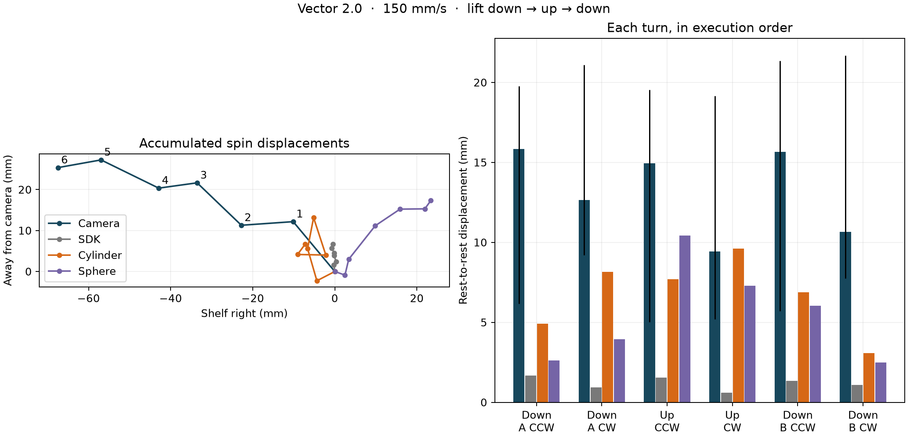

# Six camera-tracked spins with the lift down, up and down again

P2Y8 moved about **66 mm left and 26 mm away from the camera** between its first and final resting poses. The middle, raised-lift pair still drifted left. Both 42 mm contact models sent that pair **right**. The discrepancy survives comparing pairs, where the robot returns roughly to its starting orientation and optical lever-arm errors largely cancel.

[Upright shelf-camera clip, with the observed and predicted endpoints projected onto the shelf after each turn](six-spins.mp4) · [Signed vectors in millimeters](by-turn.csv)

| Spin | Camera displacement (mm) | SDK (mm) | 42 mm cylinders (mm) | 42 mm spheres (mm) |
|---|---:|---:|---:|---:|
| Down A CCW | 15.8 | 1.7 | 4.9 | 2.6 |
| Down A CW | 12.7 | 0.9 | 8.2 | 4.0 |
| Up CCW | 15.0 | 1.5 | 7.7 | 10.4 |
| Up CW | 9.4 | 0.6 | 9.6 | 7.3 |
| Down B CCW | 15.7 | 1.4 | 6.9 | 6.0 |
| Down B CW | 10.7 | 1.1 | 3.1 | 2.5 |

| Net shelf-left drift per CCW/CW pair (mm) | Camera | SDK | Cylinders | Spheres |
|---|---:|---:|---:|---:|
| Down A | 22.8 | −0.3 | 6.6 | −3.4 |
| Up | 20.1 | 0.5 | −4.5 | −12.5 |
| Down B | 24.6 | 0.3 | 5.1 | −7.5 |

The cylinder model comes within 0.2 mm of the distance on the raised CW turn while missing its direction. The optical pair distances, including the away component, are 25.4, 22.1 and 25.1 mm. The sensitivity ranges overlap. The experiment has one raised pair, and P2Y8 sampled a different part of the shelf with each spin. It establishes persistent shelf-left drift across both postures. It does not isolate a lift effect or distinguish a surface bias from a chassis bias.

## Trial and replay

CPCS controlled the physical robot. Head angle was −0.4° throughout the spins. Median lift heights were 30.6, 90.3 and 31.7 mm in A/B/A order. Each pair comprised a 3 s CCW and a 3 s CW command at equal and opposite 150 mm/s wheel speeds. CPCS measured second-half gyro magnitudes of 205.2 / 200.9, 206.5 / 204.4 and 206.2 / 203.4 °/s for the three pairs. The changes with the lift raised were comparable to the differences between the two down repeats. After the final spin, the robot returned to its charger. Robot telemetry confirmed charging and quiet mode active, and the Home Assistant quiet switch read on.

Each model replay uses the same recorded left/right speeds from 0.4 s before the command through 1 s after stop. Each spin starts settled at its measured head and lift posture. Both use the existing Vector 2.0 physical axles and 42 mm effective span. Cylinder integration uses 1 ms steps and sphere integration uses 0.125 ms steps. SDK and simulated displacement refer to the point 25 mm behind the front axle. The only optical input to each replay's placement on the plot is the starting heading. Each vector starts at zero before summing the six vectors in shelf coordinates. This omits small apparent movements in the pauses, which explains the difference between the accumulated camera vector (67.5 mm left, 25.4 mm away) and the first-to-last optical measurement. There was no fit to the six endpoint displacements.

## Optical measurement and limitations

The external recorder ran from before undocking through dock confirmation. Frames were rotated 180° and timestamped at the midpoint of the host's image request. The recording's UTC begin marker tied those times to the SDK commands. Around the spins the median interval between frame requests was 112 ms and the maximum gap was 174 ms. Endpoint picks use resting frames targeted 0.35 s before each command and 0.9 s after each stop. The clip resamples at 10 fps for viewing.

A fresh image of the uncovered 46 mm dock glyph provided four corners, with the front ramp midpoint providing a fifth reference off the glyph plane. Two shelf-edge constraints and a focal-length prior regularized the equidistant camera fit. The dock reprojection RMS was 1.84 px per point. The stationary glyph matched at the same whole-pixel location before and after the spins. [Dock dimensions in the firmware](https://github.com/kercre123/victor/blob/669ec7499a7084640b57706a7937884a6568be50/engine/charger.h#L101-L115)

The forward lit backpack window supplies a body-fixed mark, modeled at 65.5 mm above the shelf and 17.3 mm behind the drive center. For rear views the line to a second window gives forward direction. For front views the two eyes supply the transverse direction. Where the head hides the backpack light, the eye midpoint supplies position using an optical offset estimated from the two distinct front poses with both features visible. Eye rays use a nominal height of 56 mm. Optical reconstruction uses no wheel, gyro or SDK pose data. Tracking the eye midpoint alone between the nearly front-facing endpoints of each pair also gives leftward movement in all three pairs (14.9, 26.0 and 19.4 mm). Headings differ slightly across these paired views, so that check measures a different physical point.

Black bars on the plot show the central 90% of 200 sensitivity runs varying dock, shelf and body landmark picks, feature heights, focal prior and lever arm. These are conditional sensitivity results. Pair distances span 22.4–29.4, 16.6–28.0 and 21.4–29.8 mm. Individual opposite-facing endpoint differences are more sensitive to landmark geometry than pair totals. Dropping the shelf constraints and using focal priors of 450 and 720 px gives 79–92 mm of first-to-last leftward movement. Absolute scale depends on the oblique camera calibration.

Run `python replay_lift_camera.py` and `python plot_lift_camera.py` from the repository root to regenerate the replay vectors and figure. [Input telemetry](turns.json) · [Resting optical picks](picks.csv) · [Model-frame displacements](replays.csv)
