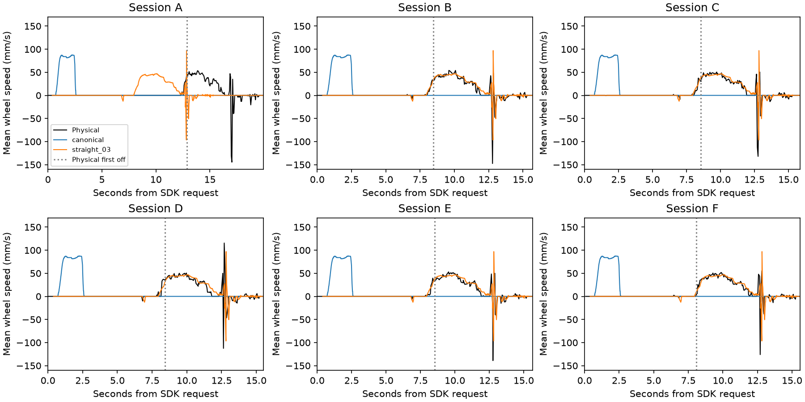

# Predicting native undock from the SDK request

The standalone simulator action drives 105 mm at 85 mm/s. On the stock robot the SDK instead delegates to DriveOffChargerStraight under both SDK control levels. Its first straight cue triggers a lift-safe animation. The group selects among two Default clips, one HighStim clip and one LowStim clip. A procedural straight drive is available on a subsequent attempt. The LowStim body timeline includes a 46 mm/s segment beginning 7.854 s into the clip and lasting 1.782 s. [SDK dispatch](https://github.com/os-vector/wire-os-victor/blob/3cec4844d24c4719b5b3892e4979494bcd260424/engine/aiComponent/behaviorComponent/behaviors/sdkBehaviors/behaviorSDKInterface.cpp#L399-L402) · [SDK override behavior](https://github.com/os-vector/wire-os-victor/blob/3cec4844d24c4719b5b3892e4979494bcd260424/resources/config/engine/behaviorComponent/behaviors/victorBehaviorTree/sdkBehaviors/SDKOverrideAll.json) · [Straight and fallback dispatch](https://github.com/os-vector/wire-os-victor/blob/3cec4844d24c4719b5b3892e4979494bcd260424/engine/aiComponent/behaviorComponent/behaviors/basicWorldInteractions/behaviorDriveOffCharger.cpp#L235-L266) · [Mood group](https://github.com/os-vector/wire-os-externals/blob/6aec7f1ddf341a898692768650fe945e334fb865/animation-assets/animationGroups/ChargerDocking/ag_chargerdocking_comeoff_straight.json)

## Physical test

All six shelf recordings contain the SDK request time, action completion, wheel reports, posture and physical charger flag. We ran the normal simulator command and all four stock motor tracks on the Vector 2.0 shelf model, starting in the normal seated pose with session B's initial head and lift. The wheel observations serve only for scoring and for choosing a clip and dispatch delay on A–C. The held-out D–F predictions receive no recorded wheels, joint trajectory, motion onset, or charger flag.

Minimizing mean whole-action left/right wheel RMSE across A–C picked the LowStim straight_03 track and a common 0.40 s delay. Each candidate could choose its own common delay from 0 to 1 s. The old action's best delay was 0.50 s.

| D–F average | Normal simulated undock | Frozen LowStim replay |
|---|---:|---:|
| Both-wheel RMSE, entire physical action | 37.98 mm/s | 21.54 mm/s |
| Both-wheel RMSE within 1 s either side of physical first off | 30.23 mm/s | 5.77 mm/s |
| Mean signed first-off timing error | 7.27 s early | 0.26 s late |



The plot shows signed mean wheel speed; the scores use both wheels individually, including differential motion. The reference action had already finished driving by the physical release window. Predicted first-off errors on D, E and F were +0.17, +0.09 and +0.53 s for the frozen candidate. In A, the same prediction was 4.25 s early. A post-hoc delay of 4.65 s for LowStim gives the lowest whole-action wheel error for A among the four clips with delays searched to 6 s. This does not establish why the delay occurred.

An independent diagnostic selected the clip and phase from only the first six seconds of observed head/lift motion. It minimized squared joint errors normalized to 67° and 60 mm. It selected LowStim for B–F, including all three reserved runs, and a different clip for A which poorly predicted its wheels. The selected clip names are inferences because the SDK captures did not record the active animation or mood. [Head/lift diagnostic](posture.csv) · [All clip and normal action scores](scores.csv)

The experiment decodes timed stock body, head and lift keyframes. Straight and arc speeds drive the normal wheel commands. For point turns the runner approximates angular speed with differential wheel targets using the firmware's 46 mm nominal track width. Head targets use the simulator servo and lift targets use their source durations. Stream scheduling, closed-loop stock point turns, exact servo interpolation, the on-treads activation gate and mood selection remain incomplete. The 0.40 s fitted shift absorbs both dispatch and simulation timing error. These limitations matter for the later part of the animation and for promoting a behavior to the canonical runtime. [Stock keyframe conversion](https://github.com/os-vector/wire-os-victor/blob/3cec4844d24c4719b5b3892e4979494bcd260424/cannedAnimLib/baseTypes/keyframe.cpp#L928-L994) · [Curvature drive](https://github.com/os-vector/wire-os-victor/blob/3cec4844d24c4719b5b3892e4979494bcd260424/robot/supervisor/src/steeringController.cpp#L883-L950)

Run from this directory with the web test dependencies and Python with NumPy and Matplotlib. The animation archives are read in memory and only temporary local files are needed.

```sh
base=https://raw.githubusercontent.com/os-vector/wire-os-externals/6aec7f1ddf341a898692768650fe945e334fb865/animation-assets/animations
for clip in comeoff_01 comeoff_binaryeyes_01; do
  curl -fsSL "$base/anim_chargerdocking_${clip}.tar" -o "/tmp/vector-${clip}.tar"
done
python extract.py /tmp/vector-comeoff_01.tar /tmp/vector-comeoff_binaryeyes_01.tar > /tmp/native-clips.json
node replay.mjs 34.52458608090514 31.999989 < /tmp/native-clips.json > predictions.csv
python compare.py
python posture.py
```
\n[Late turn controller, support contacts and held-out gyro overlays](late-turns.md)
\n[Ramp exit contact tests and physical overlays](ramp-support.md)
\n[Measured wheel waveform and gyro transfer](wheel-transfer.md)
\n[Wheel encoder direction and sub-frame timing](encoder-clock.md)
