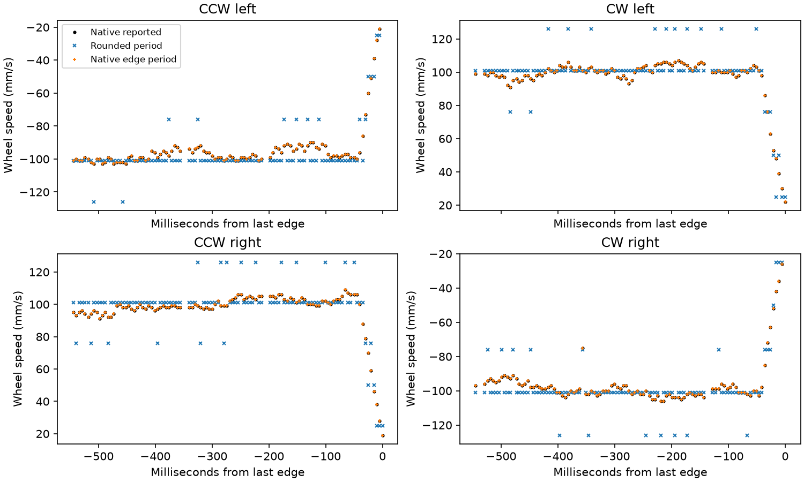

# Wheel direction and timing at the encoder edge

Four physical 100 mm/s stops provide 834 fresh wheel observations across both sides and directions, counting only adjacent native body frames. Every recorded edge period falls between multiples of 5 ms. The stock conversion of the recorded delta and period reproduces every reported integer wheel speed exactly. Rounding each physical edge period to the nearest nonzero multiple of 5 ms gives a mean absolute error of 4.9–6.7 mm/s across the eight wheel/run groups. This clock comparison uses the observed edge counts and timestamps and does not independently predict shaft motion.

The WireOS body now interpolates the last optical crossing within the physics tick and quantizes its timestamp to the 48 MHz SysTick clock shifted by eight bits. A fresh crossing is signed by motor duty. The delta and period remain latched between edges. On the 26th idle body frame the delta clears and the period remains available. In the physical stop records, 664 post-stop wheel observations retained a nonzero period with zero delta. Linear within-frame motion approximates the shaft path; multiple direction changes within one 5 ms frame remain unresolved.

The Python and browser simulators also latch the SDK wheel-speed sign on a fresh edge using the motor drive that produced that interval. A direction request arriving between edges previously could relabel an already measured speed. The WireOS regression exercises both channels through two edges in a frame, a direction change during coasting, and 26 frames at rest. The physical stops validate the clock arithmetic and period retention; their data do not include motor duty during an active reversal.

Replaying the same late-undock clip on D/E/F confirms this correction alone does not recover the missing gyro waveform. With fixed supports gyro RMSE stayed at 61.1/62.3/62.1 °/s. With driven supports it shifted from 57.0/50.4/62.3 to 59.2/48.4/65.3 °/s. These results use the complete late window from the support comparison.

Run `python encoder-clock.py` in this directory with NumPy and Matplotlib. Raw data are in [the native stop capture](../hw-rec-20261119/unit2-native-stops.csv). Firmware references are [edge interrupts](https://github.com/os-vector/wire-os-victor/blob/3cec4844d24c4719b5b3892e4979494bcd260424/robot/syscon/src/encoders.cpp#L265-L278), [encoder payload](https://github.com/os-vector/wire-os-victor/blob/3cec4844d24c4719b5b3892e4979494bcd260424/robot/syscon/src/motors.cpp#L114-L143), [direction hysteresis](https://github.com/os-vector/wire-os-victor/blob/3cec4844d24c4719b5b3892e4979494bcd260424/robot/syscon/src/motors.cpp#L243-L296), and [HAL speed conversion](https://github.com/os-vector/wire-os-victor/blob/3cec4844d24c4719b5b3892e4979494bcd260424/robot/hal/src/hal_motors.cpp#L126-L154).
