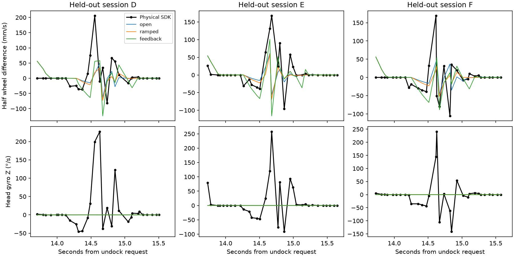

# Late undock turns on the shelf

At clip time 14.0 s the canonical shelf replay puts the chassis against the shelf and both rear tipping supports against the dock apron. No wheel geom appears in the contact list. The cube contacts only the shelf. The three steering variants produce different wheel speeds but essentially stationary chassis yaw. This support configuration is a simulation finding. The physical gyro establishes that the robot rotated, but the SDK records alone cannot identify which supports touched the physical dock.



All three D–F recordings use the previously selected straight_03 clip with the same 0.40 s start offset. The open approximation, acceleration ramp with hardware slip feedforward, and ramp with speed feedback were evaluated at the original SDK sample times from 13.7 s to action completion or 16 s, whichever came first. Adding feedback raises mean half-wheel-difference RMSE from 47.9 to 52.8 mm/s. The gyro RMS error stays at 61–62.4 °/s on each run. The steering change stays experimental. Correcting the ramp exit and verifying wheel support against physical travel should precede another gain comparison.

The 5 ms approximation seeds a new point turn from head-Z gyro divided by the cosine of the head angle. It applies a 50 rad/s² ramp, hardware slip factor 1.5, nominal 23 mm half-width, and source-default feedback gains. The stock robot-frame filter and animation scheduler are approximations. [Stock controller](https://github.com/os-vector/wire-os-victor/blob/3cec4844d24c4719b5b3892e4979494bcd260424/robot/supervisor/src/steeringController.cpp#L712-L875)

Using the animation JSON from the parent README, run the following in this directory.

```sh
node replay.mjs 34.52458608090514 31.999989 --turns < /tmp/native-clips.json > turns.csv 2>contacts.txt
python turns.py
```

The independent workshop-rest.csv records a stationary workshop robot with no behavior control. Its dock flag persisted and the battery service reported charging inactive at the end. It is an additional resting sensor sample, outside the shelf turn comparison.
