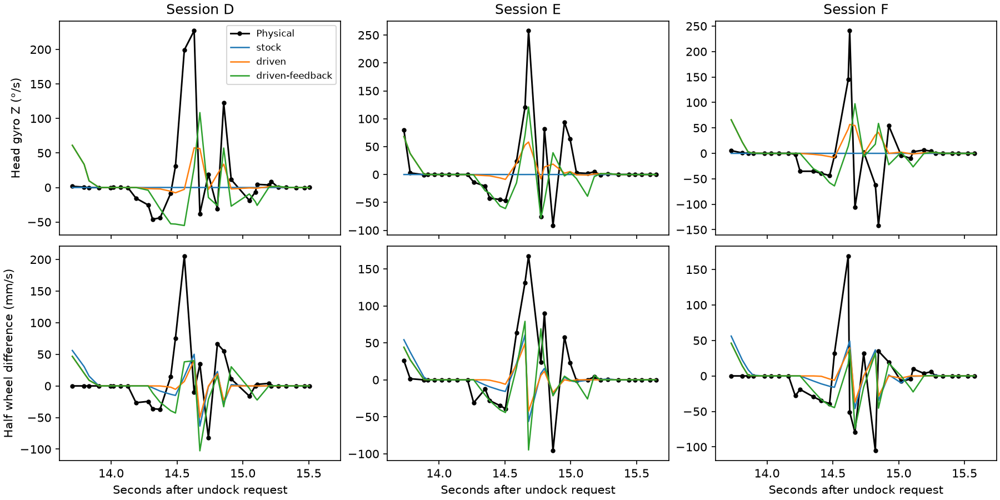

# Which contacts prevent the simulated ramp exit?

Changing the mapped shelf into a single coplanar box or an infinite plane reproduced the stalled wheel and gyro traces to the precision of the reported scores. The decisive interaction in this replay was between the body-fixed rear tread supports on the apron and the underside of the chassis on the shelf. Disabling either contact allowed the wheels to regain support. Raising the chassis collision box's bottom face by just 0.25 mm also released the robot. This is a sensitivity test of the contact geometry, not a measurement of the underside.

The physical tread wraps around the rear axle and moves under load. Enabling the simulator's existing geared tip supports restores wheel contact at every 100 ms inspection in the late scoring window on D–F. With the same clip, dispatch time and wheel controller, the first electrical release time stayed identical. Wheel-speed RMS error in the two seconds around release changed by less than 0.01 mm/s on every trial.

| Late gyro Z RMSE (°/s) | D | E | F |
|---|---:|---:|---:|
| Fixed supports | 61.1 | 62.3 | 62.1 |
| Driven supports | 57.0 | 50.4 | 62.3 |
| Driven supports with stock-like speed feedback | 69.3 | 47.1 | 72.2 |



These are three repeats on one robot. The scoring uses physical receipt times, the straight_03 clip and the frozen +0.40 s alignment. D–F were held out of clip and offset selection and had already been inspected for the support failure. The ramp-exit improvement therefore needs independent confirmation. The physical SDK traces do not measure the load on each tread. Neither the gain change nor the 0.25 mm clearance change has been promoted. Geared supports also affect wheelstands in prior experiments. [Wheelstand comparison](../unit3-wheelstand/reproduction/README.md)

Reproduce from this directory with the stock animation JSON described in the parent README. The diagnostics write temporary MJCF and timed contact dumps. Wheel support means at least one named wheel geom was in the contact list at that inspection.

```sh
d=$(mktemp -d)
python support-scenes.py "$d"
for mode in stock box plane rear-free belly-free clearance driven driven-feedback; do
  geom=$mode
  controller=open
  if [ "$mode" = driven-feedback ]; then
    geom=driven
    controller=feedback
  fi
  node replay.mjs 34.52458608090514 31.999989 --turns --scene="$d/$geom.xml" --controller="$controller" < /tmp/native-clips.json > "$d/$mode.csv" 2> "$d/$mode.contacts"
done
python support-score.py "$d"
```
