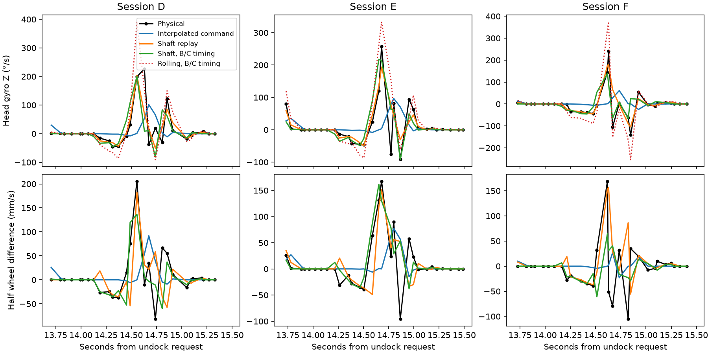

# Late undock turns driven by the measured wheel waveform

What gyro response can the simulator produce if it receives the physical robot's wheel reports throughout the undock? Five SDK recordings drive the same shelf scene from first report to last undock report. The head and lift follow the previously identified animation at the frozen +0.40 s offset. Wheel inputs are already in receipt time. Their simulation clock receives no clip offset.



| Driven supports, gyro RMSE (°/s) | D | E | F |
|---|---:|---:|---:|
| Interpolated speed as a new wheel command | 64.8 | 71.0 | 67.9 |
| Same command bypassing the wheel queue | 47.9 | 60.9 | 53.7 |
| Interpolated speed at the shaft | 37.1 | 36.1 | 36.2 |
| Shaft, with +35 ms from B/C | 55.6 | 37.9 | 44.8 |

The queue accounts for part of the error. With identical interpolated inputs, driving the shafts recovers gyro peaks of 180–203 °/s against physical peaks of 227–258 °/s. The fixed-support shaft control scores 36.0, 38.8 and 36.1 °/s respectively. Under recorded wheel drive the gyro error is therefore much less sensitive to the support choice than to the input path. A +35 ms advance helped on average in B/C but worsened all three evaluation sessions. No timing correction or friction adjustment was applied to the canonical runtime.

The CSV compares two support geometries and five input paths. A wheel command passes the reports through the simulator's command queue and wheel controller. The immediate-command control bypasses only the 75 ms wheel queue. The shaft replay instead uses a torque-limited velocity actuator on each front wheel hinge and retains the solver, tread coupling, body dynamics and simulated sensors. All modes start from the same nominal dock seat with each run's first measured head and lift posture. The held and linearly interpolated input modes distinguish motor dynamics from how a roughly 60 ms SDK stream is reconstructed. Interpolation uses the following sample and applies only to offline replay.

Sessions B/C supply a single timing offset chosen by mean per-run gyro RMSE over ±150 ms in 5 ms steps. Sessions D–F are scored with that offset and again with the clocks left as recorded. Positive offsets read the simulated gyro later. The scoring window begins at 13.7 s and ends 150 ms before the last undock report (or at 16 s, whichever comes first) so every tested alignment has data. All metrics use the physical SDK sample times. A rolling comparison uses instantaneous wheel-speed difference divided by 46 mm lateral track spacing and projects yaw onto the head gyro's Z axis.

The median physical receipt interval in the evaluation windows was 56–59 ms, with gaps as long as 104–138 ms across these late sequences. Individual brief motor commands can fall between reports. The wheel input is a reported speed estimate, not a direct measurement of continuous shaft velocity. The peak and timing comparisons cannot uniquely identify tread friction, a sensor delay or a motor gain.

Reproduce using the animation JSON from the parent README.

```sh
d=$(mktemp -d)
python support-scenes.py "$d"
python wheel-input.py > "$d/input.json"
for scene in driven stock; do
  node wheel-transfer.mjs "$d/$scene.xml" /tmp/native-clips.json < "$d/input.json" > "$d/$scene.transfer"
done
python wheel-transfer.py "$d"
```
