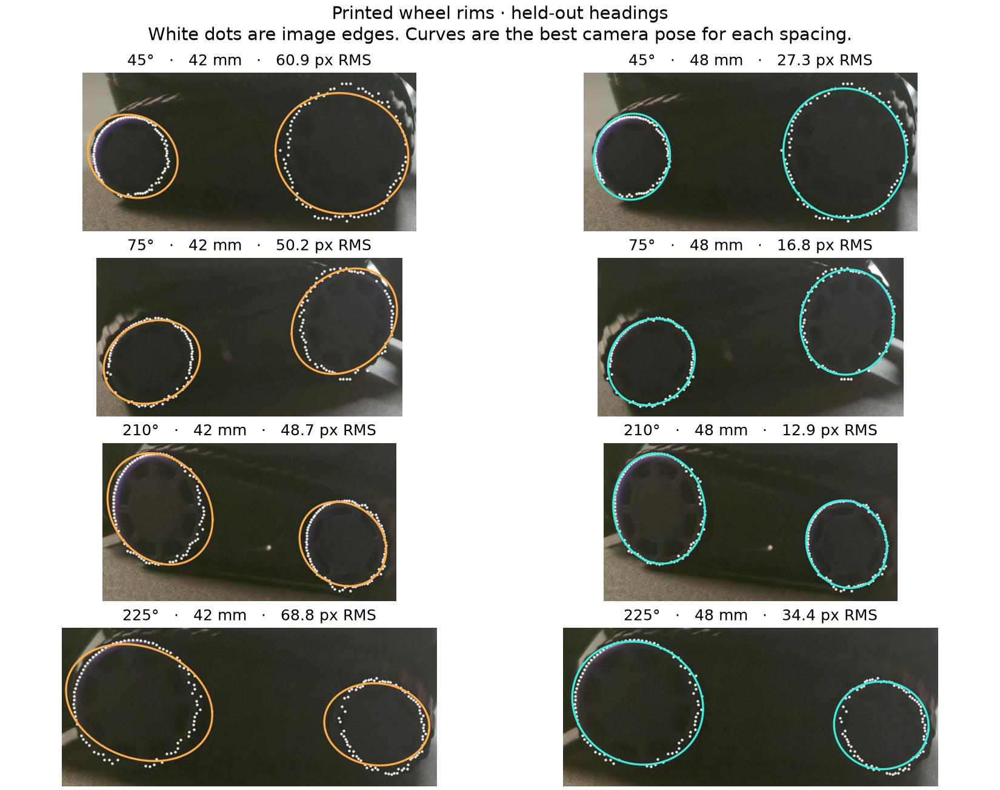
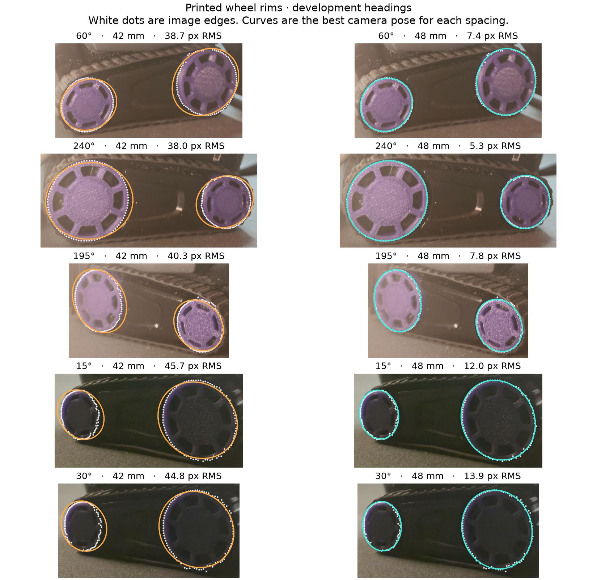

# Front-to-rear hub spacing from unit 3’s printed cap rims

**48 mm fits better than 42 mm in all nine full-resolution side views.** Five development headings gave a median free estimate of 48.27 mm. With the extraction and fitting procedure fixed, median rim error on four additional headings was **22.0 native pixels at 48 mm**, versus **55.6 at 42 mm**. These results support retaining the released 48 mm longitudinal axle spacing. The 42 mm lateral contact span used in turn replay measures a different dimension.

| Held-out orbit heading | Free longitudinal span | Rim RMS at 42 mm | Rim RMS at 48 mm |
|---:|---:|---:|---:|
| 45° | 50.79 mm | 60.9 px | 27.3 px |
| 75° | 48.57 mm | 50.2 px | 16.8 px |
| 210° | 49.15 mm | 48.7 px | 12.9 px |
| 225° | 52.63 mm | 68.8 px | 34.4 px |

## Scale and camera model

Dauler's stock-pattern and spoke-pattern meshes both have outer diameters of 26.00 mm front and 18.50 mm rear. The flat face inside the outer bevel measures 25.50 and 18.00 mm. These measurements come from the transverse extents and vertex radii of the archived binary STL files. The installed print scale and seating depth have not been measured with calipers. [Anki Vector Wheels v2, Dauler](https://www.thingiverse.com/thing:3764077)

Each fit uses the photographed purple front and rear rims on one side. No shelf plane, dock size, ruler, odometry or previous hub coordinates enter the metric fit. Two coplanar circles have the STL radii and center distance equal to the hypotenuse of longitudinal spacing and 3.75 mm axle-height difference. The latter comes from the released wheel radii. A six-parameter rigid pose projects both circles into the 8160 × 6120 Flip main-camera image. Each hypothesis gets its own best pose at every heading. Nominal orbit headings label the exposures only. [Released axle geometry](https://github.com/digital-dream-labs/vector/blob/main/simulator/protos/CozmoBot2.proto#L27-L30)

The manually initialized bounds identify each purple rim. Up to 96 evenly spaced radial searches per cap use local purple-to-background contrast and a weaker brightness gradient at native resolution. Two ellipse-fitting passes update the search direction. Low-contrast and search-boundary hits are dropped. The white points are the retained observations. We score the first-order distance normal to each projected conic in native pixels. Display crops are brightened and reduced after measurement. The rectilinear camera model uses the main-lens focal prior and centered principal point on the phone’s processed JPEGs.

## How precisely does this locate the axles?

The brighter opposing 60° and 240° photos give free estimates of **47.48 and 48.27 mm**. Across all nine, the free estimates extend to **52.63 mm**. The 225° overlay shows where extraction wanders across the dim rim, and this view gives the largest residual even with free spacing. A change of ±5% in focal length moved the four held-out free estimates by less than 0.08 mm. Fitting the narrower face diameters instead of the outer rims lowered them by 1.0–1.3 mm. Unmeasured print scale, unequal cap seating, bevel selection and dark edges limit absolute accuracy. The roughly 42 mm result from the earlier dock reconstruction does not transfer to this same-plane test. The images alone cannot identify a unique fault in that earlier calibration.

Run `python fit.py` with NumPy and SciPy to reproduce both fixed-hypothesis errors and free spans from [native edge coordinates](edges.json). The [score table](scores.csv) includes SHA-256 hashes of the original photos, retained edge counts and sensitivity runs. Heading labels 15°, 60°, 195° and 240° use supplementary main-lens exposures. The other five are first-pass exposures.
