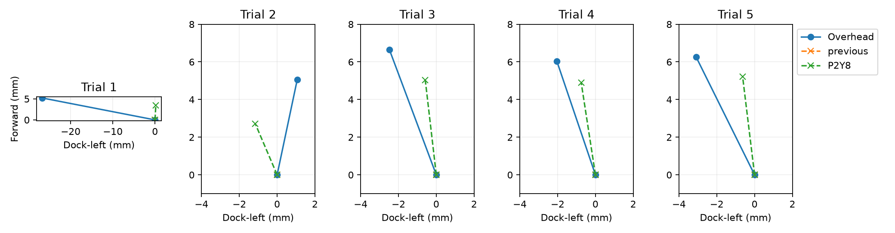
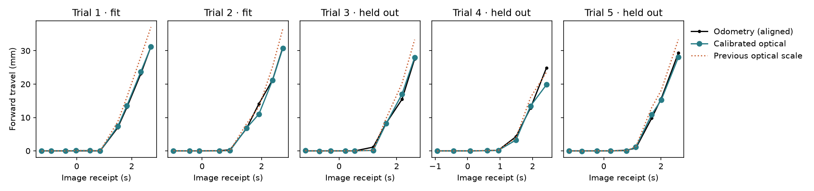

# P2Y8 camera scale and first contact

GetCameraConfig on the same P2Y8 that made the recordings returned focal lengths of 406.314453 and 405.335419 pixels and a principal point of (404.559357, 295.485). Its reported field of view is 89.102623° by 73.0123444°. The captured JPEGs are 800 × 600. The earlier cube depth estimate used a focal length of 537 pixels and a centered principal point. Substituting the robot-reported values moved the initial cube center 22.6–23.8 mm closer across five approaches. This used no final cube positions or overhead-camera data.

| Trial | Physical travel (mm) | Onboard + odometry 2D error (mm) | Simulated travel (mm) | Simulation 2D error (mm) |
|---|---:|---:|---:|---:|
| 1 | 27.23 | 3.65 | 3.48 | 26.98 |
| 2 | 5.16 | 0.36 | 2.96 | 3.22 |
| 3 | 7.09 | 0.52 | 5.06 | 2.49 |
| 4 | 6.37 | 0.17 | 4.96 | 1.71 |
| 5 | 7.00 | 0.56 | 5.25 | 2.68 |

All five simulated forks now contact the cube. The earlier RGB pose had five misses. Physics, printed-marker dimensions and measured fork path were held fixed. The simulation still underpredicts lateral travel, especially trial 1 where the physical cube swept 26.72 mm to the right during the lift. The nominal fork, ideal level wrist, pinhole approximation and missing arm/chassis contacts still limit attribution. In the independent 18 mm retreat with a stationary cube, camera-plus-odometry apparent travel fell from 4.42 mm to 0.94 mm with both versions using the same head-dependent mount transform. Overhead measured 0.06 mm.

## Independent scale check

The fork progressively obscures the lower marker corners. Optical flow on features along the upper printed edge tracked the apparent width during approach. Per-frame coordinates and capture and host-receipt timestamps are in edges.csv. The overhead track stayed within 1 mm of its starting position through the 2.75 s window. Fitting an effective width-to-travel scale and relative host clock alignment on trials 1–2 gave 10,380 pixel·mm and 0.232 s. Held-out trials 3–5 had travel RMS errors of 0.94, 3.00 and 0.89 mm, versus 2.79, 5.11 and 2.59 mm with the original scale and receipt timing. These sparse moving samples couple timing, perspective and scale. The fitted scale is a diagnostic. The contact results use P2Y8's independently reported camera parameters and Anki's nominal 23 mm marker. [Anki block definition](https://github.com/kercre123/victor/blob/669ec7499a7084640b57706a7937884a6568be50/engine/BlockDefinitions.h#L3-L12)

## Reproduction

From this directory run `python scale.py`, `python contact.py 10379.5644` and `python endpoints.py` with the dependencies listed in the contact replay. The first argument to contact.py sets the optical scale for two sensitivity checks. The P2Y8 result always reads the checked-in camera profile. The Python Vector 2 model now builds the head camera at this stream resolution and vertical field of view. The web optics exporter can construct the matching off-axis camera block from the Vector 2 parameters. The default web scene still selects Vector 1. The calibration RPC exposed no distortion coefficients. These measurements cover the shelf and this individual robot.
