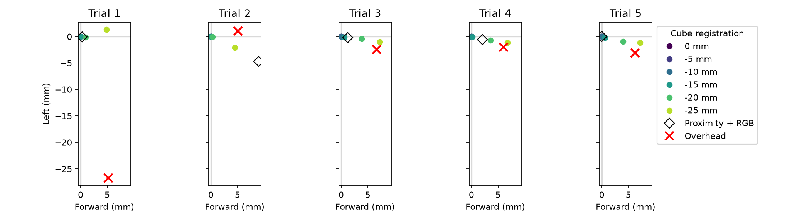

# Does the simulated fork reach the cube?

Five shelf push–lift–lower–withdraw cycles with P2Y8. The independently tracked cube moved in all five. Replaying measured chassis odometry, yaw and lift with the contact model and the initial onboard RGB pose produced zero fork contacts across all five. Friction cannot explain a miss before first contact.

The red cross is the settled overhead displacement in dock-forward and dock-left coordinates. Colored dots move the initial cube position towards the robot along its starting heading by the indicated distance. This sweep tests sensitivity. Its offsets are not measurements. The black diamond uses the independent initial proximity reading for depth with the same RGB-based lateral position and orientation.

| Trial | Measured travel (mm) | Proximity depth adjustment (mm) | Proximity replay travel (mm) | 2D error (mm) |
|---|---:|---:|---:|---:|
| 1 | 27.23 | −18.96 | 0.29 | 27.11 |
| 2 | 5.16 | −30.07 | 10.13 | 6.97 |
| 3 | 7.09 | −16.00 | 1.25 | 5.87 |
| 4 | 6.37 | −17.72 | 2.15 | 4.23 |
| 5 | 7.00 | −13.93 | 0.00 | 7.00 |

The range-based initialization gave contact in four trials. A common 25 mm shift produced net travel within about 1 mm of the measured magnitude in trials 2–5, but retained vector errors of 1.13–3.21 mm and missed the 27 mm sideways sweep on trial 1. The contact outcome depends on registration, the fork geometry, and how the fore–aft pose of the camera relates to the printed fork. These results alone cannot identify a correction to any one of those quantities.

## Replay

Run `python replay.py ../p2y8-paired-cube-push` from this directory with NumPy, OpenCV, matplotlib and MuJoCo. inputs.csv contains timestamped telemetry relative to the initial camera endpoint. The paired measurement directory supplies initial marker corners and independent overhead endpoints. No final measured cube pose is used as an input. The CSV identifies which rows use proximity, includes the tested fore–aft shift, and records fork contact separately from final displacement.

The free 44 mm cube uses the existing 50 g assumption, compound collision geometry and rubber corner patches. A kinematically driven fork follows the recorded chassis and lift trajectory with the 66 mm level-wrist linkage. This isolates the fork and free cube from drivetrain errors. It omits incidental chassis or arm contact, chassis pitch and printed-fork flex. Initial yaw and lateral position use the 23 mm front marker, 537 px effective focal length, nominal camera principal point and firmware neck/camera transform at the recorded head angle. The proximity variant assumes the median settled reading in the first 0.7 seconds came from the center ray striking the near face. The real sensor integrates over a cone. The 5 mm increment sweep and proximity variant use identical contact parameters. No simulated sensor accuracy or hardwood transfer is established by this replay.
