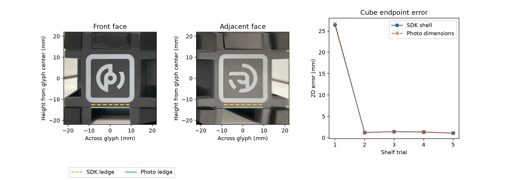

# Does the lower cube ledge explain the sideways lift?

Two faces of Sat’s rubber-corner cube photo were independently rectified using the nominal 23 mm printed glyph. The lower rim is about 13.9 mm below glyph center. The five onboard standoff views put the front rim 13.8–14.1 mm below center. These are image estimates conditional on glyph scale and approximate coplanarity. The SDK-derived collision boxes put this rim 12.55 mm below center. The front view also suggests an approximately 18 mm opening between the feet and a 28 mm center panel. The pocket depth is less well constrained.

We replayed the same five shelf push/lift cycles with seven collision profiles. They use the original shell, the ledge change alone, narrower foot opening alone, wider center panel alone, all three together, or all three with the added material extending 1.5 or 6.5 mm into the cube instead of 3.25 mm. Applying the face dimensions symmetrically to all four sides is an assumption. Each run uses the same registered fork, measured motion, initial pose, mass, and contact parameters as the printed-fork comparison.

Trial 1's endpoint error was 26.43 mm originally and 26.75 mm with all three dimensions changed. Across all seven profiles it ranged from 26.43 to 26.84 mm. The small change in predicted position cannot account for the observed 26.72 mm sideways sweep. This experiment does not identify what caught the fork. The default collision model remains at its previously tested settings.

[All 35 outcomes](scores.csv) · [Fork registration and baseline XML preparation](../p2y8-printed-fork-contact/) · [Physical camera comparison](../p2y8-cube-camera-scale/)

To reproduce, run python compare.py REPO_PATH REGISTERED_FORK_XML from an environment with MuJoCo and NumPy. Generated profile XMLs are written alongside the script. Keep any relative mesh dependencies resolvable there.
