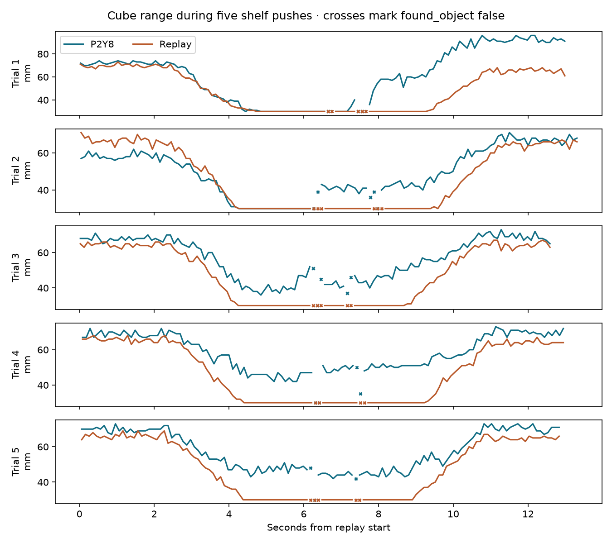

# Can the shelf replay predict the distance that P2Y8 reports?

The 19-ray production proximity model observes the simulated free cube and shelf in each printed-fork replay. Each replay starts from the camera-derived cube location and overhead-derived yaw and follows the measured chassis and lift trajectory. The chassis is assumed level. The stateful sensor runs at the configured state period with a fixed noise seed per trial. Each SDK row is compared with the most recent simulated sample. There is no time alignment fitted to the range data.

| Trial | Paired SDK rows | Both report a target | Mean absolute range error on those rows | Found flag agreement |
|---|---:|---:|---:|---:|
| 1 | 130 | 125 | 13.54 mm | 100% |
| 2 | 133 | 126 | 6.50 mm | 97.7% |
| 3 | 126 | 121 | 8.73 mm | 100% |
| 4 | 129 | 124 | 11.15 mm | 98.4% |
| 5 | 128 | 123 | 9.59 mm | 98.4% |

The last three runs have 368 paired positive readings. The model reads short by 9.80 mm on average. As a diagnostic, the median physical minus simulated range in the first two runs is +2 mm. Adding that fixed offset on the last three lowers mean absolute error from 9.83 to 7.94 mm, with 31.5% within 5% of measured distance. Adjacent SDK samples are correlated. These are repeat trials in one session and the upper sensor flag agreement alone does not establish cube fidelity. The physical endpoints include cube motion the replay misses, so this does not isolate sensor calibration, initial placement, or material response. No global range bias was applied.

Run score.py with the repository path and the printed-fork fixture XML built as described in [the fork comparison](../p2y8-printed-fork-contact/). [Per-sample data](samples.csv)
