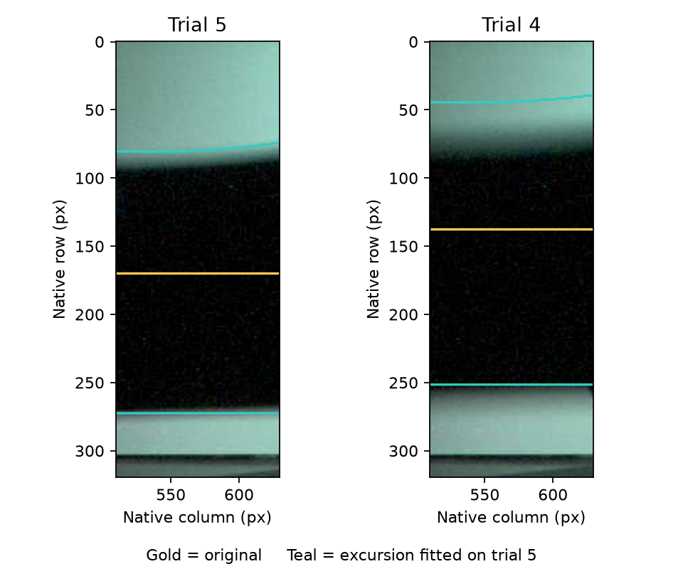

# Where the raised fork appears in P2Y8's camera

The physical fork's lower edge is at native image row 272 in trial 5 and 259 in trial 4. The original printed-fork replay projects it at rows 169 and 137. Trial 5's head and lift telemetry were constant for the preceding 400 ms. Trial 4 uses telemetry 230 ms before frame receipt; its lift changed by 1.97 mm across that window. The crop covers native columns 510–629. Edge measurements use the median intensity profile across columns 550–590. The SDK camera intrinsics, firmware neck transform, level wrist and registered forks7.stl define the projection. The exact installed fork STL is unconfirmed.

## Two independent checks

1. Fitting lift excursion above 32 mm using trial 5's lower edge gives a multiplier of 0.8533. That predicts row 251 on trial 4 (8 px error); the upper edge still visibly misses. When replayed with the same change, trial 1's cube travel error goes from 26.43 to 26.49 mm and its peak tilt from 2.29° to 2.21°. The four remaining endpoint errors all change by less than 0.04 mm. The camera fit supplies no evidence for changing the physical lift gain.
2. Independently, the orientation of the *stationary upright cube* constrains camera pitch relative to the shelf. Knowing the 23 mm glyph size, we solved its pose in ten settled views. In the original transform the glyph center is only 15.47–16.18 mm above the shelf. Using four picks from trials 1–2 gives a +5.16° pitch correction and a −0.52 mm camera height correction, assuming a centered glyph on a level, 44 mm cube. With both corrections frozen, the six picks in trials 3–5 yield 21.36–21.73 mm against 22 mm nominal. The same camera correction predicts the raised fork edge at rows 165 and 196 in trials 4 and 5, leaving errors of 94 and 76 px respectively.

The effective camera correction covers one head angle and includes chassis pitch relative to the shelf. All observations are from the same session. Distortion, a printed fork with different geometry, wrist pose and the head mount remain confounded. A second head angle or an independent side view with fork and rigid chassis landmarks would help distinguish them. The baseline physics and global camera mount remain unchanged.

Run geometry.py for the crop overlays, shelf.py for the stationary-cube and camera-only checks, and contact.py REPO_PATH REGISTERED_XML for the ten contact simulations. The fixture construction is documented in the adjacent printed-fork study.
