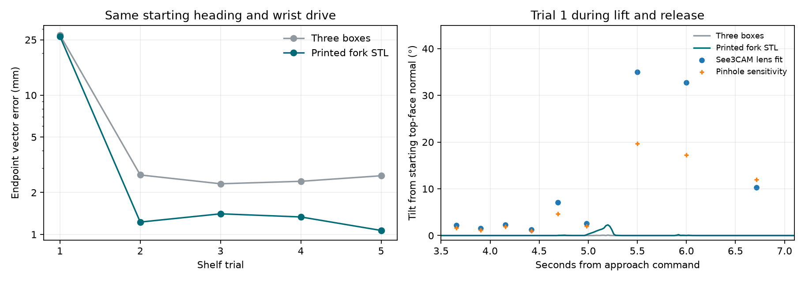
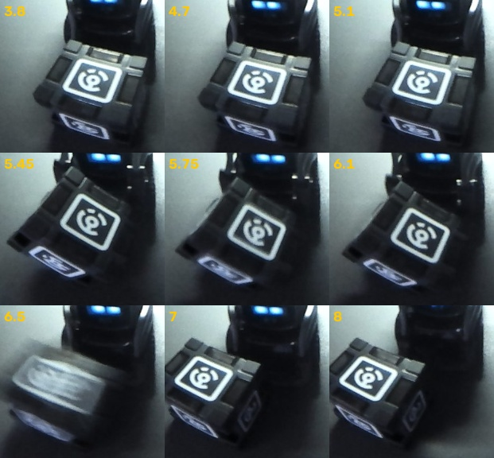
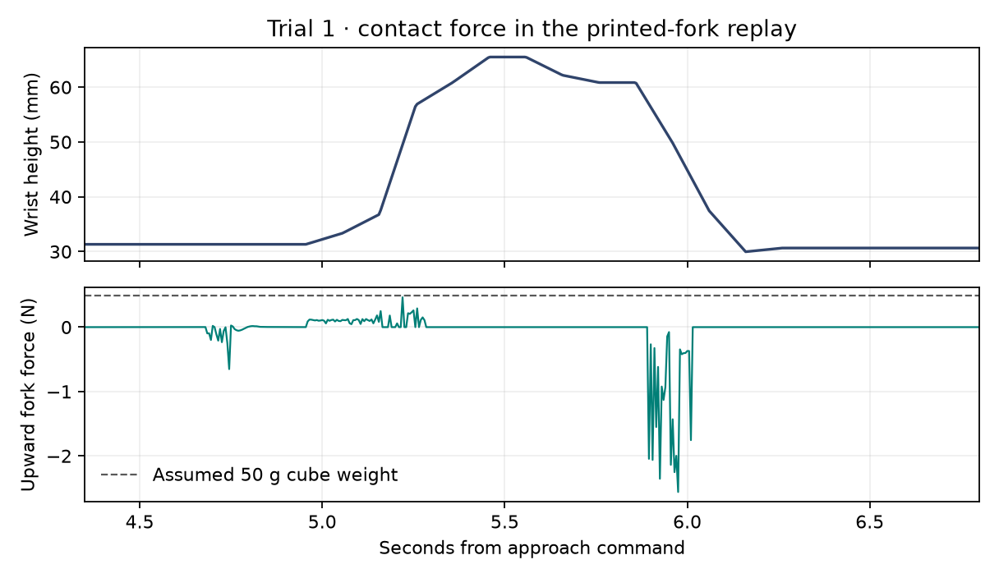
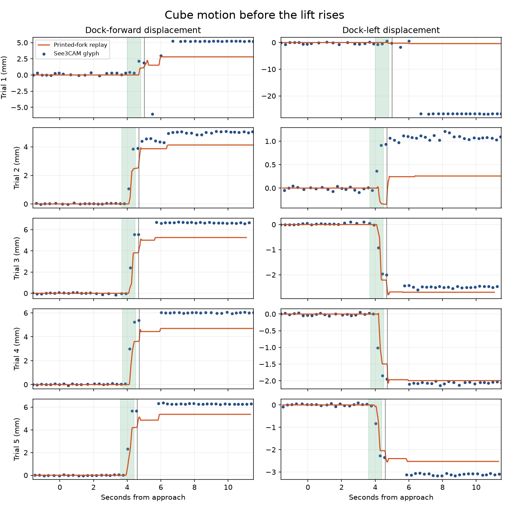
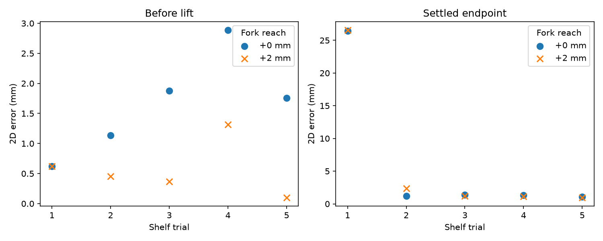

# What the printed fork changes in P2Y8's five cube trials

Replacing the three collision boxes with 58 convex parts from Dauler's forks7.stl roughly halved the mean endpoint vector error on trials 2–5, from 2.51 to 1.26 mm. Both runs used the same starting cube center from P2Y8's calibrated camera, starting heading from the overhead marker, recorded odometry and lift, and moving wrist driven by a stiff weld. No contact parameter was fitted. With onboard heading alone, the mean improved from 2.70 to 2.39 mm and two of those four individual trials worsened. The particular STL installed on P2Y8 has not been independently identified.

| Trial | Three boxes, error (mm) | Printed fork, error (mm) |
|---|---:|---:|
| 1 | 27.05 | 26.43 |
| 2 | 2.67 | 1.23 |
| 3 | 2.31 | 1.41 |
| 4 | 2.41 | 1.34 |
| 5 | 2.64 | 1.07 |



## Trial 1 tipped before it slid



At 5.45 s the cube was visibly tilted against the rising fork. At 6.5 s it was moving rapidly sideways. The top-marker normal changed by about 20° using a simple pinhole and about 35° using the fitted See3CAM lens. The two estimates quantify lens sensitivity, not a confidence interval. Height inferred from these frames is too sensitive to lens and edge errors to score. The other trials have gaps in the marker track at raised lift.

The printed fork tilted the simulated cube only 2.29° in trial 1. Its simulated contact force dropped to zero above 58 mm wrist height while the recorded lift kept rising past 65 mm. Simulated rightward travel was 0.40 mm; the real cube moved 26.72 mm right. The replay first diverges at engagement and retention, before the final slide. No real fork force was measured.



Across 48 initial placement combinations (two headings, fore–aft offsets −6/−3/0/+3 mm, lateral offsets −4/0/+4 mm and wrist height offsets −1.5/0 mm), the largest simulated tilt in trial 1 was 3.28°. Separately multiplying fork-to-cube sliding friction by four gave 3.35° in trial 1 and 10.06° in trial 4. The nominal split-contact control reproduced the original force-law endpoint results with cube-to-shelf friction held fixed. A universal grip increase is unsupported.

## Methods and reproduction

The overhead headings are derived from the rectified top marker at rest and expressed modulo 90° in shelf coordinates. Shelf axes approximate the SDK dock axes. Heading is the only overhead input to that replay. The endpoint never initializes the simulation. The alternative RGB-only replay uses the onboard front marker for both position and heading. In trial 1 those two initial yaw estimates differ by 15.9°. Each fork is tested both on a directly positioned motion-capture body and on a 6 g wrist welded to that target. Neither weld touches the cube. All distances use millimetres and angles use degrees in the CSVs.

The source STL is registered in millimetres using the same transform as the visual model in printparts.js. Binary SHA-256 is `c9dcd46e3c4b2c4b4aa896256109cd0b583a68adec432d615499c9c506dd281a`. CoACD 1.0.14 uses threshold 0.025 and seed 0 to retain the openings in the crossbar. Use your own local copy of the STL. [Dauler's lifting forks](https://www.thingiverse.com/thing:3731746)

From this directory, using MuJoCo 4.0.1, CoACD, NumPy, SciPy, OpenCV and Matplotlib:

```sh
python build_fixture.py /path/to/forks7.stl /tmp/p2y8-fork.xml
python evaluate.py ../.. /tmp/p2y8-fork.xml
python sensitivity.py ../.. /tmp/p2y8-fork.xml
python materials.py ../.. /tmp/p2y8-fork.xml
python support.py ../.. /tmp/p2y8-fork.xml
python plots.py
python support_plot.py
```

The same collision builder is available through the rescue simulator's `--patient-fork-stl` option. Both patient orientations ran with the new surface, and compiled body mass, center of mass and inertia were identical to the original scene. This experiment scores shelf pushes. Rescue performance has no physical validation here.

## Before the lift rises

The frozen printed-fork replay already underpredicts forward travel in trials 2–5 before the raise. Each green window ends 0.2 s before the recorded lift first rises 1 mm above its initial height. Three See3CAM frames fall in each 0.8 s window. The replay is sampled at those same frame times. The discrepancy between the median displacement vectors is 1.14, 1.88, 2.89 and 1.76 mm in trials 2–5. The maximum apparent displacement in their preceding stationary frames (−1.5 to 0 s) was 0.06–0.09 mm. This measures repeatability near the starting pose. Scale, registration and clock error remain possible.

Trial 1 differs. The pre-raise mismatch was 0.62 mm, within its 0.77 mm stationary excursion, yet the settled endpoint missed by 26.43 mm. Resolving ordinary push onset and resolving trial 1's lift engagement therefore require separate checks. Elevated marker positions in the plot include projection changes and cannot directly measure horizontal cube-center motion.



Run `python push_phase.py` with NumPy and Matplotlib to reproduce the overlay and [per-trial values](push-phase.csv) from the frozen trajectories.

## Testing the fork reach on reserved pushes

Moving the modeled wrist 2 mm forward along the robot's instantaneous heading reduced mean pre-raise displacement error on trials 4–5 from 2.32 to 0.71 mm. The two settled endpoint errors also decreased, from 1.34 to 1.11 mm and 1.07 to 0.95 mm. The offset was selected using only the pre-raise error on trials 2–3 over a 0–3 mm grid at 0.5 mm intervals. Initial cube poses, shelf contacts, odometry, wrist height and timing were held fixed.

The improvement depends on phase. Trial 2's settled error increased from 1.23 to 2.37 mm. Trial 1's missed sideways sweep persisted (26.57 mm endpoint error, 2.27° peak simulated tilt). A forward wrist offset could compensate for a depth registration error. These same-session trials do not distinguish the two or establish the physical fork length. The offset is an experimental replay parameter.



Run `python reach.py ../.. /tmp/p2y8-fork.xml` after building the fixture above. The [grid and reserved trials](reach.csv) include peak cube tilt.
