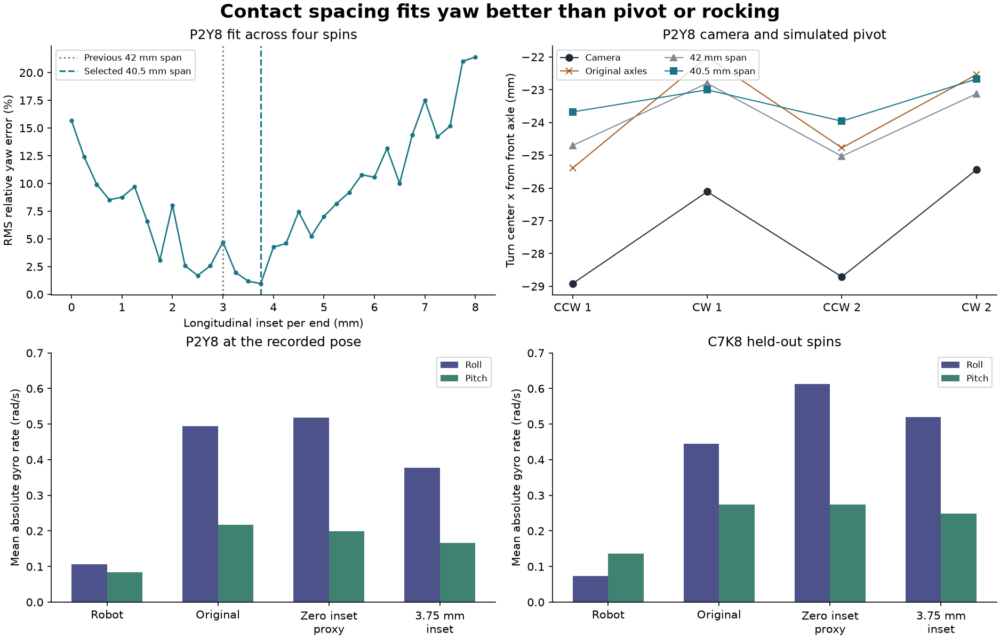
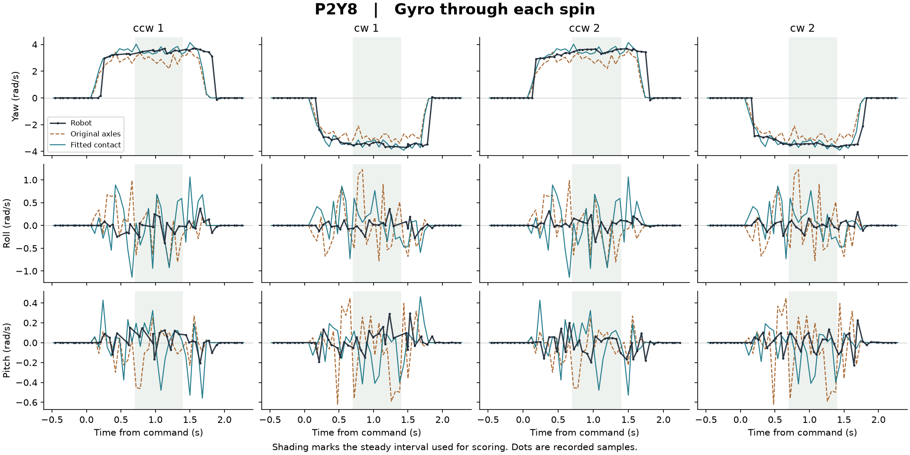
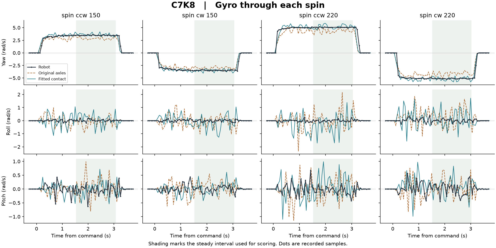

# Fitting longitudinal tread contact on P2Y8 and transferring it to C7K8

A symmetric **3.75 mm inset per end** gave the lowest four-spin RMS relative yaw error on the 0.25 mm grid. This places the load-bearing contact centers 40.50 mm apart while keeping the axle centers 48 mm apart. The frozen value reduced yaw error on each of C7K8’s four run E spins. P2Y8’s camera pivot and both robots’ roll/pitch gyro traces still disagree with the model. The fit is experimental.



| P2Y8, four-spin mean | Steady body yaw (rad/s) | Yaw RMS error | Center x (mm) | Mean absolute roll / pitch (rad/s) |
|---|---:|---:|---:|---:|
| Robot | 3.501 | — | −27.30 | 0.107 / 0.084 |
| Original axle contacts | 2.905 | 17.08% | −23.68 | 0.494 / 0.217 |
| Auxiliary rollers, zero inset | 2.955 | 15.67% | −22.65 | 0.519 / 0.199 |
| 3.00 mm per end (42 mm span) | 3.336 | 4.72% | −23.91 | 0.550 / 0.212 |
| 3.75 mm per end (40.5 mm span) | 3.479 | 0.96% | −23.33 | 0.378 / 0.166 |

The front axle is x = 0. At the selected inset the pivot is **3.97 mm forward** of the camera estimate on average, slightly worse than the original 3.62 mm error. The center comes from a circle fitted to the backpack landmark in matched camera frames and projected onto the body axis. Camera calibration choices moved the earlier mean by up to about 2.4 mm. The small difference in pivot error between the two models is unresolved. [Optical references and camera calibration](../camera-spins/README.md)

Each P2Y8 replay starts at the measured head and lift near 22.5° and 32.7 mm. The wheel commands were ±150 mm/s. The simulator gave about 150 mm/s at steady state while the hardware gave about 146–147. Repeating the simulations with each tread targeted to its recorded steady mean, keeping the selected inset fixed, gave yaw RMS errors of 16.3% (original), 5.5% (42 mm span) and **2.3%** (40.5 mm span). At 40.5 mm the simulated pivot was −23.16 mm and the simulated roll/pitch magnitudes were 0.458/0.208 rad/s. Wheel speed explains some of the yaw fit but leaves the pivot and rocking discrepancy. [Speed sensitivity by spin](wheel_speed_sensitivity.csv)



## C7K8 held-out transfer

Run E contains two speeds in both directions on the refurbished first-generation robot, on a different surface. We replayed each recorded command at its starting posture with the first-generation table. We carried over only the P2Y8-selected inset and used the same contact implementation. Run E was excluded from this selection. It has been used in other calibration studies, so this is a holdout for this fit.

| Run E command | Measured yaw magnitude (rad/s) | Frozen fit (rad/s) | Relative error |
|---|---:|---:|---:|
| CCW 150 | 3.488 | 3.606 | +3.39% |
| CW 150 | 3.466 | 3.495 | +0.84% |
| CCW 220 | 5.070 | 5.234 | +3.25% |
| CW 220 | 5.099 | 5.183 | +1.66% |

The four-spin yaw RMS error went from **16.10%** with original contacts and **12.69%** with zero-inset rollers to **2.53%** with the frozen inset. Mean absolute roll/pitch rates were 0.074/0.136 rad/s on C7K8, 0.444/0.274 in the original model and 0.520/0.248 with the frozen inset. The fitted model overpredicts roll by about sevenfold. Its simulated turn centers span −23.6 to −21.8 mm. Run E has SDK odometry only, so the physical turn centers remain unverified.



## Measurement and reproduction

Yaw and roll are the head gyro rotated into chassis axes with the sampled head encoder angle plus the generation’s IMU mounting offset. Pitch is the gyro y channel and can include head motion. These are chassis-axis rates, with no optical correction for instantaneous chassis tilt. P2Y8’s mean absolute head gyro z alone was 3.238 rad/s. Each turn contributes equally to the RMS of its fractional steady-yaw error. The score uses 0.7–1.4 s on P2Y8 and the second half of the longer commands on C7K8. Time zero is the logged wheel command. The figures also show the unscored starts and stops.

The grid was 0–8 mm per end in 0.25 mm steps. Individual spins select 1.75–4.25 mm. Leaving any one P2Y8 spin out still selects 3.75 mm, although the two repeats in each direction produce identical steady model outputs. The grid spacing is computational resolution. This experiment measures an effective yaw parameter for the simulated contact dynamics.

Both generations use the bbec512a1212 physics reference, MuJoCo 4.0.1, a 1 ms physics step, and 60 ms SDK states. Auxiliary rollers retain the existing 42 mm experiment's coupling, inertia split, collision settings and tip clearance across the grid. The zero-inset control isolates the effect of introducing those rollers. At ±146 mm/s, the 3.75 mm rollers carried all sampled table normal force during the steady interval in both directions. Shaft-to-roller surface-speed disagreement averaged under 0.28 mm/s. [Contact force audit](contact-load.csv)

From the repository root, with Python, MuJoCo 4.0.1, NumPy, SciPy and Matplotlib installed:

```sh
e=evidence/recorded-pose-inset
scratch=$(mktemp -d)
python "$e/prepare_reference.py" "$scratch/model"
export PYTHONPATH="$scratch/model"
python "$e/fit_p2.py" evidence/camera-spins "$scratch/p2"
inset=$(python -c 'import json,sys; print(json.load(open(sys.argv[1]))["inset_mm"])' "$scratch/p2/selection.json")
python "$e/c7_transfer.py" evidence/hw-rec-20261118/run-e-spins.jsonl "$scratch/c7" "$inset"
python "$e/check_speed.py" evidence/camera-spins "$scratch/p2"
python "$e/check_patch_forces.py" 0 3 "$inset"
python "$e/plot.py"
```

The reference setup patches a temporary copy of the public source. The public recordings reproduced the scored CSVs and signed traces byte for byte. The plotting script uses the included CSVs. [P2Y8 grid and per-spin metrics](metrics.csv) · [P2Y8 signed traces](traces.csv) · [C7K8 per-spin metrics](c7_scores.csv) · [C7K8 signed traces](c7_traces.csv)

A subsequent peer comparison crossed collision settings, checked gyro bandwidth, and tested a second optical pivot estimator. It qualifies the physical interpretation of the raw roll/pitch ratios above. [Peer comparison and corrected interpretation](peer-check/README.md)
