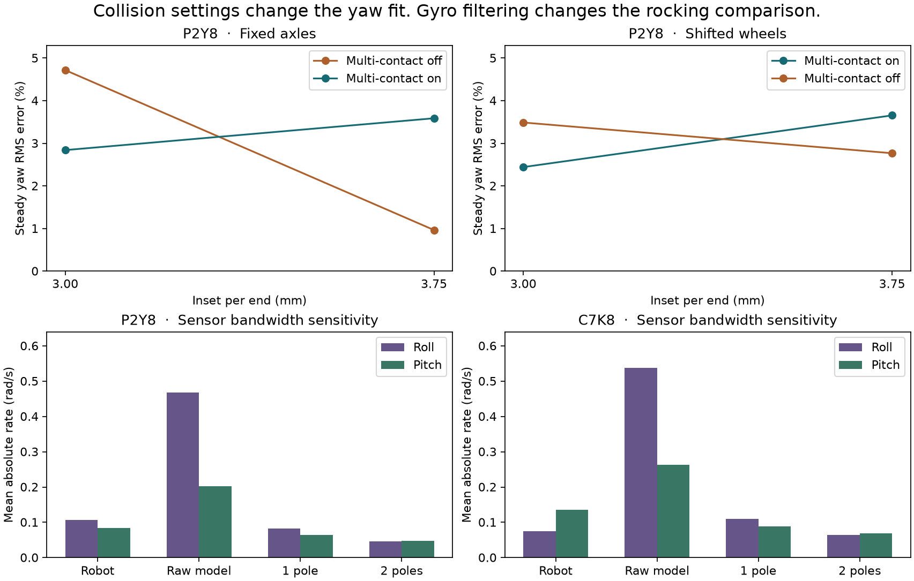

# Comparing the contact fits across lanes

CPCS fitted a shifted-wheel model to C7K8 and checked P2Y8. The fixed-axle roller experiment fitted P2Y8 and checked C7K8. To reconcile the results, we replayed both implementations with identical recordings, starting posture, reference model, gyro-axis conversion and scoring windows. We then exchanged one MuJoCo setting between them. All tests used recorded data.



**Why the inset estimates differ.** With multi-contact collision detection off, moving from 3 to 3.75 mm per end reduced P2Y8 steady yaw RMS error from 4.72% to 0.96% for fixed axles and from 3.49% to 2.77% for shifted wheels. With it on, the same change increased error from 2.84% to 3.59% for fixed axles and from 2.44% to 3.66% for shifted wheels. The setting alone is sufficient to reverse the ordering of these two candidates. C7K8 favors 3 mm for shifted wheels under either setting. These recordings support inward contact under load but do not identify a unique tread pressure spacing. [Original settings](crossed_summary.csv) · [Exchanged settings](swapped_multiccd_summary.csv)

**What the gyro measured.** The previous comparison used instantaneous simulated gyro readings against an already filtered physical sensor. Across twelve possible SDK publication phases, the frozen model’s P2Y8 roll/pitch magnitudes averaged 0.468/0.202 rad/s. A one-pole approximation to the nominal 18.65 Hz gyro bandwidth gave 0.082/0.064 against 0.107/0.084 recorded. C7K8 went from 0.537/0.263 to 0.110/0.089 against 0.074/0.136 recorded. Mean steady yaw changed by less than 0.01 rad/s. A two-pole approximation suppresses more rocking. The actual transfer function on either unit remains unknown. The simulated motion is sensitive to contacts, but the earlier ratios of raw model to sensor readings cannot establish how much extra physical rocking occurred. [Bandwidth and sample-phase sweep](sampling_scores.csv) · [Gyro configuration and filter assumptions](../../hw-rec-20261119/sensor-timing.md)

On the separate P2Y8 100 mm/s native recording, the two wheel readings and gyro z identified 45 matched SDK/native rows. Gyro x and y also agreed to floating-point precision. This supports SDK subsampling of the native signal. The native signal itself is downstream of the physical IMU filter. [Matched samples](sdk_native_matches.csv)

**What changed the dynamics.** At 3.75 mm inset, shrinking the physics step from 1 to 0.125 ms while keeping the coupling time constants fixed reduced P2Y8 raw roll/pitch from 0.378/0.166 to 0.169/0.086. Yaw RMS error rose from 0.96% to 3.91%, and turn-center error from 3.97 to 5.20 mm. C7K8 yaw error rose from 2.53% to 3.53%. At the original 1 ms step, changing contact relaxation alone from 4 to 8 ms reduced rocking more modestly. P2Y8 raw roll fell to 0.302 rad/s and C7K8 roll to 0.401. Neither change establishes a physical tread parameter. [Integration sweep](solver_step_summary.csv) · [Contact relaxation sweep](relaxation.csv)

**What remains of the pivot discrepancy.** A second fit used both the measured backpack position and roof heading to estimate the single body-fixed point that moved least during each turn. With the original dock-and-shelf calibration, its mean x was −26.61 mm, compared with −27.30 mm from the camera circle fit. The same two estimators gave −23.35 and −23.33 mm on the fixed-axle model. Removing the shelf constraint and varying the focal prior moved the optical heading-based mean as far forward as −24.67 mm. Under all three camera calibrations and both estimators, the two physical CCW turns had pivots farther aft than the CW turns. All CCW heading-based estimates remained aft of their matched simulated values. Absolute spacing remains sensitive to calibration. The observed backpack positions missed the single-pivot prediction by 3.0–3.8 mm RMS per spin with the original calibration, versus 0.7–0.9 mm in simulation. Landmark error, heading error and actual motion of the pivot can all contribute. [Per-turn camera fits and leave-one-frame-out sensitivity](optical.csv)

## Reproduction

From the repository root, create the temporary reference model as described in the [recorded-pose experiment](../README.md). Use MuJoCo 4.0.1. In the commands below, MODEL is the absolute path to that temporary model.

```sh
parent="$PWD/evidence/recorded-pose-inset"
p="$parent/peer-check"
export PYTHONPATH="$MODEL:$parent"
a=evidence/camera-spins
b=evidence/hw-rec-20261118/run-e-spins.jsonl
out=$(mktemp -d)
python "$p/compare_geometry.py" "$a" "$b" "$out"
python "$p/compare_geometry.py" "$a" "$b" "$out" --swap-multiccd
python "$p/solver_step.py" "$a" "$b" "$parent/c7_scores.csv" "$out"
python "$p/chatter_sampling.py" "$a/robot.jsonl" "$b" evidence/hw-rec-20261119/unit2-native-stops.csv "$p/native_sdk_excerpt.jsonl" "$out"
python "$p/softness.py"
python "$p/optical.py"
python "$p/plot_peer.py"
```
