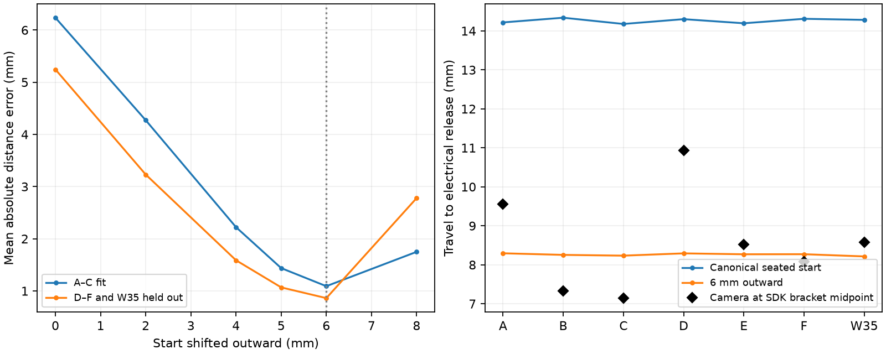

# Can seating depth explain the travel before charger release?

Starting 6 mm farther out reduced held-out mean absolute release-distance error from 5.25 to 0.86 mm. This offset was selected on departures A–C, then frozen on D–F and the later W35. All seven departures came from one physical robot. The fit changes a starting condition only.



Each run uses the canonical Vector 2 shelf model, the initial measured head and lift pose, and recorded wheel speeds supplied as motor targets, starting about 1.8 seconds before the first physical off-charger report. Before the normal settling step, shift the free chassis forward along the shelf dock axis by 0, 2, 4, 5, 6 or 8 mm. All 42 settled starts retained electrical contact. Release is the first subsequent off-contact simulation tick. Camera distances for A–F are interpolated to the midpoint of the SDK contact bracket. W35 uses the mean of its front- and rear-hub displacement estimates at that midpoint. Fit by minimizing A–C mean absolute distance error over the tested offsets.

| Held-out departure | Camera travel (mm) | Canonical start (mm) | Shifted start (mm) |
|---|---:|---:|---:|
| D | 10.93 | 14.30 | 8.29 |
| E | 8.52 | 14.20 | 8.27 |
| F | 8.08 | 14.31 | 8.27 |
| W35 | 8.58 | 14.28 | 8.21 |

Three observations limit the interpretation. D is still 2.64 mm short. The shifted W35 replay still releases 288 ms after the physical first-off report, and the replay routes measured encoder speeds through a motor controller. Finally, the shifted start places the chassis about 24 mm inward from the lip. The earlier independent tread-silhouette fit put the nominal starting depth at 14–15 mm, with an upper sensitivity limit of 23.4 mm across A–F. Absolute camera calibration and tread-edge identification affect those estimates. The distance score alone cannot justify moving the default seated pose. [Independent depth measurements](../unit3-cube-range/seating-depth.csv)

From this directory, with web dependencies installed, run the following commands to regenerate the [42 replays](sweep.csv) and plot.

```sh
python3 inputs.py .. | node replay.mjs > sweep.csv
python3 score.py
```

As an additional static check, move the initial chassis 14, 15 and 16 mm outward before settling, spanning the nominal optical depths. All seven starts retained electrical contact at +14 mm. At +15 and +16 mm, all fourteen starts were already electrically off before a wheel command. This puts the simulated contact boundary close to where the optical reconstruction places the physical robot at rest. [Static checks](static-check.csv) · Reproduce with `python3 inputs.py .. | node replay.mjs --static`.
