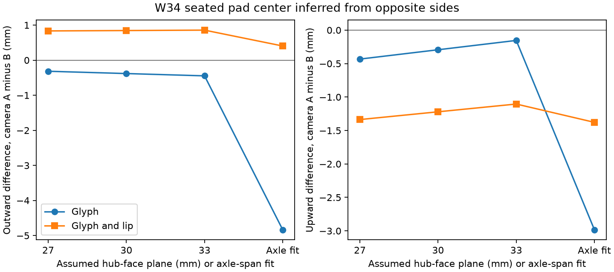

# Do the opposed cameras agree on seating depth?

The [W34 return](../unit3-w34-return/README.md) provides a second camera at the seated endpoint, 146 ms after the first on-charger report. For each camera we use its own hub picks and [dock registration](../dock-pad-registration/README.md). The estimates use the same modeled pins and physical 48 mm axle spacing. The SDK flag identifies the frame and supplies no depth measurement.

When each camera independently sets its hub-face plane from axle spacing, the glyph and dock lip give fore–aft pad centers **4.79 and 4.38 mm outward** of the modeled pins. Glyph alone gives **10.47 and 5.63 mm inward**. The lip reduces the cross-view fore–aft disagreement from 4.84 to 0.40 mm and the vertical disagreement from 2.98 to 1.38 mm.

The result depends on how depth is set. Imposing an identical 27, 30 or 33 mm hub-face plane on each side makes the glyph-only fore–aft difference just 0.32–0.45 mm, smaller than the five-anchor difference of 0.83–0.86 mm. A common imposed plane can give agreement at quite different absolute positions. The small residual with the axle fit supports using the lip for the [paired W35 departure](../camera-depth-release/README.md). Neither camera sees the pins, and only one tracks that departure. Absolute accuracy and transfer to a different docking remain unverified.

[All component estimates](cross-view.csv). Run python compare.py here with Matplotlib installed.
