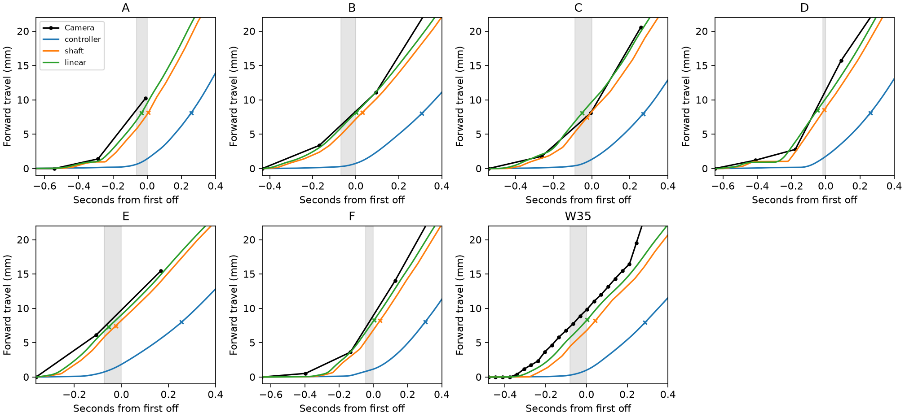

# Does shaft-speed replay predict other physical dock departures?

We transferred the W35 replay method to six earlier physical departures from the same shelf. A–C had previously been used to choose a 6 mm outward shift of the initial seat. D–F were held out in that experiment. Both the canonical and shifted seats were retained here, with identical geometry, noise seed and charger-contact threshold. No method or parameter was fit to D–F. W35 is included as a reference, since it motivated this test.

At the physical charger edge, replaying measured shaft speeds directly brought simulated travel much closer to the camera. The estimated time of electrical release also depended strongly on the initial seat.

| D–F average, initial seat shifted 6 mm | Error in travel at physical bracket midpoint | Error across camera frames¹ | Time outside physical release bracket² |
|---|---:|---:|---:|
| Wheel reports supplied as new motor commands | 7.91 mm | 7.77 mm | 273 ms |
| Wheel reports applied as shaft speeds, held until next report | 1.97 mm | 1.79 mm | 13 ms |
| Shaft speeds interpolated between reports | 0.81 mm | 0.97 mm | 12 ms |

¹ Each trial contributes one RMS optical travel error, from its camera reference through +0.4 s. Fork tips are the optical landmarks in A–F, whereas W35 uses two wheel hubs. In all cases each simulation is zeroed at the corresponding camera reference frame. These comparisons approximate forward chassis travel. The camera's landmark-height, ramp, pose and exposure uncertainties carry through to the score.

² Zero means the simulated edge fell between the last physical on and first physical off reports. All other entries measure distance in time to the nearest edge of that bracket. These are not estimates of contact-switch latency.



Direct shaft replay uses torque-limited velocity actuators on the drive shafts, reusing the wheel torque limits. The standard controller path reapplies its normal response to speeds measured after physical actuation. Interpolation is an offline reconstruction using the next report. It cannot predict a future wheel observation in a live simulation.

## What the controls establish

- With the interpolated input and **canonical seat**, mean travel error at the physical midpoint was 0.80 mm and the predicted release missed the physical bracket by 133 ms on average. With the **6 mm shifted seat**, those numbers were 0.81 mm and 12 ms. Input fidelity explains much of the camera travel error while starting depth still controls electrical timing.
- On D, E and F respectively, camera travel at the physical midpoint was 10.93, 8.52 and 8.08 mm. Interpolated shaft replay with the shifted seat predicted 9.89, 7.87 and 7.34 mm. D still released 31 ms before the physical last-on packet.
- Integrating the physical mean left/right shaft speed directly, using the same linear interpolation and camera origin, gave **0.70 mm mean absolute midpoint error** across D–F. The camera agreement is therefore largely explained by the wheel measurements themselves. This control cannot predict the electrical edge. These recordings do not independently validate the simulated friction or identify the absolute seat depth.
- All seven departures used one Vector 2.0 on one shelf. The 6 mm shift was an experimentally chosen initial condition. The canonical seated pose, electrical geometry and live motor controller retain their prior settings.

[All 42 scores](scores.csv) · [Encoder-only control](integration.csv) · [Original seat sweep](../seat-offset-sweep/README.md) · [W35 dock history](../dock-posture-history/README.md)

Run from this directory with the web test dependencies, NumPy and Matplotlib.

```sh
python ../seat-offset-sweep/inputs.py .. > /tmp/shaft-departures.json
node replay.mjs < /tmp/shaft-departures.json > traces.csv
python score.py
python integration.py < /tmp/shaft-departures.json
```
