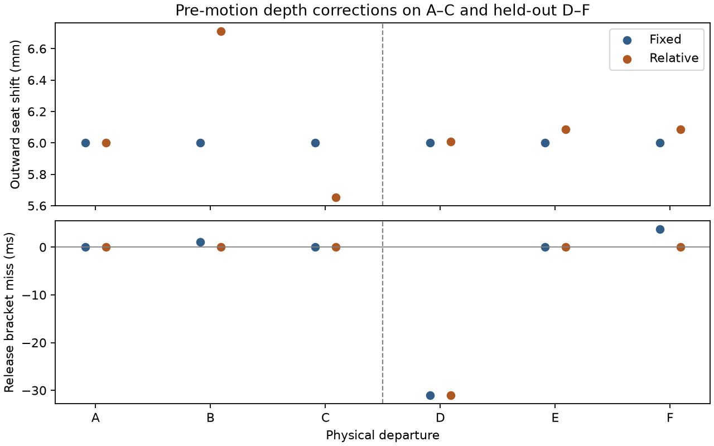

# Can the pre-motion tread silhouettes identify the deeper departures?

D showed the longest camera travel to electrical release among D–F (10.93 mm). Its pre-motion tread silhouette placed the chassis only 0.007 mm shallower than the A–C reference. E and F had exactly the same nominal optical depth, despite different observed travel to release. These small differences are computed from projected pixel picks and carry no claim of submillimetre precision.

We used the median A–C pre-motion depth (15.012 mm) as a reference. Each replay starts at the earlier 6 mm outward shift minus that trial's excess inward depth. This tests the *relative* information in the images while canceling a shared absolute bias. Unit gain follows the millimetre geometry. No held-out flag or travel measurement sets the correction. Each run receives its own recorded wheel speeds via offline linear shaft replay, with the same canonical geometry and contact threshold.



| Held-out run | Optical correction to outward shift | Fixed seat release miss | Corrected release miss |
|---|---:|---:|---:|
| D | +0.007 mm | 31.1 ms early | 31.1 ms early |
| E | +0.087 mm | Within bracket | Within bracket |
| F | +0.087 mm | 3.8 ms late | Within bracket |

Mean time outside the observed interval changes from 11.6 to 10.4 ms. Only F's simulated release moved, by one 5 ms tick. The optical corrections fail to account for D. The silhouette sensitivity ranges overlap by several millimetres, so this finding does not establish equal physical starting depths. An independent measurement of a chassis-fixed landmark relative to the dock at each start would discriminate between depth variation and variation at electrical release.

[Pre-motion silhouette measurements](../unit3-cube-range/seating-depth.csv) · [W35 seat transfer](transfer.md) · [All simulation edges](relative.csv).

Run from this directory:

```sh
python ../seat-offset-sweep/inputs.py .. > /tmp/relative-wheels.json
python relative.py ../unit3-cube-range/seating-depth.csv ../unit3-cube-range/release-optics.csv /tmp/relative-wheels.json
python relative_plot.py
```
