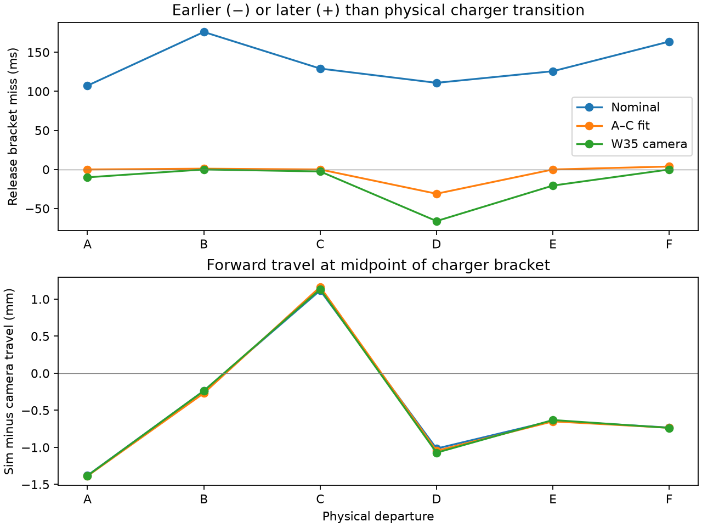

# Does the W35 camera-derived seat transfer?

We applied the 7.398 mm outward initial shift from the W35 canonical-constraint shaft replay to six other departures on the same robot and shelf. We kept the physical wheel reports, recorded initial joint posture, canonical electrical geometry and offline shaft interpolation used in the [original comparison](README.md). This transfers the model's initial placement adjustment. Actual seat depth at the start of each of these six trials was not measured. Their SDK flags are used to align and score the replay.



| Initial placement | Mean time outside physical release interval, D–F | Mean absolute travel error at interval midpoint, D–F |
|---|---:|---:|
| Canonical | 133.5 ms | 0.80 mm |
| 6 mm from A–C | 11.6 ms | 0.81 mm |
| 7.398 mm from W35 optics | 28.9 ms | 0.81 mm |

The W35 placement released 66 ms early on D, 21 ms early on E, and within the interval on F. It improves on nominal placement, but the separate 6 mm estimate transfers better to these three departures. Measured wheel speeds predict essentially the same travel with all three seats. A single global placement change cannot be justified from the W35 optical match. For a new docking, record absolute pose before departure and compare the pre-registered prediction with the ensuing flag edge.

[Per-run scores](transfer.csv) · [W35 calibration](../camera-depth-release/README.md)

Run from this directory with the existing web dependencies, Python, NumPy and Matplotlib.

```sh
python ../seat-offset-sweep/inputs.py .. > /tmp/transfer-wheels.json
node replay.mjs 0 6 7.3984375 < /tmp/transfer-wheels.json > /tmp/transfer-traces.csv
python transfer.py /tmp/transfer-traces.csv ../unit3-cube-range/release-optics.csv
```
