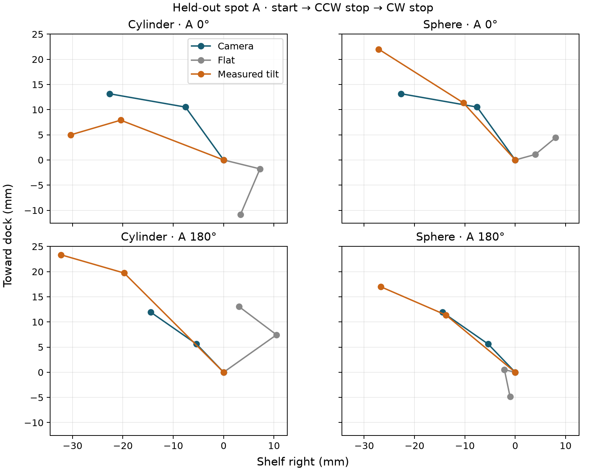
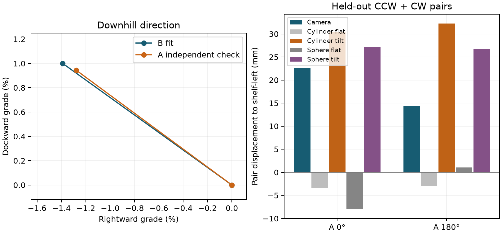

# How much of the shelf drift does gravity explain?

P2Y8's head accelerometer measured a **0.98° effective downslope** at spot B, about 1.39% to shelf-left and 1.00% toward the dock. Its direction was 36° dockward from shelf-left. Spot A, reserved for evaluation, independently gave 0.91° (1.28% left, 0.94% dockward). Applying B's gravity vector without adjustment cut held-out pair endpoint error by **39% for the cylinder contacts and 57% for the sphere contacts**. Both models overshot the leftward component.

| Held-out CCW + CW pair | Camera, left / dockward (mm) | Cylinder flat | Cylinder tilted | Sphere flat | Sphere tilted |
|---|---:|---:|---:|---:|---:|
| A 0° | 22.7 / 13.2 | −3.4 / −10.8 | 30.4 / 5.0 | −8.0 / 4.4 | 27.1 / 22.0 |
| A 180° | 14.4 / 11.9 | −3.1 / 13.0 | 32.3 / 23.3 | 1.0 / −4.9 | 26.7 / 17.0 |

All columns are in millimeters. Each overlay connects the starting rest, the CCW stop and the CW stop. Each model replay begins each individual turn at its measured starting heading. [Signed results for all eight turns at A and B](vectors.csv)

| Error metric at A | Cylinder flat → tilted | Sphere flat → tilted |
|---|---:|---:|
| Vector RMS error over four individual turns (mm) | 14.9 → 12.8 | 14.7 → 7.0 |
| Vector RMS error over two pair endpoints (mm) | 27.9 → 17.0 | 27.2 → 11.7 |

Averaged across the two headings, the camera saw 18.5 mm left per pair. Relative to the flat baseline, adding the measured tilt supplied **159% of the missing signed leftward displacement** for cylinders and **138%** for spheres. Those percentages measure model response to gravity. They do not estimate a causal fraction of the physical robot's drift. The better-performing sphere model still missed the two pair endpoints by roughly 10–13 mm. With one pair per starting heading, the residual cannot distinguish tread compliance, surface texture and other contact-model errors.

## Estimation and holdout

B was designated the calibration spot before replay. Each block contributed the 1.5 to 0.1 s window before the first wheel command, after positioning. Both reported wheel speeds were zero for all 93 samples and the gyro magnitude stayed below 0.05 rad/s. B contributed 23 samples at each starting heading. A contributed 24 and 23. The stationary gyro was used only as a motion check.

For each sample, undo head pitch in the forward/up plane using the measured head encoder, then average the forward and left specific-force components for each rest. In units of g the two means follow **body reading = fixed body offset + shelf uphill vector rotated into body axes**. Differencing the opposite headings removes the fixed offset. The fit uses the actual registered camera headings, a nominal 9810 mm/s² per g, and no camera displacements. Dividing the B windows into early and late portions gave 0.976° and 0.988°. These repeats share the same tread seating and sensor scale. The estimate measures the inclination experienced by the stationary robot at those spots; a separate surface-level measurement would distinguish shelf geometry from heading-dependent seating. [Rest accelerometer, head, gyro and wheel samples](rest.csv)

The simulation world is expressed in shelf coordinates. For every turn, rotate B's downhill components into the starting robot frame, give gravity those tangential components and reduce its normal component to preserve its full magnitude. This is mechanically equivalent to inclining the shelf and measuring displacement in its plane. Gravity acts during settling, spin-up, the turn and braking. Both 42 mm models retain the original axles, friction, measured-wheel inputs and solver steps (1 ms cylinders, 0.125 ms spheres). A's estimate is a check only. The flat baselines and camera registrations come from the preceding [See3CAM heading-reversal experiment](../heading-crossover/README.md).

Run `python replay_shelf_tilt.py` from the repository root to regenerate the estimates, vector table and both figures.
