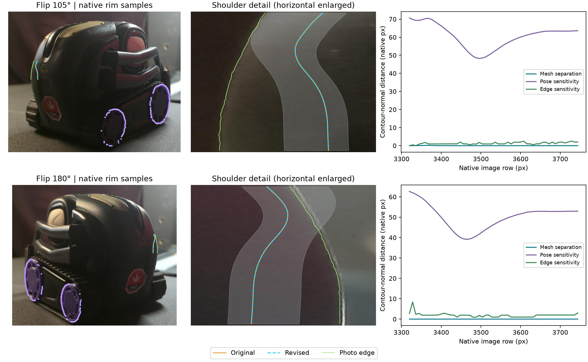
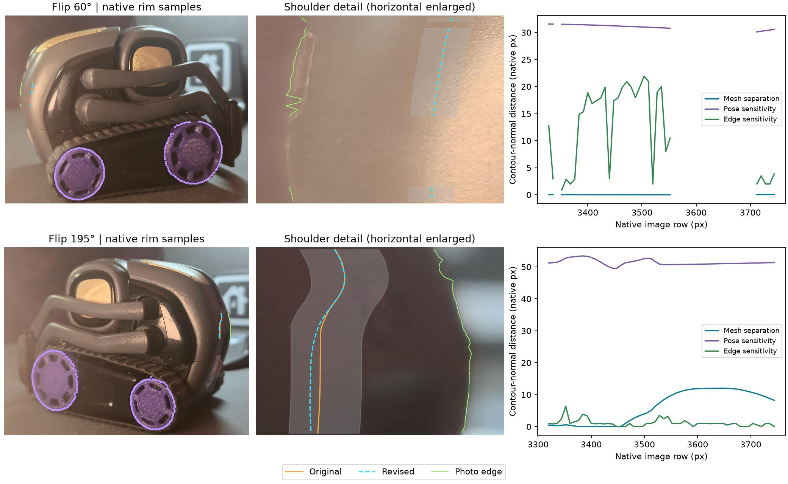
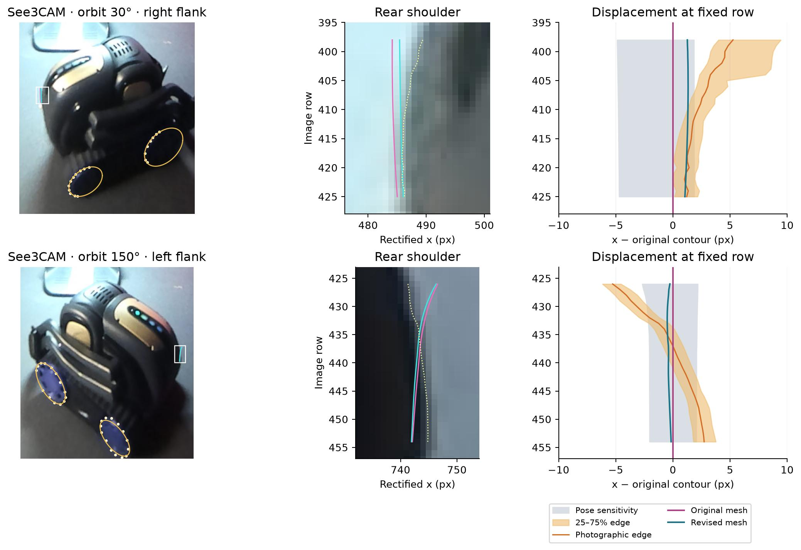
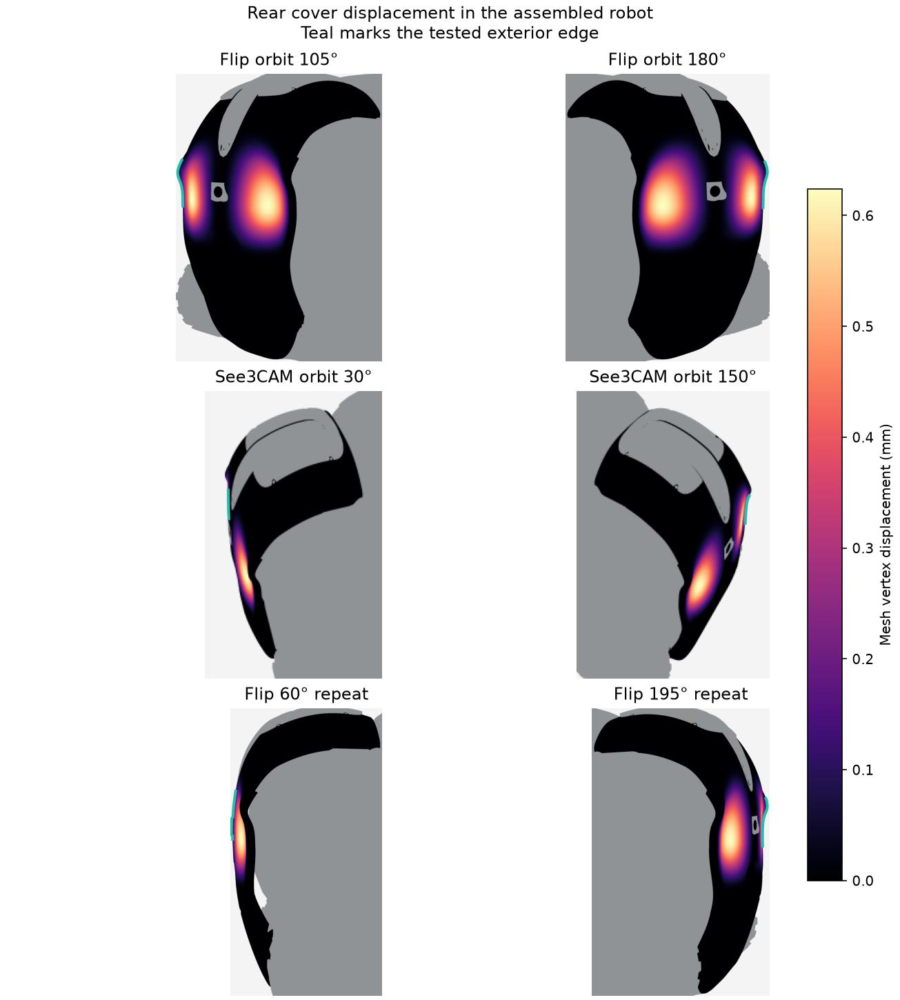

# Can the photographs resolve the rear-shoulder revision?

**The full-resolution photos leave the 0.62 mm revision provisional.** We compared the original and revised Vector 2.0 shells in six photos showing opposite flanks. Each exposure was registered on its two printed wheel rims. Both meshes used exactly the same fitted pose. None of the 252 visible shoulder samples separated the meshes by more than the local pose and edge-picking sensitivities combined. Adjacent samples along an edge are correlated.

| Camera and archive heading | Visible rows | Largest outline shift (px) | Median pose sensitivity (px) | Median edge sensitivity (px) |
|---|---:|---:|---:|---:|
| Flip 105° | 54 | 0.15 | 62.26 | 1.00 |
| Flip 180° | 54 | 0.012 | 51.87 | 1.96 |
| Flip 60° repeat | 33 | 0.05 | 31.15 | 15.36 |
| Flip 195° repeat | 54 | 12.03 | 51.19 | 0.99 |
| See3CAM 30° | 28 | 1.33 | 4.78 | 1.04 |
| See3CAM 150° | 29 | 0.50 | 2.07 | 0.88 |

Flip distances are measured along the contour normal in 8160 × 6120 originals. The See3CAM originals are 1920 × 1080, rotated and fisheye-corrected into the calibrated 1200 × 780 view. Its distances are horizontal at fixed image rows. The table summarizes each quantity separately. The pass/fail calculation uses paired values at each row. The tested perturbations describe sensitivity and carry no statistical confidence level.

**The 195° Flip repeat provides the clearest geometric signal.** It separates the meshes by 7.81 px at the median. Dropping a single octant from each printed rim changes the projected shoulder by 9.23 px at the median. Varying focal length and the choice of outer rim versus flat face widens the envelope. Under the nominal pose, the median absolute contour error increases from 179.9 to 187.5 px with the revision. Using three independently bench-calibrated cameras as alternative solutions for this same Flip lens also favors the original at their nominal fits, but shifts the baseline outline by 86–139 px and predicts at most 5.6 px of mesh separation. The absolute registration-to-shoulder mismatch is much larger than the proposed revision here. [Alternative fits and numerical results](visibility/calibrated.json)

**The See3CAM sides give different nominal preferences.** On the right, the mean absolute error falls from 2.43 to 1.19 px. Fifteen of sixteen pose perturbations favor the revision there. On the left, the error rises from 1.99 to 2.03 px and six of sixteen favor the revision. Both rankings can reverse. In the two more directly rearward Flip views, the absolute contour mismatches are about 114 and 73 native pixels, while the old and revised contours nearly coincide. These observations do not establish a revised physical curvature or a replacement dimension.

## Registration and visibility

The fit uses nominal STL diameters of 26.0 and 18.5 mm, 48 mm longitudinal axle spacing and a 3.75 mm axle-height difference. The shoulder supplies no pose landmarks. Each camera reviewer traced the image edge separately from the rim fit. For Flip, varying the image channel and smoothing scale measures edge sensitivity. For See3CAM, the 25–75% local contrast transition supplies the edge band. A full-rig depth-buffer pass with the printed lift down, head near level, and faceplate removed verified ownership of the outer contour in both models. It excluded 21 rows from the 60° Flip repeat where another part reached the outline. This separate check matters because the maximum 0.62 mm displacement occurs inside the shoulder surface.

## Reproduction

Use the original photos listed in the results files and the shell exporter from the [LiDAR experiment](../iphone-lidar-orbits/README.md). Export the parent of commit 33ff9ea and that commit into the same directory as pre.json and post.json. The checked-in per-row results and poses can be inspected independently of the photo archive.

- In the flip directory, set FLIP_ARCHIVE and MESH_EXPORTS to the photo and shell directories. Run fitflip.py then scoreflip.py. Repeat both with --broad for the brighter pair. The visibility audit is read from the adjacent visibility directory. [Initial rows](flip/flip-results.json) · [Brighter pair](flip/flip-results-broad.json)
- The See3CAM analysis includes the camera distortion map and each rim pick. [See3CAM replay instructions](see/README.md) · [Row measurements and pose variants](see/results.json)
- To repeat the full-rig depth-buffer audit, start the web simulator with SDK and printed assets installed. Set VECTOR_WEB to its development server address, and supply Chromium and playwright-core via CHROMIUM and PLAYWRIGHT_CORE. In the visibility directory run visible.cjs with the camera JSON, pre.json, and a prefix from rows.json. Use each Flip fit directly and extract the matching See3CAM camera object from see/poses.json. Run inspect_rows.py after rendering all six cameras. [Visibility decisions](visibility/visibility-results.json)
