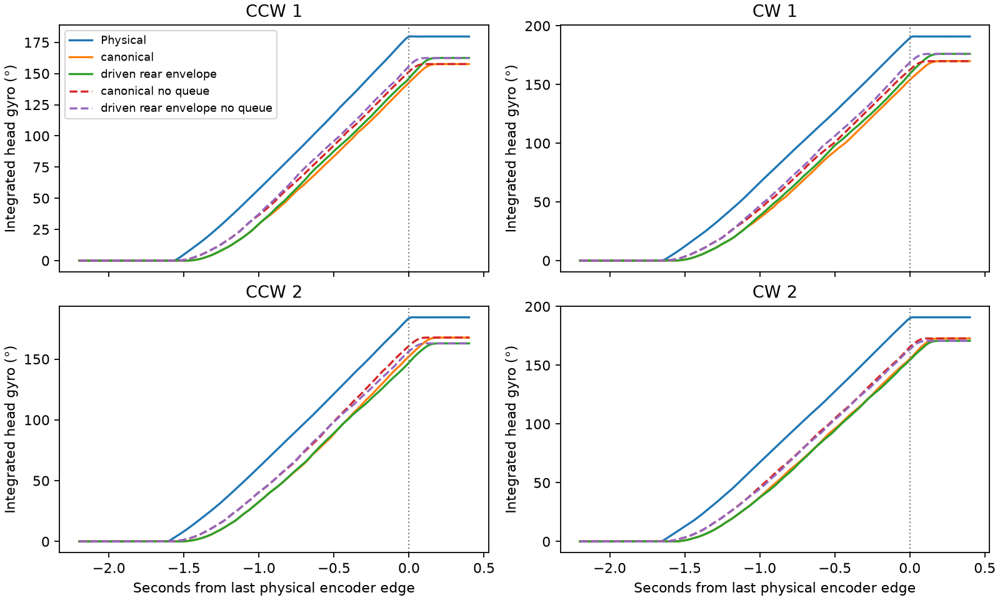

# Does the driven rear dock support transfer to flat-table spins?

The driven rear support narrowed the dock travel gap in [W34](../unit3-w34-return/opposed-pose.md). On four earlier 100 mm/s spins from the same physical unit, it improved total integrated head gyro on the first pair but increased the shortfall in both directions on the reserved pair.

| Reserved turn | Physical head gyro integral | Canonical | Driven rear support | Physical / canonical / driven mean absolute wheel speed during steady turn |
|---|---:|---:|---:|---:|
| CCW 2 | 184.34° | 167.70° | 162.90° | 98.06 / 97.44 / 97.45 mm/s |
| CW 2 | 190.76° | 172.80° | 170.72° | 97.38 / 97.31 / 97.16 mm/s |

From the last physical wheel edge through +400 ms the two held-out gyro integrals were 0.81° and 0.85°. Canonical gave 15.38° and 17.42°. Feeding the same wheel reports directly to the motor controller with its command queue bypassed brought that to 6.73° and 7.29°, while changing the complete spin integrals by less than 0.01°. Applying a command delay to an observed wheel signal accounts for much of the apparent late braking in this replay. The full-turn deficit survives that timing control.

Each scene starts on the table clear of the dock and cube, at the first recorded head angle and an assumed 32.7 mm lift. The simulation uses the Vector 2.0 web model at commit 232c712. Each reported wheel speed is held until the next native packet as a motor target. This reapplies the motor response to a measured signal and cannot alone assign the full-turn discrepancy to tread friction. Integrated turn-aligned head-axis gyro also differs from a camera measurement of world heading. No surface or physics parameters were fitted here.

Scores use the native sample times, from the first packet through +400 ms relative to the last shaft edge. The steady window is −850 to −250 ms. The first and second pair follow the [original split](../hw-rec-20261119/hybrid-replay.md). To reproduce, install the web dependencies, then run `node replay.mjs > replay.csv` and `python score.py` in this directory. The script checks the four input traces for missing intervals. [All scores](scores.csv)

[Full-spin encoder travel and corrected starting lift](travel.md)

[Replay of the original wheel commands on a separate SDK session](command-spins.md)

[Steady wheel error by side, direction and observed battery voltage](wheel-voltage.md)

[Steady head inclination and transverse gyro variation](spin-axes.md)

[Native-cadence frequency analysis of the missing roll variation](native-axes.md)
