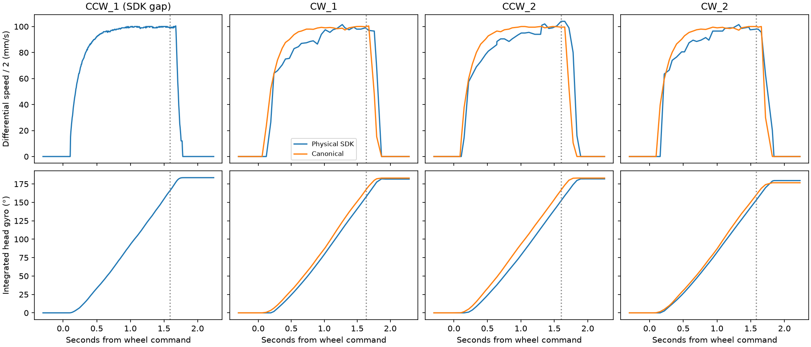

# Recorded wheel commands predict the full-spin angle more closely

A separate SDK recording contains host issue times for both wheel commands and stops. We replayed those commands on the canonical Vector 2.0 flat table, with the model frozen and the initial head and lift taken from each spin’s last pre-command packet. Only the initial pose and commands enter the simulation. The previous native-count session has a nominal 1.5 s duration; substituting this SDK session’s command times into that native recording would mix separate trials.

| Reserved spin | Issued pulse | Physical / sim wheel travel | Physical / sim head gyro integral |
|---|---:|---:|---:|
| CCW 2 | 1.602 s | 146.17 / 148.00 mm | 181.90 / 182.98° |
| CW 2 | 1.582 s | 141.50 / 146.15 mm | 179.60 / 176.65° |

Direction-aligned full-spin gyro errors are +0.59% and −1.64%. Differential wheel travel errors are +1.25% and +3.29%. The earlier 12 mm shortfall does not reproduce on this command-driven session. There is still a waveform discrepancy. Mean steady differential speeds are 92.50 and 94.12 mm/s on hardware versus 98.62 and 98.08 mm/s simulated. The steady head gyro is about 5°/s faster in the simulation in both directions. Agreement in total angle can conceal phase errors.

Time zero is the logged host wheel-command issue. Pulse end uses the stop record’s issued_t; its enclosing timestamp occurs after the call returns. Time of receipt inside the robot remains unknown. Both observed and predicted signals use the physical receipt-time grid for paired scores, with endpoints interpolated at −300 ms and +650 ms after the issued stop respectively. Travel integrates half the signed difference of wheel-speed reports, and angle integrates the head-Z gyro. These are apparent sensor outputs and do not establish the world-space trajectory. The first CCW recording lost 2.95 s and has no physical score. The two second-pair repeats were already reserved in the earlier stop analysis. This is one surface, one robot, one speed and one SDK session.

Run `python commands.py` in this directory with the web dependencies installed. [All scores](command-scores.csv) · [Physical commands and states](../hw-rec-20261119/unit2-repeat-stops.jsonl) · [Native count-travel comparison](travel.md)
