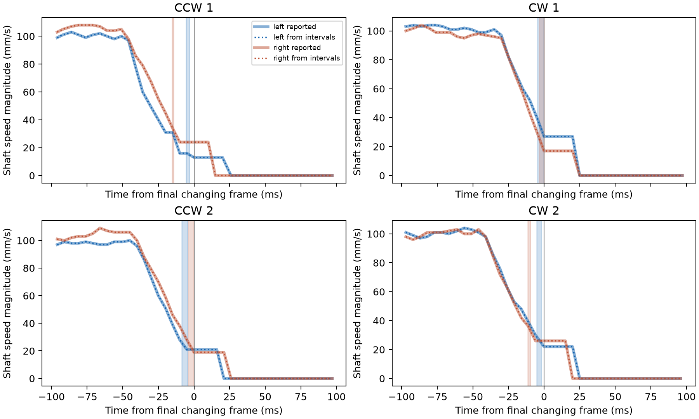

# Wheel-speed reporting through four native stops

The interval estimator reproduced **312 of 312 signed wheel-speed observations exactly**, in whole mm/s, across four 100 mm/s braking windows. That includes all 156 observations from the reserved second clockwise/counterclockwise pair. On that pair, differencing the same shaft counts at frame timestamps instead gives 5.08–5.76 mm/s mean absolute disagreement per wheel and turn. This checks the sensor report reconstruction. It does not equate the reported speed to the tread's instantaneous surface velocity.

The calculation uses the published [HAL conversion and stationary timeout](https://github.com/kercre123/victor/blob/669ec7499a7084640b57706a7937884a6568be50/robot/hal/src/hal_motors.cpp#L52-L66), opposite shaft polarity for the right wheel, the native count delta and elapsed edge timer in each frame, and truncation to whole mm/s. The fifth consecutive frame without a position change reports zero. All constants come from the reference source. The capture contains two buffer updates; evaluation uses each observation as paired in the file without shifting either stream. The canonical encoder synthesizes sub-frame edge times from simulated travel. This test isolates whether the measured hardware timer fields account for the physical reports.

**The last left and right edges can fall in different frames.** Colored bands show conditional bounds for the final edge of each wheel. On CCW 2 the left edge lies between −8.60 and −4.50 ms and the right between −4.05 and −0.30 ms relative to the final changing frame. On CW 2 the left lies between −5.15 and −1.80 ms and the right between −11.50 and −9.63 ms. The motor can move by less than one encoder count beyond that edge.

For the bands, sum the native edge intervals backwards from the last changing frame of each wheel, keeping only position changes in the last 100 ms. Each such edge must fall in its frame's acquisition interval. Intersect those intervals for the unknown final-edge time, allowing ±0.5 ms for integer timestamps at both boundaries. With no timestamp allowance, the first CCW right-wheel intersection misses by 0.17 ms. The CSV retains both versions. These are bounds relative to an assumed common acquisition phase. A constant offset between supervisor state and controller frame would translate them together; they do not calibrate the gyro clock. The earlier [native-stop](../hw-rec-20261119/native-stops.md) and [hybrid replay](../hw-rec-20261119/hybrid-replay.md) comparisons separately evaluate yaw.

Run `python edge_clock.py ../hw-rec-20261119/unit2-native-stops.csv` here. [Per-wheel errors and timing bounds](edge-clock.csv)
