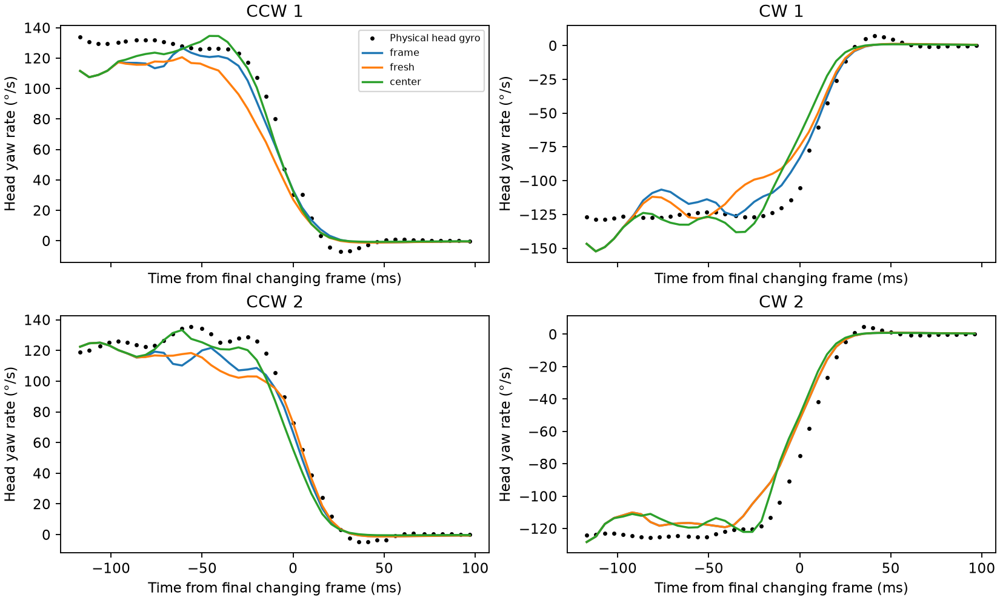

# Sub-frame encoder timing in a braking replay

Using the captured edge timers to place count changes inside the 5 ms control frames did not consistently improve the predicted head gyro. The apparent counterclockwise improvement at the canonical 1 ms integration step reversed when we halved that step. In the first 100 ms after the last changing frame, the midpoint estimate worsened both reserved stops at both steps.

| Reserved stop | MuJoCo step | Brake RMS, frame → timer midpoint | Post-edge RMS, frame → timer midpoint |
|---|---:|---:|---:|
| CCW 2 | 1 ms | 10.16 → 8.03 °/s | 3.51 → 6.67 °/s |
| CW 2 | 1 ms | 10.74 → 10.84 °/s | 7.95 → 9.46 °/s |
| CCW 2 | 0.5 ms | 5.35 → 11.40 °/s | 4.07 → 7.82 °/s |
| CW 2 | 0.5 ms | 7.57 → 10.95 °/s | 6.91 → 9.32 °/s |



Each simulation uses the Vector 2.0 browser chassis, its filtered gyro and the torque-limited shaft-position replay. The 5 ms control tick commands the average target velocity over the upcoming tick plus the existing 50 ms position feedback. Counts are converted with stock shaft polarity and pitch. No contact, gyro time shift, feedback gain or surface parameter was fitted. On each solver step, all variants have identical predicted gyro before −120 ms. On the reserved pair final shaft travel changes by less than 0.00002 mm between variants.

The frame baseline linearly interpolates the original cumulative counts. In the final 100 ms the fresh-frame control interpolates only the frames with new counts, suppressing plateaus between them. The timer variants use those same counts and place the final edge of each group using the [captured intervals](edge-clock.md), anchored to the early, midpoint or late feasible final-edge time on each wheel. The two extremes move both anchors to the same end of their respective ranges. After the final count the shaft target stays fixed. This offline reconstruction assumes uniform travel between consecutive knots. It has no sub-count observation of rebound, tread slip, or exact alignment to the gyro. RMS is computed on native timestamps over −100 to +100 ms and 0 to +100 ms respectively. The first CW/CCW pair is shown alongside the previously reserved second pair.

[Half-step overlay](half-edge-replay.png) · [Scores at 1 ms](edge-scores.csv) · [Scores at 0.5 ms](half-edge-scores.csv)

Run from this directory with the normal web test dependencies installed:

```sh
python edge_path.py
node edge-replay.mjs > edge-replay.csv
python edge_score.py
VECTOR_SPIN_STEP_MS=.5 node edge-replay.mjs > half-edge-replay.csv
python edge_score.py half-edge
```
