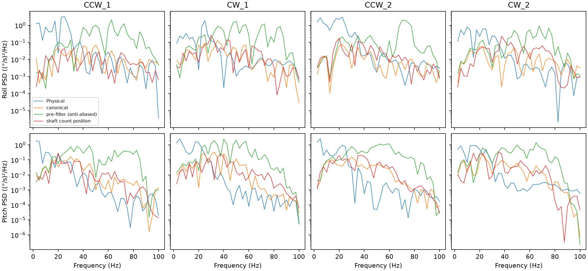

# The slow roll variation is already missing before gyro filtering

The earlier [SDK comparison](spin-axes.md) found that the simulated raw amplitude was large and the reported amplitude small. The robot-clock recordings resolve where that power lies. In all four 100 mm/s spins, even the *unfiltered* canonical dynamics supply less roll variation in the 2.5–20 Hz band than the physical head IMU reports after rotation into chassis axes.

| Reserved spin | Physical roll, 2.5–20 Hz | Canonical before IMU filtering | Canonical reported | Shaft count-position replay, reported |
|---|---:|---:|---:|---:|
| CCW 2 | 5.20 | 0.43 | 0.38 | 0.65 |
| CW 2 | 2.64 | 0.62 | 0.51 | 0.32 |

Values are band RMS in °/s. The simulated pre-filter signal has much more power at higher frequencies. In the 45–90 Hz band it measures 4.42 and 3.49°/s on the reserved spins while the physical sensor reports 0.58 and 0.40°/s. Hardware filtering contributes to that high-frequency comparison. Increasing gyro bandwidth alone cannot recover the missing low-frequency power in these model inputs.

Each comparison uses the same 400 ms grid, 520 to 125 ms before the final observed shaft edge. Native packets were interpolated at 200 Hz. The largest source spacing around these windows was 11 ms. We rotate the head gyro into chassis roll using head encoder angle. The pitch trace is the head Y gyro. Spectra use a Hann window and 2.5 Hz bin spacing after mean removal. Band RMS integrates power over bins including the lower and excluding the upper bound. The short record limits frequency resolution and gives no precise estimate of a resonance.

The unfiltered comparator takes the actual IMU input on every 1 ms solver step. A zero-phase 10th-order 85 Hz Butterworth filter before decimation prevents solver chatter above the native Nyquist frequency from folding into the slow band. The canonical reported and count-position replays retain the live web gyro pipeline. This one physical session identifies a missing slow signal. Tread contact, load transfer, structural motion and sensor artefacts remain possible contributors.

Run `node replay.mjs --axes > native-axes-trace.csv` followed by `python native_axes.py`. [All axis and band scores](native-axes.csv) · [Native measurements](../hw-rec-20261119/unit2-native-stops.csv)
