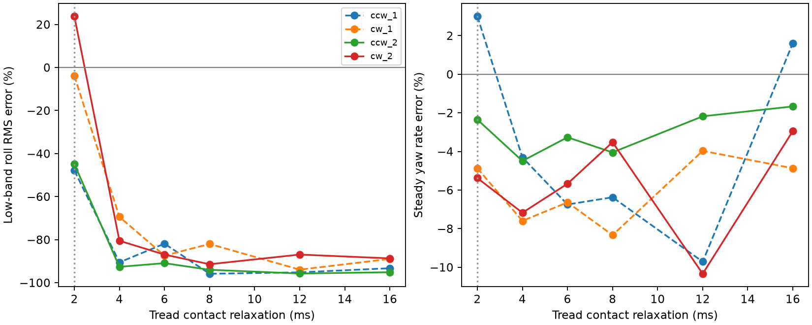

# Testing tread compliance against native roll and yaw

A stiffer contact gave a better apparent roll match at the default 1 ms integration step. That gain largely disappeared at two finer integration steps. This sensitivity rules out adopting the 2 ms contact relaxation on the strength of these spin traces.

| Reserved spin | Physical roll RMS | Default contact, default step | Stiffer contact, 1 ms step | Same stiffer contact, 0.5 ms step | Same stiffer contact, 0.25 ms step |
|---|---:|---:|---:|---:|---:|
| CCW 2 | 5.20 | 0.38 | 2.87 | 0.37 | 0.69 |
| CW 2 | 2.64 | 0.51 | 3.27 | 0.51 | 0.18 |

Values are °/s in the 2.5–20 Hz chassis-roll band. At the default step the same change also brought mean yaw speed closer on both reserved spins. CCW rose from 129.1 to 132.0°/s against 135.2°/s measured. CW rose from 126.6 to 129.0°/s against 136.4°/s measured.

We varied only the positive solref time constant on the four wheel contacts and four tread-end guards, using 2, 4 (default), 6, 8, 12 and 16 ms. The measured-wheel motor targets, IMU filter, friction, damping ratio, axle positions and initial head and lift pose are shared. The first CW/CCW pair selected 2 ms by minimizing mean squared log error in band RMS. The second pair was scored without refitting. Scores use the same 400 ms steady window and gyro rotation as the [native frequency analysis](native-axes.md).

The integration control retained the 5 ms controller period and increased the number of physics substeps accordingly. The results identify numerical sensitivity of this contact representation. They do not measure the rubber's physical stiffness. Run `python relaxation.py` to reproduce. [Contact sweep](relaxation.csv) · [Timestep controls](relaxation-step.csv)
