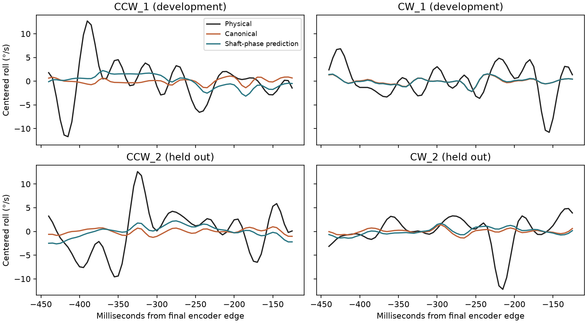

# Does steady roll recur at the same shaft positions?

The cumulative-encoder test did not identify a reliable spatial period for correcting the roll signal in both directions. Cross-prediction between the first CW and CCW chose 35 mm of tread travel per cycle. Applying the frozen fit to the second pair reduced CCW roll-rate RMS error from 4.76 to 4.43°/s but increased CW error from 3.43 to 3.54°/s.

The scored steady windows cover only 31.4 and 32.4 mm on the reserved pair, less than one proposed cycle each. A separate control used full and half circumferences of the nominal 29 and 21.5 mm wheels. The rear half-revolution period (33.77 mm) showed essentially the same directional split. Nothing here establishes a tread pitch or an eccentric wheel. A more discriminating recording would span several uninterrupted wheel revolutions per direction, logging all three native gyro axes and continuous counts through the entire steady turn.

We converted signed cumulative shaft counts to tread travel using the reference encoder scale, preserving count origins across trials. The model assumes a sinusoidal roll-angle contribution per tread. Its predicted roll rate is proportional to signed tread velocity times a sinusoid of its position. Four ridge-regularized sine/cosine coefficients allow an independent phase and amplitude per side. Both physical roll and the predictors use a causal 20 Hz low pass and steady-window centering. We fit the residual above the canonical prediction. We select the period in the 5–40 mm range on a 0.25 mm grid by fitting each first-pair spin and predicting the other. The final coefficients use both first-pair spins. The second pair has no phase adjustment or parameter refit.

Run `python shaft_phase.py` after generating the [native replay traces](native-axes.md). [Reserved and development scores](shaft-phase.csv) · [Axle-dimension controls](shaft-geometry-controls.csv)
