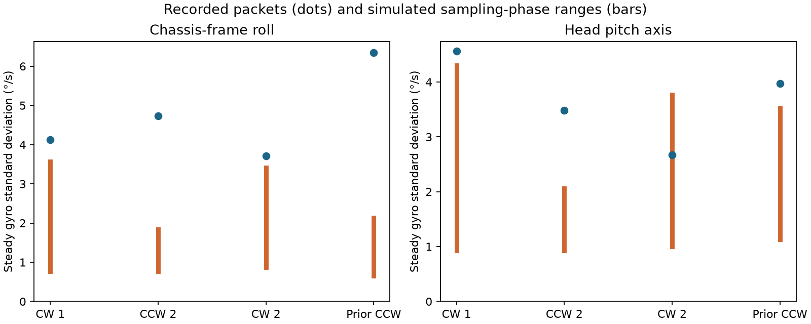

# Head angle and transverse gyro during steady 100 mm/s spins

The mean head gyro points within 0.67° of the recorded encoder inclination in all four usable physical turns. The simulated head encoder is within 0.08° of its physical counterpart on each. A large head-angle error is unlikely to explain the earlier steady yaw discrepancy on these runs.

| Reserved turn | Physical roll SD | Simulated reported roll SD | Simulated raw roll SD | Physical pitch SD | Simulated reported pitch SD |
|---|---:|---:|---:|---:|---:|
| CCW 2 | 4.73 | 0.8–1.8 | 11.0–20.4 | 3.48 | 0.9–2.1 |
| CW 2 | 3.72 | 0.9–3.4 | 10.1–27.9 | 2.67 | 1.0–3.8 |

All rates use degrees per second. The plotted dots are physical standard deviations across the 13–14 steady packets per spin. Bars span the simulated results at the same packet times shifted together from −30 to +30 ms in 5 ms increments. They represent sensitivity to sampling phase. The solver’s unfiltered roll variations exceed the recorded values in every spin and phase. The canonical filtered sensor underpredicts roll variation in every spin and phase. Pitch has a less consistent mismatch.

The replay uses the same command issue times and measured starting pose as the [wheel comparison](wheel-voltage.md), with the canonical battery and contacts. We rotate head X and Z rates into chassis axes using each source’s reported head angle. The pitch channel is the head Y gyro, which can also include movement at the head joint. Direction-aligned mean rates, encoder angles and gyro inclinations from atan2(mean X, mean Z) are in the CSV. A uniform steady-window coverage check excludes the first CCW turn. Each spin is one short observation and the phase range alone does not capture between-run variability.

This comparison brackets the observed roll variation between raw solver motion and reported gyro. Several changes could produce that outcome, including the spectrum of contact-induced motion or the sensor transfer function. These SDK recordings alone cannot distinguish them. Run `python spin_axes.py` to reproduce. [Complete scores including unfiltered rates](spin-axes.csv)
