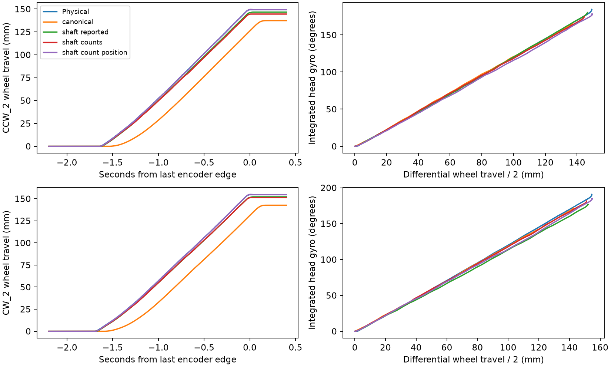

# Where the full-spin angle goes

The standard wheel controller replay finishes roughly 12 mm short of the native encoder count travel in each of four 100 mm/s spins. Its head gyro accumulates less angle per millimeter as well. The hardware input here is a recorded wheel-speed report used as a new motor command. This deficit characterizes that replay path.

| Reserved spin | Physical travel / angle | Canonical travel / angle | Count-position replay travel / angle |
|---|---:|---:|---:|
| CCW 2 | 149.24 mm / 184.34° | 137.36 mm / 166.53° | 149.24 mm / 178.08° |
| CW 2 | 154.51 mm / 190.76° | 142.62 mm / 171.89° | 154.51 mm / 184.81° |

Travel is half the signed right-minus-left tread displacement, aligned to the direction of turn. Physical travel comes from the net shaft counts at the existing reference conversion. Simulated travel comes directly from the wheel joint positions. Physical and simulated angles integrate the corresponding head gyro through 400 ms after the last physical shaft edge. Neither gives an independent world heading. The replay uses the measured starting head angle and the 30.645 mm lift reference from the original native-stop analysis, correcting the earlier comparison’s assumed 32.7 mm.

For the position-tracking diagnostic, two torque-limited velocity actuators drive the same wheel joints. The offline target interpolates the shaft count positions across each actual sample interval. A 50 ms proportional position correction makes up missed travel. Both actuators retain the standard peak torque. This controller and its gain were identical for all four turns. The two simpler controls drive the shafts from either reported speeds or finite count differences without the position correction.

Matching endpoint shaft travel reduces the held-out angle error from 9.7% to 3.4% CCW and from 9.9% to 3.1% CW. The remaining gap includes contact dynamics, tread distance calibration, head gyro response and timing within the turn. Matching the final travel does not establish that instantaneous speeds match. The position diagnostic has access to the recorded shaft trajectory and cannot predict an unseen motor response.

Run `node replay.mjs --travel > travel.csv` then `python travel.py`. [Results for all four turns and all controls](travel-scores.csv) · [Native replay inputs](../hw-rec-20261119/unit2-native-replay-input.csv)
