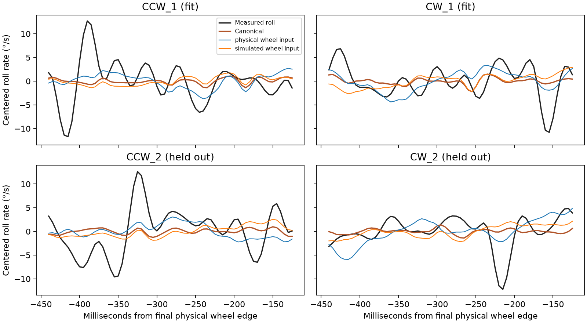

# Do wheel fluctuations predict the missing roll?

The two recorded wheel-speed reports contain some information about subsequent physical roll. A linear correction fitted on one CW/CCW pair reduced the error on both reserved turns when given their physical wheel reports. The same correction fed by the simulated wheel reports improved CCW slightly and worsened CW.

| Reserved spin | Canonical RMS error | With physical wheel reports | With simulated wheel reports |
|---|---:|---:|---:|
| CCW 2 | 4.76 | 4.35 | 4.65 |
| CW 2 | 3.43 | 3.24 | 3.70 |
| Pair | 4.15 | 3.84 | 4.20 |

All values are °/s. The 55 ms lag and two signed coefficients were selected using only the first pair. Independently circular-shifting each held-out physical wheel correction gave error at least as low as the observed alignment in 1.7% of 4,096 alignments. With simulated reports, 38.6% did as well. These are descriptive timing controls for two short autocorrelated traces. They do not establish causality or a hardware delay.

This test uses the existing canonical flat-table replay driven with recorded wheel speeds. We rotate X/Z head gyro into chassis roll using the reported head angle, resample at 5 ms, and pass both roll and wheel signals through a causal 20 Hz second-order low pass. We compare variations around each window mean, from 440 ms to 125 ms before the final native shaft edge. A least-squares fit predicts the physical-minus-canonical roll residual from the two centered wheel reports, with one shared delay selected over 0–90 ms in 5 ms steps. The control with simulated wheel reports freezes every coefficient and uses the simulator’s motor response. The training and evaluation windows come from the same session and surface.

The evidence supports investigating wheel-speed fluctuations and contact under load together. It does not justify adding the fitted gyro correction to the simulator. Reproduce the native replay as in [the frequency comparison](native-axes.md), then run `python wheel_roll.py`. [Per-turn scores and fitted coefficients](wheel-roll.csv)
