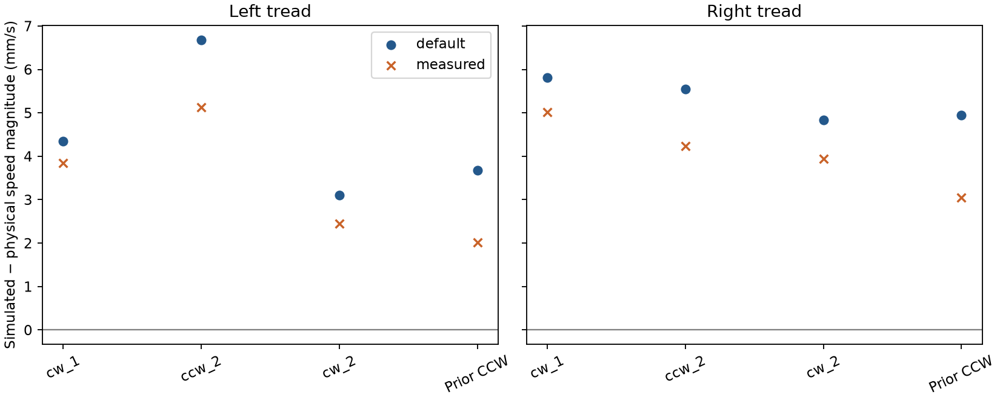

# Steady wheel speed by tread and direction

Both treads run fast in both directions in the command-driven repeats. On the reserved CW spin, the backwards right tread had the larger excess. On the reserved CCW spin the backwards left tread had the larger excess. An independent CCW recording reverses that ordering. Four usable spins in two sessions support a shared excess, while the side or direction dependence remains unresolved.

The default rest voltage is 4.03 V. We substituted each session’s pre-spin pack reading (3.8172 V in the repeats and 3.7516 V in the earlier CCW session), preserving the same sag model, controller, motor reference voltage, contact geometry and commands. This is a proxy for rest voltage. The recording has no motor-terminal voltage under load.

| Spin | Default left / right excess (mm/s) | Measured-voltage left / right excess (mm/s) | Full gyro angle error, default → measured voltage |
|---|---:|---:|---:|
| Reserved CCW 2 | +6.68 / +5.55 | +5.13 / +4.23 | +1.08° → −5.93° |
| Reserved CW 2 | +3.10 / +4.83 | +2.44 / +3.94 | −2.95° → −0.24° |
| Earlier CCW | +3.68 / +4.94 | +2.02 / +3.05 | +6.78° → −5.22° |

All eight individual tread-speed errors decrease, yet the total head-gyro angle error grows on two of four turns. A global voltage change therefore lacks support as a correction for this discrepancy. Each steady value averages physical speed magnitude and the simulated report interpolated at the same 13–14 packet times, from 550 ms after issue until 250 ms before the stop. We exclude any steady window crossed by a packet gap longer than 180 ms. The full-turn angle uses the earlier command replay window and a separate gap check. All comparisons are offline.

Run `python wheel_voltage.py` alongside [the command replay](command-spins.md). [Per-wheel scores](wheel-voltage.csv) · [Full-turn angles](voltage-angle.csv)
