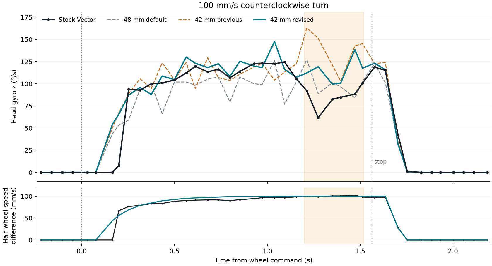
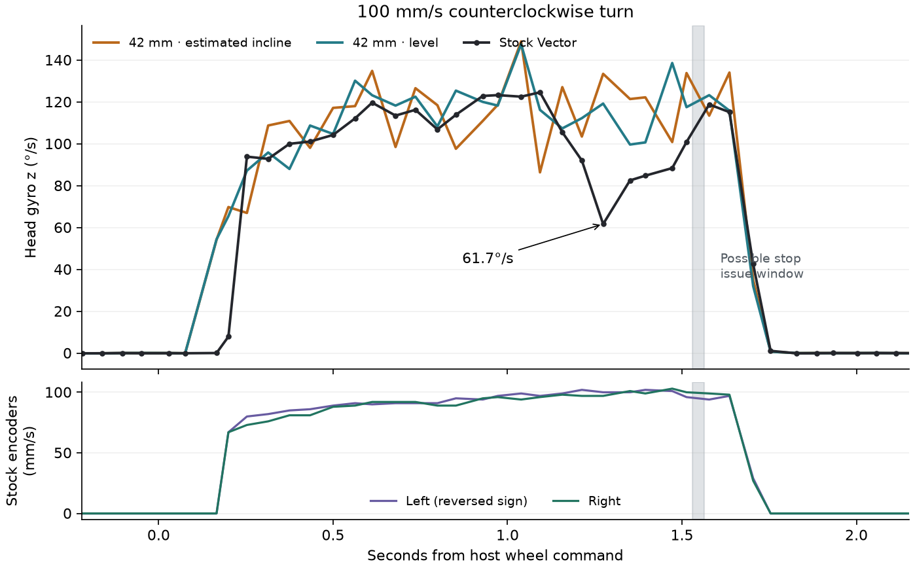
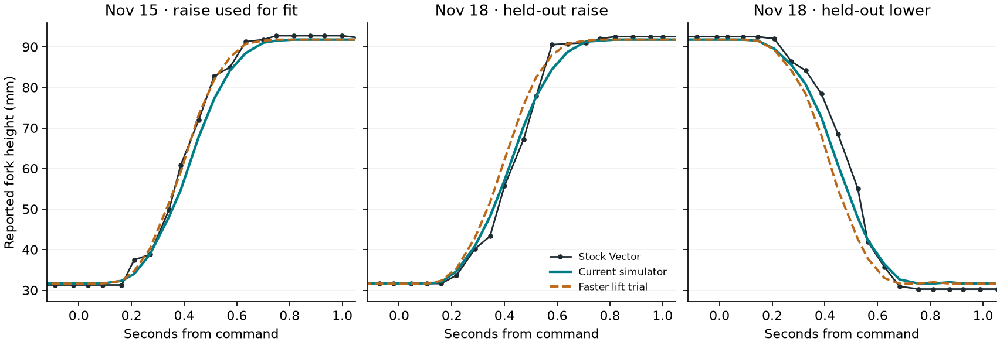
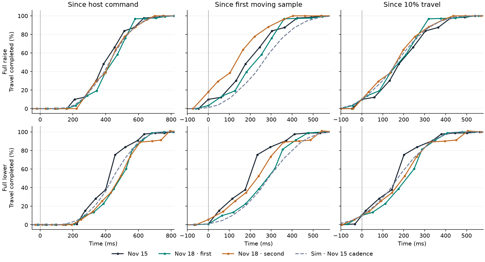
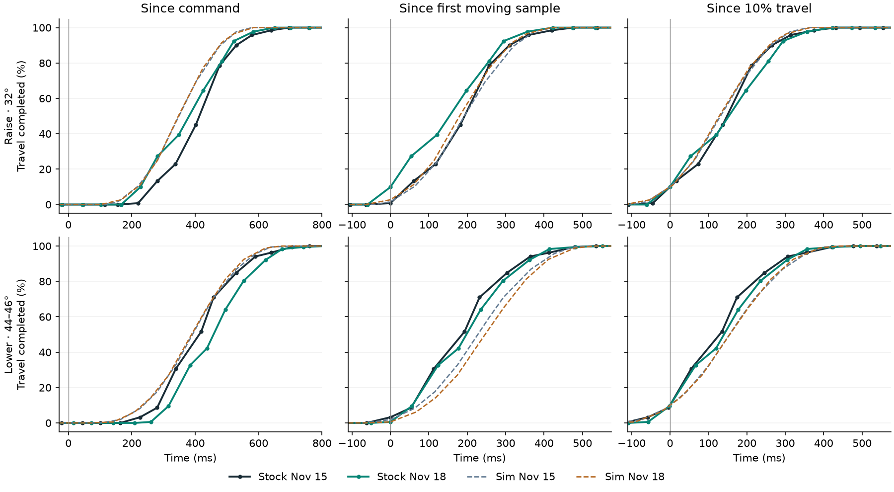
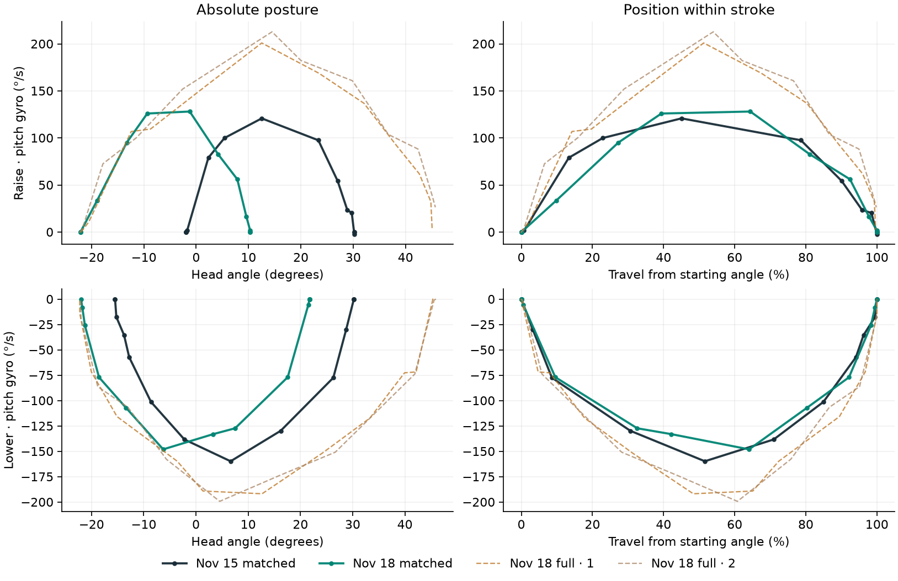

# Stock shell and physics checks, 18 November 2026

## Visual registration

The front three-quarter view uses the [iFixit device photograph](https://www.ifixit.com/Device/Anki_Vector). The raised-lift side view uses step 1 of [Shay Takei’s touch sensor replacement guide](https://www.ifixit.com/Guide/Anki+Vector+Capacitive+Touch+Sensor+Replacement/123280). The local comparison includes the photograph, the browser rig from 3424959, and the updated rig. Each pair of renders uses the same camera, rig pose and lighting.

At 800 × 600 pixels, the estimated camera azimuth/elevation is 27.8°/35.6° for the front and 85.8°/−11.9° for the side. The pinhole fit used the axle centres, wheel faces and visible body or lift landmarks, with 1,400 px focal length. The corresponding per-coordinate landmark RMS is 9.8 and 2.6 pixels. These numbers describe camera registration. The reference photographs have no lens calibration.

Three owner photographs show the LCD and camera carrier with the visor removed, the head vents in profile, and the backpack from above. The gold touch plate opens at the rear. Four microphone ports lie in the scallops along its outer edges. The convex black indicator sits inside a lower channel and extends rearward past the gold. The head cover has two rows of five transverse slots. Parts of the SDK geometry remain visibly more angular than the moulded shell, particularly the lift arms and their rear pivots. The colours and shell relief are photo estimates. Wheel, fork and joint placement use print geometry and firmware dimensions.

## Physics checks

The MuJoCo camera uses the firmware's 4° downward mount angle. Two massless collision boxes approximate the fork's upright plates. A contact probe hits the left and right plates and clears the opening between them. The physics engine controls the head, wrist and wheels while the visual belt follows the driven wheel around its tangent path.

| Hardware replay | Observed error |
| --- | --- |
| Held-out head and lift moves | 1.29° head angle RMS and 3.04 mm lift height RMS |
| Held-out 60 mm/s spins and 80 mm/s straight runs | 0.1401 combined normalized error |
| Separate run A, 15 servo moves | 0.0317 mean error as a fraction of joint range |
| Run E, steady spins at 150 mm/s, CCW and CW | Robot 184.9 and 184.0°/s. Model 155.1 and 160.0°/s |
| Run E, steady spins at 220 mm/s, CCW and CW | Robot 269.3 and 271.1°/s. Model 234.0 and 229.4°/s |

Two isolated tests explored the turn error. Adding a rolling support at each belt midpoint reduced run E’s combined error from 0.1591 to 0.1543 but increased the low-speed held-out score from 0.1401 to 0.144. Changing the effective tread friction from 0.90 to 0.55 reduced run E’s combined score to 0.1508, but three of its four steady yaw rates moved further from the measured values. The shipped contact model retains the baseline on both counts.

The simulated quasi-static rear and side tipping angles are 64.90° and 51.86°. These check the model against its assumed mass distribution. Physical tipping thresholds, centre of mass, tread pressure and surface friction still need independent measurements. Run C did not connect to the cube, so it cannot validate loaded fork dynamics.

From the simulator directory, reproduce the replay values with:

```sh
python replay_recording.py
python replay_recording.py --servos-of evidence/hw-rec-20261118/run-a-rest-headlift.jsonl
python replay_recording.py --wheels-of evidence/hw-rec-20261118/run-e-spins.jsonl
python replay_recording.py --set tread_friction=0.55 --wheels-of evidence/hw-rec-20261118/run-e-spins.jsonl
```

## Fast-turn diagnosis and oblique head comparison

The additional oblique photograph places the upper LCD between the projecting cheeks. The camera bracket projects forward of the display. The updated shell has an open front with a flush upper edge and a shallow lower lip. The nominal LCD plane moved back 3.15 mm in the model, an estimate from the photographs. The camera's optical centre remains at its firmware coordinates. The four lift links have rounded sections that taper and curve inward at the fork. Their shoulders and wrists follow the existing parallelogram. The rear link ends sit over dark bearing rims.

Run E contains four fast turns with the head at 22.6°. Comparing the magnitude of the three-axis angular velocity removes head-frame projection. Values below are means over the second half of each command, sampled at the hardware state times. Model wheel speeds in all four baseline cases are within 0.9 mm/s of the robot.

| Command | Robot angular speed | Baseline | Contact proxies 3 mm inboard fore/aft | Centre of mass 4 mm forward |
| --- | ---: | ---: | ---: | ---: |
| 150 mm/s CCW | 200.2°/s | 172.7°/s | 200.0°/s | 209.9°/s |
| 150 mm/s CW | 198.7°/s | 171.0°/s | 198.0°/s | 203.8°/s |
| 220 mm/s CCW | 290.6°/s | 257.2°/s | 292.7°/s | 290.1°/s |
| 220 mm/s CW | 292.5°/s | 250.3°/s | 286.6°/s | 292.8°/s |

The contact solver balances the torque from longitudinal traction against the opposing moment of lateral tread scrub. In baseline run E, the two terms have opposite signs in every trial. Their mean magnitudes at the sampled instants span 11–22 mN·m. At nearly identical belt speeds, the stock robot rotates through a larger angle. The chassis’s rotational response depends strongly on where the ground carries the load along the tread.

The contact experiment moves the four simulated rolling supports 3 mm toward the belt midpoint, reducing support-to-support span from 48 to 42 mm. It moves the associated wheel masses as well. A second experiment retains all four support positions and moves the assumed fore-aft centre of mass from −24 to −20 mm. On the 29 completed spins of run F, the median model/hardware gyro-z rate ratio is 0.882 for baseline, 1.010 for the shorter span, and 1.015 for the forward mass. This segment replay initializes the model separately for each spin. The low-speed held-out combined scores are 0.1401, 0.1323, and 0.1362 respectively. Encoder and gyro data alone cannot locate the centre of pressure or the centre of mass. Both experiments stay diagnostic because either change would also affect contact with edges and the tipping threshold. A fore/aft static load split with known support positions, followed by a print of the loaded tread contact patch on the recording surface, would discriminate between them.

To reproduce the four run E rows and the signed drive/scrub moments, run:

```sh
python diagnose_turns.py
python diagnose_turns.py --inset-mm 3
python diagnose_turns.py --com-x-mm -20
```

## Installed shield

Bill Henderson’s stock Vector photographs show the cover rolling over the upper corners of the head, meeting the side cheeks along a narrow seam, then curving back beneath the camera. The oblique close-up was mirrored for comparison with the owner’s photograph. The cameras for the stock and owner photographs were matched separately. Both simulator revisions use identical camera, head, lift, and lighting settings within each comparison. Registration and profile depth are photo estimates. [Stock face close-up, image 9](https://the-gadgeteer.com/wp-content/uploads/2018/12/Anki_Vector_9.jpg) · [Crown and ear, image 4](https://the-gadgeteer.com/wp-content/uploads/2018/12/Anki_Vector_4.jpg) · [Review](https://the-gadgeteer.com/2018/12/31/anki-vector-robot-review/)

The cover and shell now use the same perimeter. The temples sweep back into the crown, the gold insert sits inside a curved ear surround, and the lower quarter of the shield clears the camera barrel. The visor material transmits the LCD and reflects the simulated room. The sensor positions still come from the robot parameter table. A ray test checks the installed shield in front of the camera barrel, bracket and LCD hardware.

The subsequent contour correction builds the outer shell and removable shield from one convex head surface. The seam determines the material boundary. Its 96 vertices coincide and use the same surface normals. The recessed return behind the cheeks has independent normals so it can be visible with the shield removed without producing a ridge in the installed silhouette. The side-profile comparison uses the same camera and head pose in both renders. The regression test checks the position, the direction of adjacent surface segments, the shading normal and clearance over the hardware. Absolute curvature remains a photograph-based estimate.

## Rear linkage and tread contact isolation

The raised side photograph shows a flatter outer cheek on each moulded link, a slimmer upper arm, and a fuller lower arm that bends again as it enters the rear bearing. The lowered three-quarter photograph shows the narrowing and inward sweep toward the fork. The revised links follow those contours and cover the pin with a rounded end over a stepped bearing. The before/after renders use the same two registered cameras and lift poses. The pin centres and fork geometry retain the rig and print dimensions. The visible bearing profile and link sections are photo estimates.

To isolate the fast-turn deficit, the support centres were moved fore/aft while compensating the chassis inertia for the relocated wheel masses. Equal and opposite displacements conserve the robot COM. A parallel-axis correction restores the full inertia tensor, including its xz term. At the default pose the 3 mm experiment reproduced the production COM exactly and the largest absolute change in the MuJoCo generalized mass matrix was 3.3e−19 in SI units. This allows contact leverage to change independently of free-space mass properties.

| Run E steady angular speed (°/s) | Hardware | Production, 48 mm span | 45 mm span, inertia held | 42 mm span, inertia held |
| --- | ---: | ---: | ---: | ---: |
| 150 mm/s CCW | 200.2 | 172.7 | 187.4 | 195.6 |
| 150 mm/s CW | 198.7 | 171.0 | 180.0 | 199.9 |
| 220 mm/s CCW | 290.6 | 257.2 | 277.9 | 296.8 |
| 220 mm/s CW | 292.5 | 250.3 | 270.4 | 288.7 |

At a 42 mm support span all four rates are within 2.4% and mean encoder speeds within 1 mm/s of hardware. On the 29 completed run F turns the median simulated/measured gyro-z ratio moved from 0.882 to 0.984. The low-speed held-out combined score moved from 0.1401 to 0.1334 (lower is better). Two controls retained the full 48 mm span. Reducing only the contact width from 10 to 1.5 mm with wheel mass and inertia held fixed still left all four turns 9–11% slow. Reducing the integration step from 1 to 0.125 ms with fixed contact and coupling time constants still left them 13–15% slow.

The four end-loaded contact cylinders therefore provide enough lateral scrub leverage to explain the error on this surface. The 42 mm value describes an equivalent contact span for these recordings. Independent pressure or load measurements are needed to assign a physical span or a mass distribution to the stock robot. The production robot retains its measured axle positions.

Reproduce the controlled run E sweep with:

```sh
for inset in 0 1.5 3; do
    python diagnose_turns.py --inset-mm "$inset" --preserve-inertia
done
```

## 42 mm contact trial with fixed stock axles

Open the web simulator with `?contact=42` to use the separate trial MJCF. The wheel joints and encoders stay at x = 0 and −48 mm. Two numerically coupled rolling contact supports per side sit at −3 and −45 mm. Each support borrows 1 mg of wheel mass and 10% of the reflected shaft inertia. The original axle-centred collision cylinders are relieved by 0.3 mm so the outer tread can take the load during tipping. These are modelling choices. The visible wheels and belts use the stock axes in both modes.

| Stock recording comparison | Default | Fixed-axle trial |
| --- | ---: | ---: |
| 40 mm/s straight, reverse / forward encoder RMS (mm/s) | 3.7 / 3.6 | 3.7 / 3.6 |
| 80 mm/s straight, reverse / forward encoder RMS (mm/s) | 5.8 / 6.9 | 5.8 / 6.9 |
| 30 mm/s spin, CCW / CW gyro-z RMS (°/s) | 7.3 / 5.4 | 7.0 / 5.6 |
| 60 mm/s spin, CCW / CW gyro-z RMS (°/s) | 12.8 / 16.3 | 11.4 / 14.0 |
| 100 mm/s spin, CCW / CW gyro-z RMS (°/s) | 18.5 / 19.0 | 26.5 / 15.6 |
| Simulated rear / side tipping thresholds (°) | 64.902 / 51.855 | 64.907 / 51.855 |

The 150 mm/s CCW/CW steady rates were 199.62/200.15°/s (hardware 200.19/198.71); at 220 mm/s they were 290.64/286.89°/s (hardware 290.63/292.51). Full-transient gyro RMS and steady spin rate measure different things. The 100 mm/s CCW transient worsened. Straight-run hardware data include wheel encoders and odometry but no independent displacement measurement. Runs B and C logged no successful wheelie and neither brackets physical tipping. The stock-matched tipping condition for enabling this trial by default is still open. Compare with a rear and side balance release from a stock robot on the recording surface.

Run `python contact_trial.py replay`, `python contact_trial.py spin` and `python contact_trial.py tip` in the simulator Python environment. Each command also works with the corresponding original replay, diagnosis or wheelstand script for the default model.

The revised rear shell follows the convex centre panel and its two moulded lines down toward the underbody. The belly pan has four recessed cliff windows at the firmware sensor centres. The rearward contact carrier holds two flush gold pads and the identification label. Panel depth, label typography and contact size are estimated visually. [Anki FCC exhibit 4074220, external photographs](https://fccid.io/2AAIC00010/External-Photos/External-Photos-4074220) · [Production underside, Bill Henderson, image 12](https://the-gadgeteer.com/wp-content/uploads/2018/12/Anki_Vector_12.jpg).

## Resolving the 100 mm/s CCW regression

The 41-point gyro-z overlay uses the host receive times in table-run1, the recorded head/lift pose and the original replay window. There is no fitted time shift or smoothing. Six samples from 1.20 to 1.52 s account for 69% of the previous 42 mm trial's squared error. At 1.274 s the physical left/right encoders read −100/+97 mm/s but gyro z drops to 61.7°/s. The three-axis angular speed also drops to 69.4°/s and the head angle remains 22.36°. The previous 42 mm calculation gives 151.3°/s at that sample. The stop is later, at 1.563 s. A second mismatch occurs at onset: the simulator is already rotating in the 0.17 s sample while stock encoders and gyro are still at rest.

The numerics amplify the difference. Rotating just the square table about its vertical axis while the robot stays well inside its edges changes the previous 42 mm CCW error from 17.9 to 26.5°/s across five orientations. At 150 mm/s CCW its steady rate spans 190.2–199.6°/s across those orientations. With multi-point collision detection enabled the four contact proxies sometimes generate up to eight patch contacts in one sampled step. Disabling that option alone recovers the medium-speed trace (19.1°/s RMS), but the 29 completed 300 mm/s commands in run F then have a median simulated/hardware gyro-z ratio of 1.041. This was a tuning cross-check.

The revised opt-in scene uses single-contact CCD and gives the auxiliary belt-to-axle equality constraints a 10 ms settling time. The production axle, motor controller and gyro readout are unchanged. The settling time is a numerical calibration, not a measured belt time constant. The recordings support increased slip during the late dip, but cannot identify a specific tread defect or variation in the physical surface.

| Metric | Default 48 mm | Previous 42 mm | Revised 42 mm |
| --- | ---: | ---: | ---: |
| Full 100 mm/s CCW gyro-z RMS error (°/s) | 18.5 | 26.5 | 19.1 |
| Late six samples, gyro-z RMS error (°/s) | 20.4 | 57.5 | 34.3 |
| Full 100 mm/s CW gyro-z RMS error (°/s) | 19.0 | 15.6 | 13.7 |
| Run E, worst absolute steady angular-speed error, four spins | 14.4% | 1.92% | 1.10% |
| Run F, median model/hardware steady gyro-z ratio, 29 completed spins | 0.882 | 0.992 | 1.013 |

For run E the revised angular speeds are 198.00/198.52°/s at 150 mm/s CCW/CW and 289.37/293.52°/s at 220 mm/s. The held-out 60 mm/s gyro errors are 11.3/13.8°/s and the 80 mm/s reverse/forward encoder RMS errors are 5.8/6.9 mm/s. Simulated rear and side tip angles are 64.817° and 51.852°. The trial also passes the cliff-reaction, override-fall and open-fork contact checks. Physical tip angles still lack a stock measurement.

Run `python contact_trial.py trace` for the time-aligned overlay CSV or pass a recorded spin label to select another maneuver. Use `replay`, `spin` and `tip` as above for the updated scalar results.

Two additional owner photographs show the back head-on and at rear three-quarter. They expose the continuous sweep from the electrode down the grey shell, the convex glossy pivot surrounds, the rear badge, and a central rounded recess crossing a low horizontal parting line. The web mesh now carries this contour from the belly to the touch plate; the indicator follows the upper arc. The photos supply shape and relative placement; absolute depths are estimates. The earlier FCC underside and stock side views constrain the lower return and side silhouette.

## Table turns

Pull request #114 moved the treads to where Anki's rig has them: centres 47.9 mm apart, 11.5 mm wide (they had been 46 and 10 mm). With the trial's 42 mm span unchanged, the run E test failed on MuJoCo 4.0.1: `spin_cw_220` ran 2.16 % slow against a 2 % limit.

Turning the 1.5 m table box about its own vertical axis changes nothing physical, but it moves each spin's steady rate. The table was turned by k × 11.25 rad for k = 0 to 7. Within the box's quarter-turn symmetry those turns are 0, 14.6, 29.2, 43.7, 58.3, 72.9, 87.5 and 12.0°. On this geometry, each spin's standard deviation over the eight turns was 0.9–1.8 %. The default model is as sensitive: from a turn of 0 to one of 30 rad, its 150 mm/s CCW error went from −3.1 to +3.1 %. A cylinder on a box goes through MuJoCo's general convex collider. With single-contact collision, the one contact of each 11.5 mm patch landed 27–29 mm from the robot's centre line (standard deviation 3–5 mm per patch), against a tread centre at 23.95 mm. At that spread an unbiased trial keeps all four spins within 2 % at only about half the orientations, so one orientation cannot resolve the limit. The test now holds each spin's mean over the eight turns to the same 2 %.

Run E steady rates are read at the robot's 25 sample times in the second half of each spin, as the test reads them. Spins are listed CCW 150 / CW 150 / CCW 220 / CW 220 mm/s.

| Trial | Mean error over the eight turns | Worst spin | Turns with all four within 2 % |
| --- | --- | ---: | ---: |
| `main` 1fe224e, 42 mm | −0.84 / +0.79 / +0.12 / +0.23 % | 0.84 % | 6 of 8 |
| This PR, 42 mm, kept | −1.34 / −0.71 / −1.14 / −1.64 % | 1.64 % | 0 of 8 |
| 41.0 mm | +0.25 / +0.74 / +0.68 / −0.74 % | 0.74 % | 5 of 8 |
| 41.5 mm | −0.32 / +0.07 / −0.39 / −0.67 % | 0.67 % | 4 of 8 |
| 43.5 mm | −4.04 / −3.27 / −3.15 / −4.26 % | 4.26 % | 0 of 8 |
| 48.0 mm, no inset | −11.54 / −10.41 / −10.82 / −9.93 % | 11.54 % | 0 of 8 |

The corrected geometry leaves every spin slow, by 1.21 % on average. That is a model error of the trial on this geometry, within the 2 % limit, and it is recorded here rather than tuned away. The span is an equivalent span fitted to these recordings. Averaged over the four spins, the error falls steadily with span: +0.23, −0.33, −1.21, −3.68 and −10.67 % at 41.0, 41.5, 42.0, 43.5 and 48.0 mm. So 41.0 to 41.5 mm would remove the bias. But at 41.5 mm the 100 mm/s CCW trace, which the test still reads at one orientation, came out at 22.6 °/s RMS against its 21 limit (19.3 at 42 mm), so the span stays 42 mm. Whether the trace has the same orientation spread was not measured. The 43.5 and 48 mm spans fail the averaged check, and the mutation check types the span 1.5 mm long and expects the test to fail.

Two other contact proxies were measured over the same turns and not adopted:

- **Narrow patch cylinders on the tread centre line.** Worst spin 0.77 % for a 0.5 mm patch, 1.31 % for 1 mm and 0.82 % for 2 mm. The 0.5 mm patch raised the 100 mm/s CCW trace to 21.8 °/s RMS, over the test's 21. The 1 mm patch braked worse than the tread copy (below).
- **A sphere of the tread radius.** Identical results at every turn. But the front spheres contain the front cliff sensor sites: at (2, ±14, 8) mm the front sphere spans heights 5.2–23.8 mm. MuJoCo's documentation says a rangefinder ignores only the body its site is on, so the cliff rays would meet the sphere; this was not run. A sphere also reaches 8.75 mm beyond the tread's outer face at axle height.

Native braking on this geometry, from `experiment_pressure.py` in native mode at the 1 ms step (unit 2's two native stops, hybrid braking gyro RMS): the tread copy at 42 mm gave 9.97 °/s, the 1 mm patch 12.28 and the sphere 10.69. The spheres' 16.91 °/s in [Separating numerical drift](endurance-drift/pressure.md) was measured on the earlier geometry.

`python contact_trial.py turns` prints each spin's error at the eight turns, with their mean and standard deviation.

## Vector 2.0 underside appearance

The separate owner photograph identifies this unit by its printed “MODEL: Vector 2.0” label. Its stepped battery door, centre-front screw, brass pads and offset rectangular label differ from the Anki underside photograph. A planar registration using the centres of the four cliff windows places the pad centres about 35.2 mm behind the front axle, at lateral offsets of about 9.9 mm. The pads measure approximately 12.2 by 5.5 mm in the registered plane. Relief and screw depth are visual estimates. The two serial fields are represented without copying the owner's identifiers.

Use `?shell=2` for this appearance, or `?shell=2&contact=42` to pair it with the contact trial. The selection changes rendered body geometry only. The new photograph shows a different ESN from the hardware drive recordings and does not establish their hardware revision.

The 2.0 lower rear cover now turns nearly parallel to the belly at its centre. Its outer edges rise earlier and sweep around the corners. The rear band of the black pan curves up behind this lip. The comparison reuses the four-window registration, the same 800 × 600 camera and identical lighting for both browser renders. At image rows 218, 230, 248, 270, 300, 330, 360, 390, 420 and 437, the manually read grey/black boundary in the photo is at x = 204, 222, 241, 246, 249, 252, 254, 255, 252 and 235 pixels, respectively. The mean horizontal discrepancy against the rendered cover silhouette fell from 7.4 to 3.6 pixels. The contour between these landmarks, especially its depth, is a visual estimate.

In the subsequent underside and straight-rear comparison, the lower grey panel has a broad planar centre, a short return onto the belly and rounded flanks alongside the treads. The shallow arch above the sticker fades at the horizontal seam. Both views use the same mesh. Across a 15.6 mm wide central sample between heights of 6 and 16.7 mm, all 558 sampled vertices lie on the inclined plane within 0.00001 mm. A segment–triangle check found no crossings among nonadjacent triangles in the sampled lower shell (12,096 triangles). These checks describe the simulated surface. The panel inclination and flank curvature are estimates from the photographs.

The taped underside and rear views refine the longitudinal section of the 2.0 cover. In the oblique image, manually sampled both long tape edges. Estimated a pinhole camera from the four cliff windows and two contact pads (about 10 px RMS landmark reprojection error at 1440 px image width). Each edge was back-projected into a longitudinal plane using its lateral position over the belly, then registered separately to the existing model lip and parting seam. At 20%, 40%, 60% and 80% of the rise, the two traces respectively traverse about 38–39%, 58–60%, 74–75% and 89% of the rearward offset. A cubic follows those proportions with a horizontal belly tangent and a shared tangent at the shoulder. The straight rear photograph constrains the breadth of the central strip and the rounding at its sides. The 21.9 mm developed length is for the fitted model centreline between lip and seam. Absolute dimensions still depend on the existing mesh landmarks and tape adhesion.

## Testing the remaining CCW dip against incline and timing

For the revised 42 mm trial, `python contact_trial.py trace --rest-tilt` also replays the segment with gravity oriented using the stationary IMU readings in the preceding 0.9 s. This removes the calibrated accelerometer bias and rotates each reading back by the measured head angle and sensor pitch. It estimates apparent incline, which also includes any static chassis lean. It uses no turning gyro samples to select the incline. At 100 mm/s CCW the estimate was 1.59°. Level and inclined replay errors were 19.1 and 23.0°/s RMS. At 1.274 s the stock gyro read 61.7°/s, versus 119.2 and 133.4°/s. Integrating the head gyro z trace between the six stock samples at 1.213–1.513 s gives 24.5° on hardware, 34.4° on level and 35.8° on the estimated incline. This integral is about the sensor z axis.

At 60 mm/s CCW/CW the gyro RMS errors went from 11.3/13.8 to 10.5/13.6°/s. At 80 mm/s reverse/forward the level encoder errors were 5.8/6.9 mm/s, and the incline sensitivity was less than 0.5 mm/s in either direction. Across the four run E fast spins the largest absolute steady angular-speed error was 1.10% on level and 1.78% with the individually estimated inclines. These mixed results support keeping incline as a diagnostic scene condition.

Historical recorders stamped the drive command before its RPC but the stop after its RPC. In the 100 CCW run the requested hold could expire no earlier than 1.5292 s after the wheel command, with the stop acknowledged at 1.5632 s. Neither boundary precedes the 1.274 s dip. A sensitivity replay on the same common sample window gave 19.4°/s RMS at the recorded stop and 21.0°/s at the earliest possible stop. Increasing the shared command delay from 75 to 90 or 105 ms gave 21.0 and 22.2°/s. New barriered recordings store the stop issue and return times together on the successful stop row. Replays use the issue time when present and retain the existing interpretation of old files.

A cross-check used the magnitude of gyro z divided by the magnitude of the measured right-minus-left wheel speed, from 0.55 s after each command until its stop. In the 100 CCW run the 10th percentile of this ratio was 67% of its median on stock and 88% in the simulator. Across the 29 completed run F spins, the corresponding medians of the per-spin fractions were 97% on stock and 91% in simulation. In 26 of 29 runs the stock fraction was at least as high as the model's. A universal increase in random slip would move fast turns in the wrong direction on this measure. No repeated 100 CCW trial under matching conditions is available to identify whether its dip recurs.

## Unloaded lift encoder and motion replay

Both archived sessions expose the lift encoder's calibrated reference. For each distinct reported height, invert the firmware geometry with angle = asin((height_mm − 45) / 66), without clamping at SDK command limits. Quantize the angle in 0.0052465 rad increments, then convert it back to height. A zero-angle origin misses the hardware reporting grid by up to 0.07261 mm. With the origin at the angle corresponding to the 32 mm low-dock height, the largest discrepancy is below 0.00018 mm across all 2,700 table-run1 states (126 distinct heights) and all 1,384 run A states (70 distinct heights). This matches the encoder reset in the pinned LIFTC source, OnMotorCalibrated. Both simulators now report lift counts relative to this angle. These residuals describe agreement with the encoder's reporting grid, not mechanical positioning accuracy.

To test the multi-millimetre transient error independently, replay the Nov 15 full raise with lift accelerations 8, 10, 12, 15 and 18 rad/s² crossed with servo delays 75, 90, 105, 120, 135 and 150 ms. Select by the raise's height RMSE only, then apply that pair to the other moves. The selected 12 rad/s² at 105 ms improves the fitted raise from 2.36 to 1.20 mm and the held-out Nov 15 lower from 3.09 to 2.28 mm. Mean per-move RMSE across the six moving lifts of Nov 18 run A worsens from 2.24 to 3.43 mm. Its first full lower crosses halfway at 489 ms on hardware, 445 ms in the current simulator and 417 ms in the faster trial (linear interpolation of the recorded sample times between each trace's resting heights). The stationary command was scored separately. The simulator retains the SDK's 10 rad/s² ramp. Reproduce the independent-session comparison with replay_recording.py --servos-of evidence/hw-rec-20261118/run-a-rest-headlift.jsonl, adding --set lift_accel_default_radps2=12 for the candidate.

### Stock and simulator overlays







## First-motion alignment of the unloaded lift



Both recorders stamped the host's SDK command and sampled the reported fork height. The interval from the command to the first encoder change includes transport in both directions, mechanical take-up, encoder resolution and sampling. With these data it is possible to test a rigid time shift, but impossible to isolate the one-way command latency.

For each trace, take the median pre-command height as rest. First observed motion is the first sample at least one encoder count from rest in the command direction, confirmed by the next sample. Its possible onset lies between that sample and the preceding one. Normalize travel between rest and the median height from 0.82 s to the end of the replay window. Interpolate the 10%, 50% and 90% crossings separately on each trace. Both simulation and stock are read at the original host sample times. The plot compares full strokes; half strokes are also included in the validation below. The plotted simulated curve uses the Nov 15 sample times.

| Full stock stroke | Last still to first moving (ms after command) | Midpoint (ms after command) | 10–90% duration (ms) |
| --- | ---: | ---: | ---: |
| Nov 15 raise | 163–210 | 394 | 379 |
| Nov 18 first / second raise | 159–218 / 222–295 | 440 / 427 | 299 / 336 |
| Nov 15 lower | 157–224 | 419 | 331 |
| Nov 18 first / second lower | 145–208 / 192–251 | 489 / 483 | 343 / 388 |

To avoid treating interpolation as ground truth, also compare the raw adjacent sample times bracketing every 10% increment from 10% to 90%. For a single rigid translation to explain a pair, its shift must fall inside all nine difference intervals. Compared with the Nov 15 raise, the first Nov 18 raise requires at least +17 ms at one crossing and at most +6 ms at another. The 11 ms incompatibility is modest and includes any variation in state-message arrival time. The second raise admits +12 to +61 ms. For the two lowers the admissible shifts are +67 to +103 ms and +34 to +92 ms. These intervals test the middle of the stroke, not motor onset. The first Nov 18 lower actually first reports motion 16 ms earlier than the Nov 15 lower yet reaches halfway 70 ms later. A shift compatible with mid-stroke samples is insufficient evidence of an SDK latency change. Raising the motion threshold to three counts changes which sample counts as onset on the Nov 15 lower and the first Nov 18 lower; the interpolated travel durations are independent of that threshold.

Two sensitivity trials used only the Nov 15 raise for selection. In one trial select the delay matching the midpoint of its onset interval, breaking ties with full-trace RMSE. In the other first select acceleration by the raise's 10–90% duration at the existing delay, then select delay the same way. The sweep uses 6, 8, 10, 12, 15 and 18 rad/s² and delays from 75 to 180 ms in 15 ms steps. All errors below are in millimetres, scored at original command time without an alignment offset.

| Trial (acceleration, delay) | Nov 15 fit raise | Nov 15 held-out lower | Nov 18 six moving lifts, mean per-move RMSE |
| --- | ---: | ---: | ---: |
| Existing 10 rad/s², 105 ms | 2.36 | 3.09 | 2.24 |
| Onset-matched 10 rad/s², 165 ms | 6.83 | 7.16 | 3.68 |
| Duration- and onset-matched 8 rad/s², 165 ms | 9.40 | 9.68 | 5.77 |

The Nov 18 stationary lift command has no onset and is excluded. No time or acceleration adjustment from these trials was adopted. Run `python diagnose_lift_timing.py` in the simulator Python environment for the per-move landmarks, errors and rigid-shift bounds.

## Head timing on the command and first-motion clocks



The closest same-direction stroke pairs are Nov 15 head_2 / Nov 18 head_6 (32.2° / 32.4° up) and Nov 15 head_3 / Nov 18 head_1 (45.7° / 43.7° down). Absolute start angles differ: −2.0° / −22.1° on the raises and +30.2° / +21.7° on the lowers. The 67° run A strokes have no Nov 15 counterpart and enter the held-out replay score. Each trace is normalized to its own measured excursion in the figure; errors below use unnormalized degrees.

| Stock move | Last still – first moving after command (ms) | Half travel after first moving sample (ms) | 10–90% travel (ms) |
| --- | ---: | ---: | ---: |
| Nov 15 raise | 156–220 | 193 | 265 |
| Nov 18 raise | 167–227 | 154 | 287 |
| Nov 15 lower | 164–226 | 187 | 279 |
| Nov 18 lower | 209–260 | 198 | 293 |

The nine stock 10–90% crossing brackets admit Nov 18 minus Nov 15 rigid shifts of approximately −46 to 0 ms on the raise and +37 to +76 ms on the lower. No single shift satisfies both. The head lower shares the direction of the lift lowers' mid-stroke offsets (+67 to +103 and +34 to +92 ms). The head raise admits a rigid shift at this sampling rate; the first repeated full lift raise did not. For the head raises, the head-mounted pitch gyro reads −1.7°/s and −33.7°/s respectively at the first changed encoder sample. Both preceding samples read approximately zero. First detection thus catches different stages of motion. Requiring three counts moves the Nov 15 raise onset from 220 to 281 ms, and the Nov 18 lower from 260 to 316 ms. Exact mechanical onset and one-way command latency are unresolved.

The Nov 15 32° raise alone selected the trial. The same onset and 10–90% grid search as the lift selected the existing acceleration (10 rad/s²) and a longer shared servo delay (165 ms). The delay-only candidate and duration-plus-onset candidate coincide. Replays are scored on the command clock.

| Head move (angle RMSE, °) | Existing 105 ms | Candidate 165 ms |
| --- | ---: | ---: |
| Nov 15 fitted 32° raise | 2.70 | 0.49 |
| Nov 15 held-out 46° lower | 1.29 | 3.08 |
| Nov 15 held-out 15° raise | 1.21 | 0.89 |
| Nov 18 all eight head moves, mean per-move RMSE | 2.07 | 2.67 |

The Nov 15 near-zero adjustment had less than 3° of settled travel and was excluded by the diagnostic's preexisting small-motion cutoff. On the four held-out 67° full strokes the longer delay worsened every replay. The existing actuator settings remain in use. Reproduce the results with `python diagnose_lift_timing.py --joint head`. The default invocation still analyzes the lift.

## Head angular speed versus posture



Use −gyro-y in degrees/s for nose-up movement. The IMU is on the head; chassis rocking would contribute to this reading. The integral across the replay window differs from encoder net rotation by 0.5–1.6° in the four matched traces. Speed is plotted from actual gyro samples, without differentiating or smoothing the encoder signal. Lines join adjacent observations.

Subtract the median pre-command gyro bias and require two consecutive samples above 1°/s in the commanded direction. The interval between the preceding sample and the first sustained detection is the observed bracket. Two conditional sub-sample estimates illustrate its uncertainty. Interpolate the threshold between the last quiet and first moving sample, or extrapolate the first two moving speeds back to zero assuming locally constant acceleration and accept only an intercept inside the bracket. These are different assumptions; a threshold estimate earlier than a ramp intercept is evidence of that sensitivity. Times below are milliseconds from the host command.

| Move | Gyro bracket | Interpolated 1°/s | Local ramp intercept | First changed encoder sample |
| --- | ---: | ---: | ---: | ---: |
| Nov 15 32° raise | 156–220 | 195 | 219 | 220 |
| Nov 18 32° raise | 167–227 | 169 | 198 | 227 |
| Nov 15 46° lower | 164–226 | 166 | 192 | 226 |
| Nov 18 44° lower | 209–260 | 218 | 256 | 260 |

Ten of twelve commands first crossed the gyro threshold in the same message as the first encoder count. In two, the gyro crossed one message later. Neither sensor supplied a finer sampled clock. On the Nov 15 raise, varying the gyro threshold from 0.5 to 3°/s moves the interpolated crossing from 176 to 221 ms (on the Nov 18 matched raise, 168 to 172 ms). Both onset estimators suggest an earlier Nov 18 matched raise and a later matched lower, but millisecond-accurate mechanical onset is unverified.

There is a direct check on sub-sample precision. During the Nov 18 raise the first moving interval spans 60 ms; its encoder advanced 3.19°, an average 53.2°/s, while gyro speed reached only 33.7°/s in its ending sample. A synchronous monotonic ramp ending at that speed could account for at most 2.02°, still over 1° short after allowing one encoder count. Within-interval speed changes, chassis motion or timing skew can break this simple ramp assumption. For a separate timing check, integrate piecewise-linear gyro samples over consecutive encoder intervals from command time through 0.82 s. On the fit raise, a −60 to +60 ms offset sweep in 5 ms steps selects reading the gyro 5 ms later for each encoder timestamp. On all eight held-out Nov 18 moves the mean per-move increment RMSE decreases from 1.68° to 1.61°. This modest improvement is retained as an analysis option only. A fitted offset below the telemetry interval cannot establish the sensor clocks or justify moving the physical actuator timing.

**Absolute angle and progress.** The Nov 15 / Nov 18 matched raises start at −2.0° / −22.1° and peak at +12.5° / −1.2° (121 / 128°/s). At 0° the interpolated speeds are 35 / 118°/s; at half travel they are 117 / 127°/s. Two other Nov 18 raises start near −22° but continue to +45° and pass 0° at 147 and 161°/s. Starting posture changes where in the stroke a given angle occurs. Posture alone does not determine speed there. Peak lowering speeds are 160 / 148°/s at +6.6° / −6.3°. The differences mix start angle, destination, stroke length, run and sampling; they do not identify a gravity torque.

**Held-out checks.** The stock model places head mass at the pivot. A diagnostic displaced its centre of mass 4 mm in either fore–aft or vertical direction while preserving head mass, central box inertia and collision geometry. Select only on the Nov 15 32° raise by pitch-speed RMSE. Separately select delay by the closest interpolated gyro threshold crossing, with speed RMSE breaking ties (75–215 ms, 5 ms spacing). Re-score the eight independent Nov 18 moves at their actual command times. The offsets and the extended delay range are sensitivity tests.

| Candidate | Fitted raise angle / speed RMS (°, °/s) | Nov 18 mean per-move angle / speed RMS (°, °/s) |
| --- | ---: | ---: |
| Existing 105 ms, centred mass | 2.70 / 17.66 | 2.07 / 18.60 |
| 105 ms, mass 4 mm below pivot | 2.69 / 17.64 | 2.08 / 18.63 |
| Gyro-onset match, 205 ms | 2.09 / 18.53 | 5.03 / 26.00 |
| 205 ms plus 4 mm below pivot | 2.10 / 18.49 | 5.02 / 25.97 |

The onset-only delay also worsens the held-out Nov 15 lower from 1.29° to 5.49° angle RMSE. The centred model and existing delay remain in service. Reproduce the paired angle/rate samples on stdout and estimates and scores on stderr with `python diagnose_head_gyro.py`.
