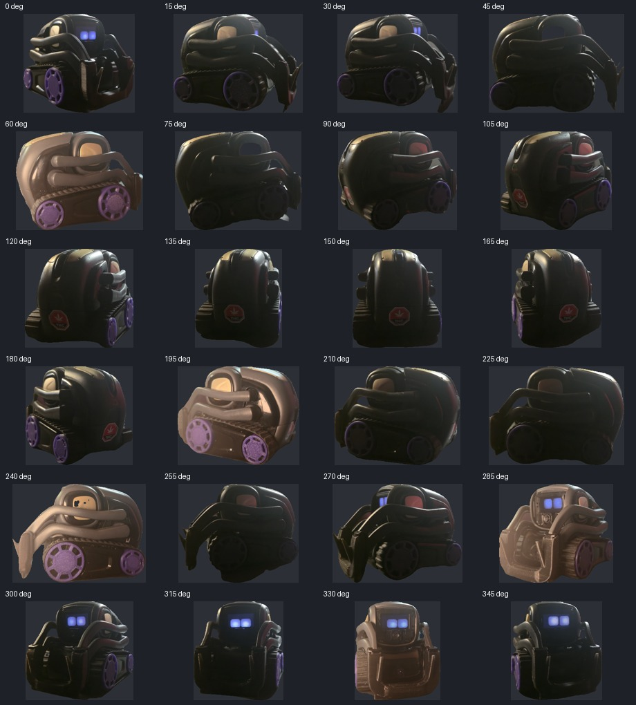
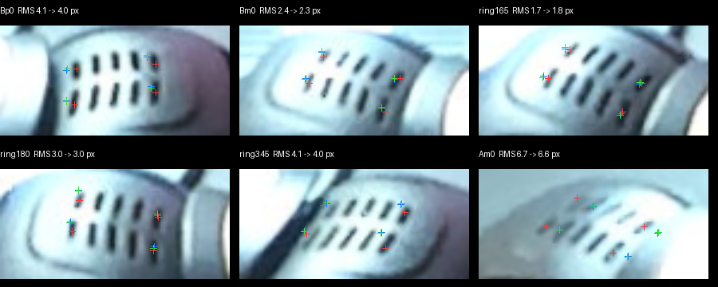
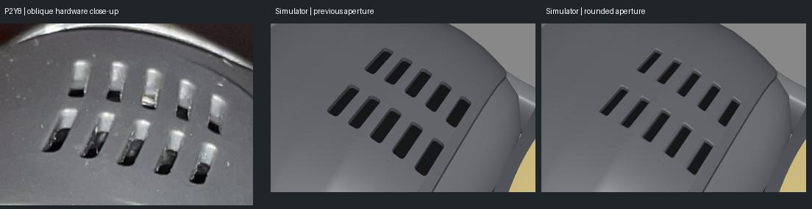
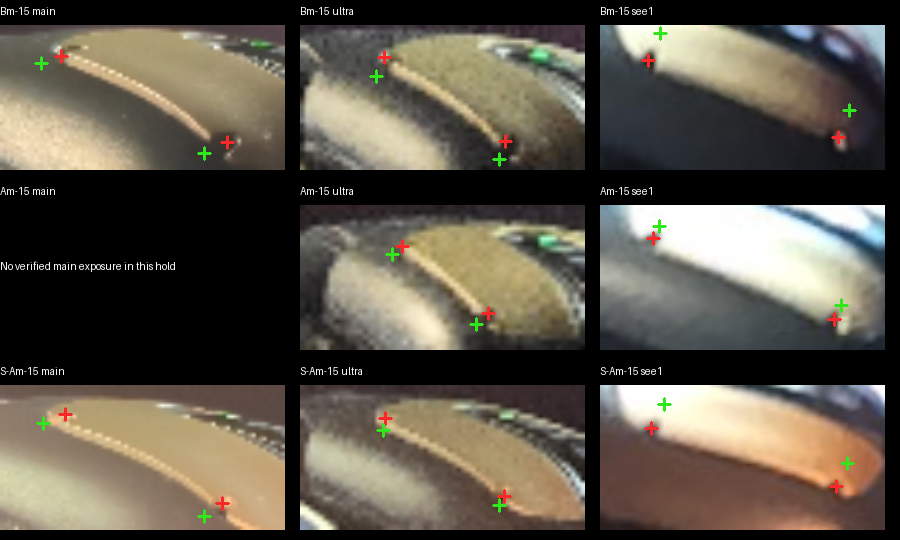
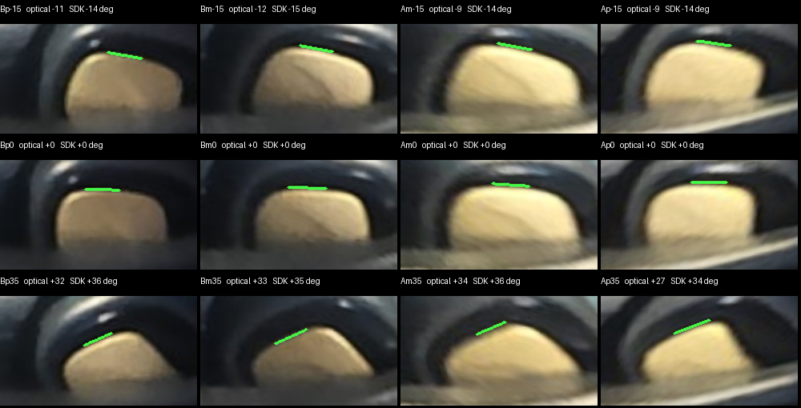
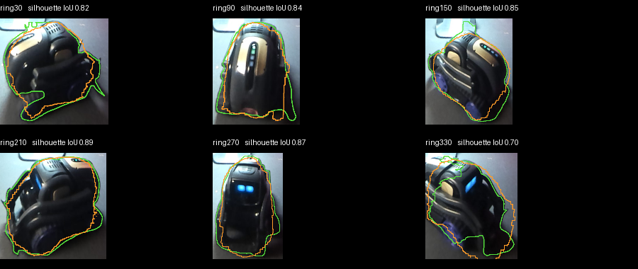

# P2Y8 three-camera survey · 19 November 2026

P2Y8 is a Vector 2.0 with stock treads, printed lift and hubcaps, and the transparent faceplate removed. The shelf hides the ground-contact surfaces. Stock exterior and underside references are available in [Digital Dream Labs’ Vector 2.0 regulatory photographs](https://fccid.io/m/f715ecdccc13ef685afd7a3a3221e5ec5971fe605c006cf883b6620114e3d932.pdf).

## Capture and calibration

The [capture index](capture-index.csv) records 118 off-dock originals, their hashes, dimensions, trigger or receive times, and nearest SDK poses. Both wheels reported zero at those samples. The 24 main-camera headings cover 360° in nominal 15° steps, with the head level and the lift down. Six are from a verified second pass. The first pass has a native See3CAM view at every heading. Eight headings also have an ultrawide view. Head sweeps use two headings at each spot, with a nominal 63 mm move from B to A. S-prefixed exposures belong to a separate run. Use their own poses for registration. The supplementary SDK session disconnected before its final A positive-heading high-angle shutter. The first pass saved the ultrawide and See3CAM views at that pose.

| Instrument | Hardware reference | What was used |
|---|---|---|
| Galaxy Z Flip6 | [Samsung specifications](https://images.samsung.com/is/content/samsung/assets/us/business/mobile/phones/galaxy-z-flip6/specs-pdf/B2B_Galaxy_Z_Flip6_Spec_Sheet.pdf) | 32 main JPEGs at 8160 × 6120 and 20 ultrawide JPEGs at 4000 × 3000. EXIF identifies 5.4 and 1.7 mm lenses. Camera2 reports a 14.232 mm baseline, used as a weak prior. |
| See3CAM_24CUG | [e-con Systems AR0234CS camera and M12 lens mount](https://www.e-consystems.com/industrial-cameras/ar0234-usb3-global-shutter-camera.asp) | 66 native 1920 × 1080 JPEG frames, rotated 180° and rectified with the mounted shelf lens calibration. |
| Vector | [DDL simulator prototype, lines 9–30](https://github.com/digital-dream-labs/vector/blob/main/simulator/protos/CozmoBot2.proto#L9-L30) | The released model specifies 48 mm front-to-rear axle spacing, 14.5 and 10.75 mm front and rear radii, and head travel from −22° to +45°. These dimensions are reference geometry. |

The dock glyph anchors the shelf frame. The phone camera poses also use fixed wall features and visible B hub centers. The transferred hub heights yield **41.45–41.99 mm** fore-to-aft wheel spacing in three poses. That conflicts with the released 48 mm reference and limits absolute scale on this shelf setup. The 42 mm lateral tread-contact parameter describes a different axis and quantity. Static holds allow sequential shutters. There is no hardware shutter synchronization. Phone reprojections below use a 1000 px working width, See3CAM a 1200 px rectified crop.

## Crown and backpack

Across five neutral B views, the four end slots were triangulated in head coordinates using the wheel hubs for heading and the fixed backpack indicator tip as origin. Opposite headings swap the near and far banks. The low phone sightline obscures the crown apertures. The free three-dimensional estimate gives 8.4 mm fore-to-aft span per bank and about 5.9 mm between banks. Held-out A reprojection RMS was 7.5 px. Constraining the slot centers to the existing crown surface gives 6.7 px RMS at A, or 6.6 px with all three layout parameters refitted at B. This small gain supports retaining the original layout. Red crosses mark observations, blue the existing centers and green the surface-constrained refit.

A separate check measured the dark core across the center three apertures of both banks at half local contrast. Median width was 0.60–0.82 mm across B views and 0.74 mm at A, conditional on a 2.08 mm pitch. The oblique macro shows gray, rounded edges around a dark throat. The web mesh now rolls each Vector 2.0 aperture inward by an estimated 0.16 mm per side, giving a 0.78 mm throat within the existing 1.10 mm mouth. The radius is a visual estimate. The simulator panels below use identical lighting and camera pose.

The two visible microphone scallops give **19.22 mm at B** and **18.68 mm in the independent three-camera A repeat**. The first two-camera A hold gives 18.44 mm. These are straight-line distances across the curved backpack. Leaving out the See3CAM and projecting from the two phone lenses misses its scallops by 31–45 px at B and 14–24 px on the A repeat. That weak depth constraint and the axle check prevent a metric backpack revision. Red crosses mark picked ports and green crosses mark projected 3D points. Run `python check_survey.py` with NumPy and SciPy to reproduce the triangulations.

## Independent head-angle check

For each heading the two hub centers define a vertical chassis-side plane. The green segment marks a manually selected portion of the upper edge of the gold head insert. Its slope in the rectified plane gives pitch change relative to that heading’s neutral frame. Both headings at B give an optical raise within 4° of the encoder. At A the high pose gives +34.3° against +35.6° on one heading and +27.2° against +34.4° on the other. Both low poses at A read about −9° against −14.5°. Curvature, occlusion, edge selection and side-plane placement all affect this check. A correction to the head encoder would require an independent, better-conditioned angle reference. [Angles](angles.csv) · [Selected rectified edge pixels](cap-edge.csv)

## Reconstruction

The [coarse visual hull](orbit-hull.ply) uses a 1.5 mm grid, SDK yaw, dock calibration, and image-based translation per view. Eighteen See3CAM silhouettes determine its surface. Run `python check_hull.py` with NumPy and OpenCV to reproduce the silhouette scores from the published masks and camera poses. Six interleaved headings test its shape, with translation centered independently on each silhouette. Mask errors are visible around the lift and dock. Green shows the observed mask boundary and orange the predicted silhouette. Intersection-over-union is 0.70–0.89, median 0.85. This mesh recovers an exterior envelope. Undercuts, tread contact patches and vent cavities require other observations.

The masked SIFT reconstruction of the combined fixed-head data split into a six-view See3CAM component (96 points, 1.00 px mean reprojection error) and a nine-view phone component (99 points, 0.85 px). These are partial sparse models. The visual hull uses the independently calibrated camera geometry and does not depend on joining those components. Full-resolution originals and SDK logs are in the household capture archive. Only robot crops, masks, derived geometry and measurements are published here.

The [opposite-heading head-raise check at A](../head-landmark-a/) compares a second moving landmark against fixed backpack patches and stationary IMU measurements.

The [wheel-calibrated B camera matrices and held-out A measurements](../hub-calibration-b/) revisit the shorter dock-derived wheelbase and the fixed backpack microphone spacing.
