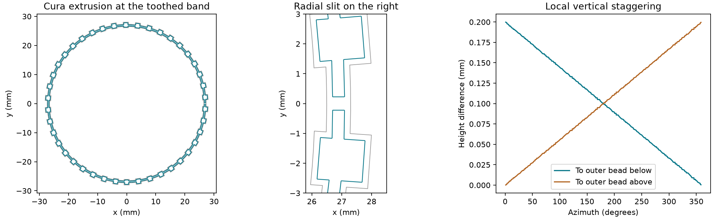

# Cura vase-path trial on a Vector tread

**Verdict.** The radial slit works as a routing trick. A usable closed belt still requires a seam that holds tension in flexion. At a representative radial position in the seam the 0.05 mm model slit produced a 0.45 mm separation between end-cap centerlines, against 0.40 mm nominal bead width. Actual TPU swell, squish and adhesion have not been measured. A continuous extrusion around the cut band is not itself a continuous load path around the axle pair.

The reference mesh is Dauler’s tread_oBar.stl, SHA256 58094321241b215e9950a9e9a5a702447cabf61773075b867b249b756c292655. It came from *Anki Vector improved treads*, Thingiverse 3464746, licensed CC-NC in the archived download. The physical reference is an aftermarket profile. [Creator’s model](https://www.thingiverse.com/thing:3464746) · [Archive](https://archive.org/details/thingiverse-3464746)

CuraEngine bundled with UltiMaker Cura reports 5.10.0-beta.1. I rotated the loop so its width ran along Z, cut one radial slit in the mesh, and sliced six versions using generic FDM definitions, a 0.40 mm nozzle and wall width, 0.20 mm layers, absolute Marlin extrusion, zero bottom, top and infill, and spiralized outer walls. These are offline assumptions. The exact machine and filament profile are pending. The CLI G-code uses a stripped start/end script, has placeholder header statistics and contains heater commands. Use it for inspection only.

The STL has 42 inner teeth confined to a 2.0 mm strip across its 11.6 mm width. The 0.05 mm slit preserves all 42 on each of the ten toothed Cura layers (24–33). Ordinary steady layers have smooth inner walls. This particular cut does not require switching toolpaths as teeth appear. On layers 1–56 we counted 316 non-extruding moves for the uncut control, 178 at 0.02 mm and zero at 0.05, 0.10, 0.20 and 0.40 mm. The smaller controls still reached portions of the inner profile.

The 0.05 mm G-code rises monotonically during extrusion. On 38,664 comparisons at matched azimuths across layers 2–55, the vertical distances to the lower and upper outer neighbors summed to a median of 0.200 mm, ranging from 0.194 to 0.206 mm. The nominal centerline separation along the ray ranged from 0.382 to 1.517 mm, so the Z sum alone does not establish bonding area. This test samples rays away from the slit and does not simulate a nozzle’s swept volume. Cura’s final non-extruding wipe descends 0.113 mm. The transition into the first tooth layer, seam fusion, bending stiffness and cyclic life remain physical tests.

For a printable revision, a designed lap joint or deliberately connected seam merits a small coupon in the actual TPU. Shore hardness does not determine traction. For simulator work keep the stock baseline, tag printed-tread runs with the STL and material, and distinguish static tilt-board friction from lateral skid during a turn.

