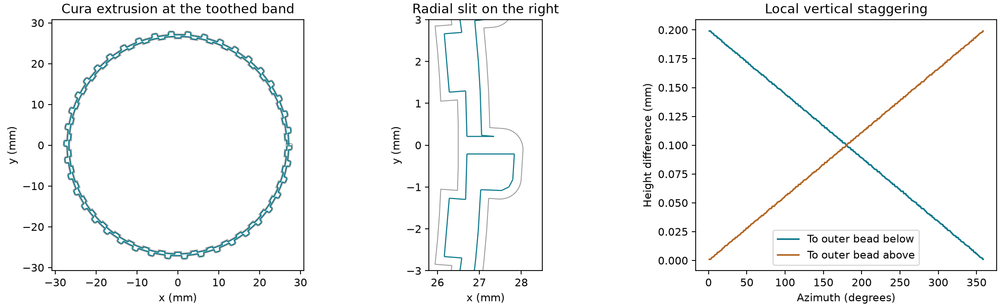

# madizmo Vector V2 tread, 0.4 mm nozzle

This replay uses the single STL from the requested design, anki_vector_tracks_V2.stl (SHA256 898644b2bea1f108c45d88131171e9d8338f479ebef0280980261b1cc86635a9). It uses the bundled CuraEngine 5.10.0-beta.1, Kingroon KP3S machine and extruder definitions, nominal 0.40 mm nozzle and bead width, and 0.20 mm layers. The local OctoPrint history for the KP3S confirms Marlin 2.1.1. The nozzle size is its estimate. [madizmo's design](https://www.thingiverse.com/thing:4287628)

The 0.02 mm slit routed all 42 inner teeth through the central tooth band without travel between paths on layers 1–56. Even 0.01 mm worked on this mesh in the tested orientation. The uncut control produced 366 non-extruding moves over those layers. This threshold is specific to the geometry and Cura settings. The teeth extend across only about 2 mm of the 11.6 mm tread width.

For the 0.02 mm cut, the measured end-cap centerlines at radius 27 mm were 0.419 mm apart. With the assumed 0.400 mm line width, there is a nominal 0.019 mm gap. Actual seam fusion, cyclic life and belt fit remain unmeasured. Extruding moves rose monotonically. In 38,457 unambiguous sampled layer/ray comparisons, neighboring vertical offsets summed to 0.194–0.206 mm (median 0.200). We skipped 207 comparisons where a ray did not identify exactly two strands on all three adjacent laps. Cura's final non-extruding wipe lowered by 0.113 mm. The preview uses stripped machine start/end scripts and contains heater commands. It is for offline inspection only.

Both linked filaments are sold as 1.75 mm 95A TPU: CCTREE glow green and SainSmart 540GBL luminous blue. The spool used in the earlier print is unknown. Geometry results are shared; seam adhesion has to be checked separately per material. [CCTREE listing](https://www.amazon.ca/dp/B0D8HZ84XT) · [SainSmart specification](https://www.sainsmart.com/products/glow-in-the-dark-luminous-blue-flexible-tpu-filament-1-75mm-1kg-2-2lb)

