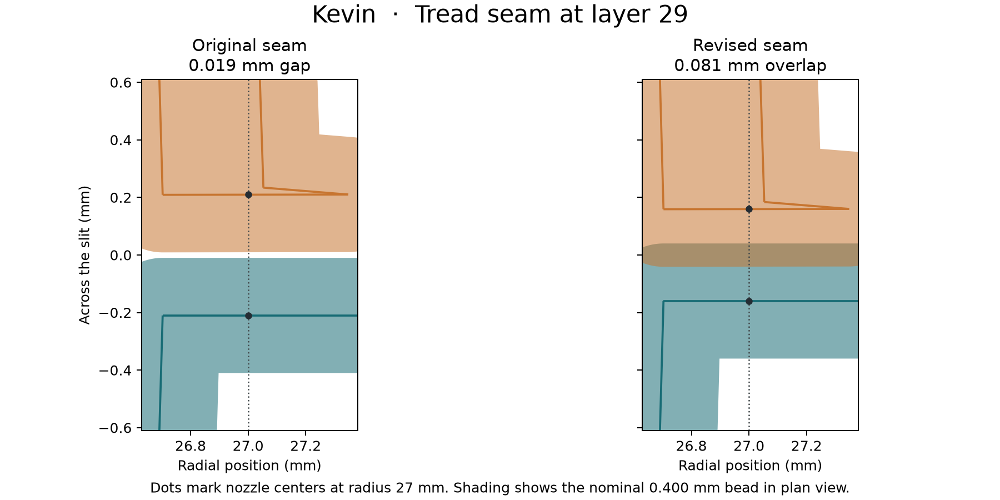

# Local overlap at the Vector V2 tread seam

At the radial slit, the postprocessor moves each opposing end-cap centerline 0.050 mm toward the other, with a smooth taper back to Cura's path within 1.5 mm on either side. Absolute E is adjusted for the changed path length. The bed center is (90,90) mm. This transformation is pinned to the original KP3S preview by SHA-256.

At layer 29 and radius 27 mm the 0.0195 mm nominal gap becomes 0.0805 mm of nominal XY overlap. At that radius the overlap is 0.080–0.087 mm across all 58 layers; neighboring cap heights differ by up to 0.0953 mm. The plan-view footprint assumes a 0.400 mm bead. Actual fusion and fatigue life require a physical test.

Inspection of the original file revealed that after returning to its seam on the last lap, Cura lowered Z and resumed extrusion for a partial finishing pass. The revised preview ends deposition on the first return to that seam. All 58 labeled layers extrude, all transitions join, the toolpath rises monotonically to Z11.713 mm, and all 42 teeth remain on each of layers 24–33. The only travel is the initial approach. This preview retains the original stripped start/end scripts and has not been sent to a printer.

