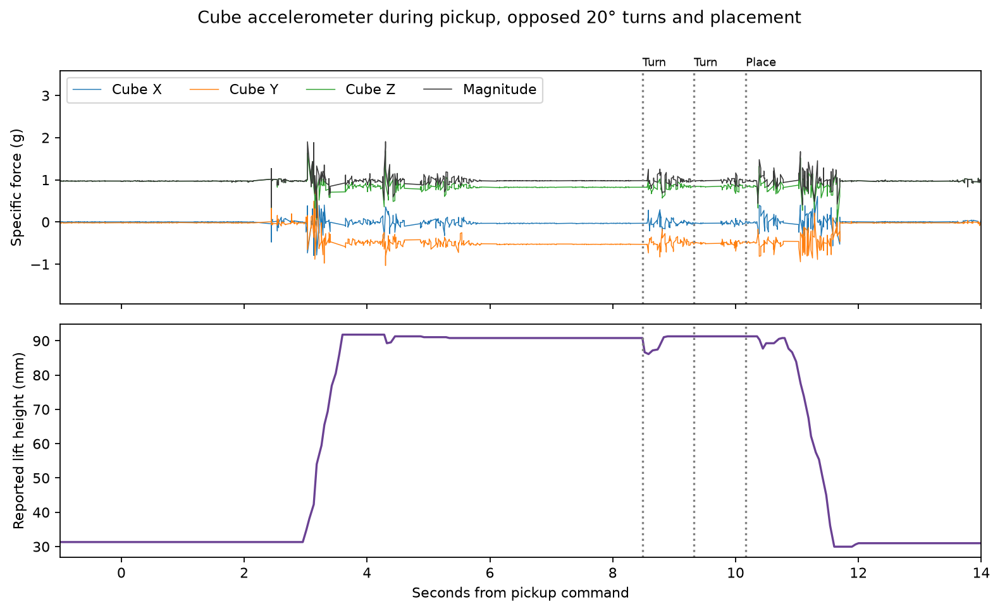

# Cube accelerometer during a physical pickup

The overhead camera shows the cube leave the shelf, travel through two opposed 20° commands, and return to the shelf. The robot's stock pickup uses a printed fork. This is a separate acquisition from the earlier improperly engaged trial. Here the cube's own three-axis accelerometer ran through the pickup.

[Overhead video](pickup.mp4) · [Selected frames](pickup-frames.jpg) · [Raw Bluetooth packets](pickup.tsv) · [Decoded counts](pickup.csv) · [Action timestamps](action-times.csv) · [Robot feedback](robot.csv)

At rest before pickup, median XYZ was (+0.002, −0.018, +0.971) g. During the relatively still raised interval 6.5–8.3 s after the command it was (−0.032, −0.528, +0.823) g. The angle between those median specific-force vectors is about 32°. This estimates the cube's change in tilt when translational accelerations are small. The accelerometer alone cannot identify fork contact points or rotation about gravity. The largest sampled magnitude during the two turns was 1.25 g and during the placement command it was 1.67 g. In the 0.9 s after the disconnect request, median XYZ was (+0.003, −0.019, +0.970) g. The largest magnitude in the entire file, 3.34 g, occurred much later during docking.

The radio recorder listened to the existing Bluetooth daemon socket, filtered notifications on the cube's accelerometer characteristic, and never wrote to the socket. Robot firmware offered stock app version 2018-08-14T17:40. Each type-2 packet holds a tap count and three XYZ observations as little-endian signed 16-bit values, nominally 8192 counts/g. The lift session yielded 1,309 acceleration packets and 3,927 XYZ observations. Radio and host delivery are batched. The longest gap between robot packet receipt timestamps was 280 ms. The action overlay uses pod receipt times for both robot and cube, with all three slots plotted at packet arrival. These times do not establish a precise subpacket impact time. The tap byte is available in the decoded files.

A separate docked baseline yielded 1,929 XYZ observations across 23.19 s. Mean magnitude was 0.971 g. On the first attempt the stream went stale during undocking and the robot returned to dock before pickup. Connecting after undocking obtained the movement recording. Disconnect was requested after placement. Notifications continued for a time after the request. The disposable cell reported at least 1.56 V across the recordings.

[Three capture segments](cube-xyz.png) · [Socket listener](robot_packets.pl) · [Decoder](decode.py) · [Overlay generator](pickup_plot.py). Run `python decode.py resting.tsv undock-check.tsv pickup.tsv` followed by `python pickup_plot.py`.

### Can the pre-turn cube orientation predict the turns?

The wheel replay uses recorded shaft speeds, initial head and lift positions, the frozen 3.75 mm contact inset, a 50 g cube rigidly carried at the SDK offset, and the simulated cube chip and shipped packet encoder. All conditions see the same wheel inputs. The tilted case rotates the cube body about its center to align its pre-turn measured gravity direction with fork vertical, leaving scale and bias unchanged. Its orientation comes only from packets received 1.7 to 0.2 s before the first turn. Both turns are withheld from that estimate. They are from the same pickup.

| Prediction | First turn, vector RMS error (g) | Return, vector RMS error (g) |
| --- | ---: | ---: |
| Level rigid carry | 0.572 | 0.556 |
| Rigid carry at measured tilt | 0.228 | 0.151 |
| Constant pre-turn reading | 0.130 | 0.054 |

Errors use the Euclidean norm of the three-axis error for each packet mean, scored at host receipt time. Gravity does not specify yaw. Testing four quarter-turn orientations about vertical gave 0.194–0.246 g outward and 0.132–0.210 g on return. Each exceeded the constant baseline on its corresponding turn. Tilt accounts for much of the mean error; the rigid model still fails to predict the transient better than a constant. The simulation assumes chip position, grip and cube center. Relative grip motion, wheel interpolation and radio latency remain unresolved. These results do not justify a universal tilted mounting angle.

[Packet overlay](turn-replay.png) · [Scores for all orientations](turn-replay.csv) · [Reproduce the comparison](replay_turns.py)

### Packet delivery during the turns

The resting capture has a median ordinary interarrival of 30 ms at the robot, interrupted by a median long interval of 260 ms roughly every 34 received packets. Long intervals here exceed 150 ms. Both the robot and pod clocks show all 38 long intervals in the pickup capture by count. The timestamps on the robot are taken by the daemon socket listener, before forwarding to the pod.

A receiver-clock model fitted only to the resting capture advances by 30 ms per packet, with every 34th interval extended to 260 ms. The phase starts at zero for all recordings. For the independent pickup recording it predicts 47.98 s for 1,309 packets, against 47.34 s measured. A uniform 30 ms model predicts 39.24 s. For the undocking check it predicts 9.17 s against 9.21 s. The pickup timeline error reaches 640 ms, so the model is useful for packet-rate estimates but unsuitable for replacing measured timestamps when aligning impacts.

In the pickup record, one delivery gap runs from 196 ms before the first turn command to 76 ms after it. Another spans 1.028–1.279 s after that command, during the return turn. The packets carry no per-sample sequence numbers or hardware timestamps. These recordings cannot distinguish skipped, stalled or delayed sampling from missing notifications. The simulator's internal chip clock is therefore unchanged.

[Robot and pod timelines](packet-cadence.png) · [Held-out scores](packet-cadence.csv) · [Analysis](packet_cadence.py)
