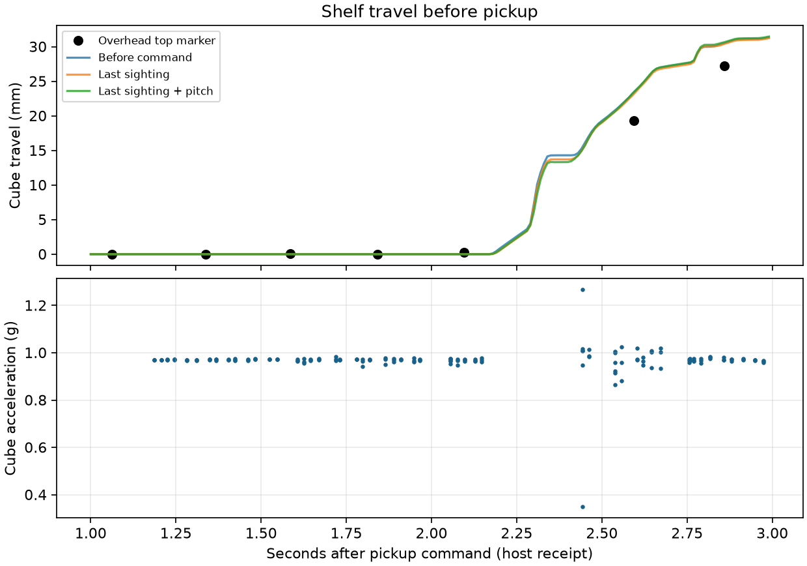
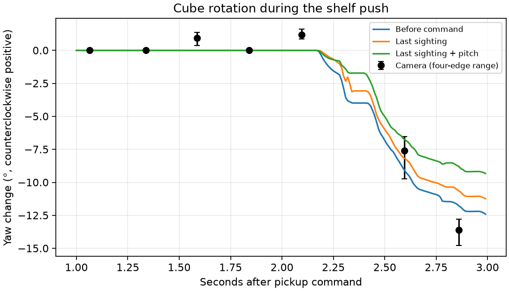

# Cube accelerometer during a physical pickup

The overhead camera shows the cube leave the shelf, travel through two opposed 20° commands, and return to the shelf. The robot's stock pickup uses a printed fork. This is a separate acquisition from the earlier improperly engaged trial. Here the cube's own three-axis accelerometer ran through the pickup.

[Overhead video](pickup.mp4) · [Selected frames](pickup-frames.jpg) · [Raw Bluetooth packets](pickup.tsv) · [Decoded counts](pickup.csv) · [Action timestamps](action-times.csv) · [Robot feedback](robot.csv)

At rest before pickup, median XYZ was (+0.002, −0.018, +0.971) g. During the relatively still raised interval 6.5–8.3 s after the command it was (−0.032, −0.528, +0.823) g. The angle between those median specific-force vectors is about 32°. This estimates the cube's change in tilt when translational accelerations are small. The accelerometer alone cannot identify fork contact points or rotation about gravity. The largest sampled magnitude during the two turns was 1.25 g and during the placement command it was 1.67 g. In the 0.9 s after the disconnect request, median XYZ was (+0.003, −0.019, +0.970) g. The largest magnitude in the entire file, 3.34 g, occurred much later during docking.

The radio recorder listened to the existing Bluetooth daemon socket, filtered notifications on the cube's accelerometer characteristic, and never wrote to the socket. Robot firmware offered stock app version 2018-08-14T17:40. Each type-2 packet holds a tap count and three XYZ observations as little-endian signed 16-bit values, nominally 8192 counts/g. The lift session yielded 1,309 acceleration packets and 3,927 XYZ observations. Radio and host delivery are batched. The longest gap between robot packet receipt timestamps was 280 ms. The action overlay uses pod receipt times for both robot and cube, with all three slots plotted at packet arrival. These times do not establish a precise subpacket impact time. The tap byte is available in the decoded files.

A separate docked baseline yielded 1,929 XYZ observations across 23.19 s. Mean magnitude was 0.971 g. On the first attempt the stream went stale during undocking and the robot returned to dock before pickup. Connecting after undocking obtained the movement recording. Disconnect was requested after placement. Notifications continued for a time after the request. The disposable cell reported at least 1.56 V across the recordings.

[Three capture segments](cube-xyz.png) · [Socket listener](robot_packets.pl) · [Decoder](decode.py) · [Overlay generator](pickup_plot.py). Run `python decode.py resting.tsv undock-check.tsv pickup.tsv` followed by `python pickup_plot.py`.

### Can the pre-turn cube orientation predict the turns?

The wheel replay uses recorded shaft speeds, initial head and lift positions, the frozen 3.75 mm contact inset, a 50 g cube rigidly carried at the SDK offset, and the simulated cube chip and shipped packet encoder. All conditions see the same wheel inputs. The tilted case rotates the cube body about its center to align its pre-turn measured gravity direction with fork vertical, leaving scale and bias unchanged. Its orientation comes only from packets received 1.7 to 0.2 s before the first turn. Both turns are withheld from that estimate. They are from the same pickup.

| Prediction | First turn, vector RMS error (g) | Return, vector RMS error (g) |
| --- | ---: | ---: |
| Level rigid carry | 0.572 | 0.556 |
| Rigid carry at measured tilt | 0.228 | 0.151 |
| Constant pre-turn reading | 0.130 | 0.054 |

Errors use the Euclidean norm of the three-axis error for each packet mean, scored at host receipt time. Gravity does not specify yaw. Testing four quarter-turn orientations about vertical gave 0.194–0.246 g outward and 0.132–0.210 g on return. Each exceeded the constant baseline on its corresponding turn. Tilt accounts for much of the mean error; the rigid model still fails to predict the transient better than a constant. The simulation assumes chip position, grip and cube center. Relative grip motion, wheel interpolation and radio latency remain unresolved. These results do not justify a universal tilted mounting angle.

[Packet overlay](turn-replay.png) · [Scores for all orientations](turn-replay.csv) · [Reproduce the comparison](replay_turns.py)

### Packet delivery during the turns

The resting capture has a median ordinary interarrival of 30 ms at the robot, interrupted by a median long interval of 260 ms roughly every 34 received packets. Long intervals here exceed 150 ms. Both the robot and pod clocks show all 38 long intervals in the pickup capture by count. The timestamps on the robot are taken by the daemon socket listener, before forwarding to the pod.

A receiver-clock model fitted only to the resting capture advances by 30 ms per packet, with every 34th interval extended to 260 ms. The phase starts at zero for all recordings. For the independent pickup recording it predicts 47.98 s for 1,309 packets, against 47.34 s measured. A uniform 30 ms model predicts 39.24 s. For the undocking check it predicts 9.17 s against 9.21 s. The pickup timeline error reaches 640 ms, so the model is useful for packet-rate estimates but unsuitable for replacing measured timestamps when aligning impacts.

In the pickup record, one delivery gap runs from 196 ms before the first turn command to 76 ms after it. Another spans 1.028–1.279 s after that command, during the return turn. The packets carry no per-sample sequence numbers or hardware timestamps. These recordings cannot distinguish skipped, stalled or delayed sampling from missing notifications. The simulator's internal chip clock is therefore unchanged.

[Robot and pod timelines](packet-cadence.png) · [Held-out scores](packet-cadence.csv) · [Analysis](packet_cadence.py)

### What the cube told the SDK

The simulator now exposes packet-level tap candidates as `sim.cube.taps.events`. It initializes the counter from the first packet and produces one candidate per changed counter, including counter wrap. Reset clears its history. This follows the [stock engine packet handler](https://github.com/kercre123/victor/blob/snowboy/engine/components/cubes/cubeAccelComponent.cpp).

In the pickup recording, all eight packet tap candidates preceded one SDK tap each in the same order. SDK receipt followed packet receipt by 127–193 ms. No up-axis change was predicted or reported. The SDK reported one stop, 21 ms after the final simulated listener stop. Two listener starts and an earlier stop had no SDK counterpart. The engine checks whether it is docking with or carrying the object when deciding which movements to broadcast. The capture lacks that internal docking state, so it cannot establish the exact reason for each omitted event.

These comparisons condition on real incoming packets. They validate decoding and event handling in this run. They do not show that simulated impacts yet produce the correct tap counts. The timestamps in the simulator are packet-level and exclude SDK delivery latency.

[Physical SDK events](sdk-cube-events.csv) · [Paired timeline](event-replay.png) · [Replay](replay_events.py) · [Event times](event-replay.csv)

### Stationary accelerometer noise

Within each three-slot packet, successive sample differences divided by √2 estimate short-term noise while excluding gaps between received packets. The fit uses the pooled RMS across the three axes of the 643-packet resting recording. The simulator receives the mean resting specific force so mounting angle and static offset are held fixed. Its stock packet encoder, filter, range and quantization are retained. Fit and evaluation simulations use distinct random seeds.

The fitted effective input noise density is 124 µg/√Hz. The Unit 3 Vector 2 profile uses this value for its recorded cube. The general profile retains the 220 µg/√Hz datasheet nominal. This is an effective parameter for the current sensor model. The experiment does not independently measure the chip's noise spectrum.

| Held-out physical segment | Packets | Nominal error | Calibrated error |
| --- | ---: | ---: | ---: |
| Cube on shelf during undock check | 253 | 1.14 mg | 0.77 mg |
| Last second before pickup | 27 | 1.94 mg | 0.24 mg |

Errors are RMS across the three axis noise estimates, in thousandths of standard gravity. During undocking the real cube's Z noise reached 3.58 mg against 2.39 mg simulated. The recording does not separate shelf vibration from chip noise.

[Axis comparison](stationary-noise.png) · [Numbers](stationary-noise.csv) · [Reproduce](stationary_noise.py)

### Does a pickup-height fit predict placement?

During lowering the cube still showed 29–32° of apparent roll at 49–56 mm reported wrist height, with packet-mean force magnitudes near 1 g. During raising, nearby heights included strong translational impulses: at 54 mm the magnitude was 0.56 g. Interpreting that sample as an orientation measurement would be misleading. The plotted signal is the angle of the packet-mean Y/Z acceleration vector relative to its pre-pickup direction.

A clipped ramp fitted only to the raise and the settled held angle gives 16.9° RMS error over the withheld lowering interval (32 packets). A second prediction holds the measured tilt until a corner of the 44 mm cube would reach the shelf, then limits the roll by floor clearance. For the SDK center offset of −12.5 mm and a single-axis roll θ, the center must be at least 22(cos θ + sin θ) mm above the shelf. This gives about 43 mm wrist height at first contact. The geometry prediction scores 11.1° RMS without tuning on placement. It assumes a fixed wrist-to-center offset and rotation about one horizontal axis. The camera does not establish the exact corner contact time.

Shifting the relative lift clock by ±100 ms changed the geometry prediction's placement error to 8.7–14.2° at the two endpoints. This single recorded placement helps distinguish hypotheses but does not verify deployment accuracy. The published simulator grip is unchanged.

[Raise and lower traces](lift-cycle.png) · [Eight overhead exposures with reported wrist heights](lift-cycle-frames.jpg) · [Timing sensitivity](lift-cycle.csv) · [Analysis](lift_cycle.py)

### Does free contact support the tilted carry?

The 50 g cube starts at the SDK carry offset with the tilt estimated from the stationary pre-turn accelerometer. The solver has gravity, the rubber-corner and plastic-shell cube contacts, 58 convex printed-fork components and the articulated upper/lower rails. Only the wrist and rails follow a prescribed path. The free cube has no constraint. The wrist holds still for 400 ms, then follows recorded placement lift heights with a fixed chassis. This is a support and release test; the actual pickup could have entered a different contact configuration.

Four cube yaw orientations and nine horizontal placements per yaw cover a ±3 mm square around the nominal offset. At 24 of the 36 starting poses, the cube touched the shelf before the wrist began lowering. Every one of the six initially non-overlapping poses fell in about 98 ms. All 12 poses still airborne at the command had started with collision overlap. Treating those as successful grips would hide an initialization artifact. The source fork STL remains a proxy for the printed part installed on this robot.

[Free-cube tilt and recorded apparent tilt](free-placement.png) · [Initial overlaps, drop and first shelf contact](free-placement.csv) · [No-overlap seating check](free-seating.csv) · [Replay](free_placement.py). Generate the fixture using the [printed-fork instructions](../unit3-printed-fork-contact/README.md) and run `python free_placement.py /path/to/fork.xml` with the viewer's link assets installed.

In the second check each cube was lifted vertically in 1 mm increments to the first collision-free pose and released above the stationary fork. Of 36 releases, two stayed off the shelf for 400 ms. Both settled around 9° tilt and 9.4–9.5 mm above the nominal center. Thus the tested geometry can provide transient support without a latch, while these placements still miss the approximately 32° observed carry. A single static hold does not establish stability during lowering.

### Acquisition from the shelf

The free-cube replay now starts before the pickup command. It drives the printed fork and moving rails with the SDK chassis XY, yaw and lift trajectory. The cube starts upright on the shelf with center XY and heading from a camera sighting in the same odometry origin. Two initializations use the last sighting before the command and the final sighting at +2.06 s before simulated contact. A third applies recorded chassis pitch about the modeled front axle. The cube and wrist never have a linking constraint.

All three runs make fork or rail contact at +2.17 s. By +6.5 s they have slid the cube 31.9–32.1 mm horizontally. The center stays within 0.55 mm of its settled shelf height during the entire replay. The last sampled contact in the raise is +3.16–3.18 s; the physical cube is visibly airborne at +3.65 s. For the level last-sighting run, the simulated cube is flat on the shelf throughout the 6.5–8.3 s physical hold.

The failure occurs between initial contact and capture. Changing between these camera sightings and including SDK pitch leaves the outcome unchanged. All three use the same assumed fork surface and cube shape. The SDK sightings are correlated, so these runs cannot eliminate a shared position error or identify the contacting features on hardware.

[Simulated center height and tilt over the real acquisition](free-pickup.png) · [Contact and displacement traces](free-pickup.csv) · [Robot path](pickup-path.csv) · [Camera poses](pickup-sightings.csv) · [Replay script](free_pickup.py). Use the same printed-fork fixture as the support test.

### Shelf slide before the raise

The overhead marker moved about 19.3 mm by +2.59 s and 27.2 mm by +2.86 s. The three frozen free-cube replays reached 23.0–23.3 mm and 30.4–30.7 mm at those times. The real pickup therefore included a substantial push across the shelf. The largest qualitative discrepancy comes when the real fork raises the cube and the simulated fork loses it.

The [corner measurements](shelf-slide.csv) are from the top glyph of the level cube in the overhead crop. A four-point perspective transform maps the first frame's outer white glyph corners to a nominal 23 mm square. Each displacement is measured from the first intersection of the diagonals to the current intersection in that plane. Absolute travel scales linearly with the assumed printed width. The largest apparent displacement before +2.10 s was 0.24 mm. The +2.34 s frame lacked a clean quadrilateral. The last plotted overhead point precedes visible tilt. Roughly 0.25 s separates camera frames, and camera and radio timestamps are host receipt times. A 3–4 mm difference during the push is insufficient on its own to fit friction. Each blue point is the measured magnitude of an XYZ sample from the cube, plotted at packet receipt time.

### Cube heading during the shelf push

At +2.59 s the real cube had turned 7.6° clockwise. The three frozen replays gave 6.7–8.9° clockwise. By +2.86 s the camera gave 13.6° clockwise (12.8–14.8° across the four edges), and the replays gave 8.8–11.8°. Camera estimates use the direction change of each edge of the rectified top marker before visible lift. Stationary frames varied by up to 1.2°. The plotted edge range describes within-frame agreement only. Camera/robot alignment and departures from the assumed top plane also affect the comparison.

A [nine-pose sensitivity check](shelf-yaw-sensitivity.csv) varied the initial cube heading from −8° to +8° in 2° increments around the last sighting, keeping the recorded pitch and fork trajectory fixed. Every run ended the physical carry interval with the simulated cube on the shelf (22.15 mm center height). The −6° case brought travel closer to the camera (28.7 vs 27.2 mm) but still under-rotated (9.2 vs 13.6°). At −8° the simulated spin reversed direction. These cases test sensitivity within this pickup only. No parameter was adopted.

Run free_pickup.py with the printed-fork fixture, then shelf_yaw.py to reproduce the [simulated rotations](shelf-yaw-sim.csv) and [four-edge measurements](shelf-yaw-camera.csv).
